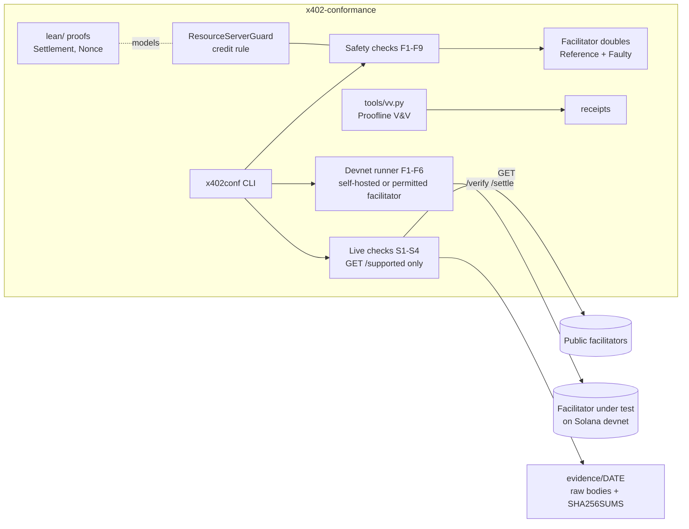

# Architecture

Status: experimental, v1.2.1. Expect changes.

## Components
| path | role |
|---|---|
| `src/x402conf/spec.py` | Identifiers quoted from the x402 V2 spec and the Solana `exact` scheme (CAIP-2 IDs, error codes) |
| `src/x402conf/harness.py` | The checks. `run_live` makes exactly one GET per target. `check_safety` runs F1 to F6 against anything that has `verify` and `settle`, and F7 to F9 against a double whose simulated chain it can advance between retries |
| `src/x402conf/mock.py` | The `Reference` double, which behaves as the spec asks, and `Faulty` doubles, each reproducing one known failure. `Chain` is the simulated ledger F7 to F9 advance |
| `src/x402conf/fixtures/devnet.json` | Devnet requirements (`solana:EtWTRABZaYq6iMfeYKouRu166VU2xqa1`, devnet USDC) and the test vectors |
| `lean/` | Lean 4 models of the credit rule and the nonce state machine, built by `lake build` |
| `tools/vv.py` | Verifies every Proofline criterion in `proofline.json` and writes receipts |
| `src/x402conf/devnet/` | The devnet runner: F1 to F6 over real `/verify` and `/settle` on Solana devnet, with a self-hosted reference facilitator (`node/`) and its fault-injected builds |
| `ts/` | TypeScript runner for resource servers: a facilitator double with fault modes, and a probe of the paid route (R0-R9) |
| `action.yml` | The GitHub Action that runs the live, resource-server and offline checks and writes a job summary |
| `evidence/` | Dated live results with raw bodies and hashes, and the devnet run in `evidence/devnet` |

## Boundaries
- Live mode is GET-only, and this is enforced in code and tested (`test_live_mode_is_get_only`).
- The suite holds no keys of yours. The devnet runner uses throwaway devnet keypairs from a directory outside the repository (`X402C_KEYS`); they are never committed, and the runner refuses a keys directory inside the repository.
- The devnet runner refuses any network but Solana devnet (checked by genesis hash) and any third-party facilitator without the operator's written permission.
- No mainnet payments, ever.
