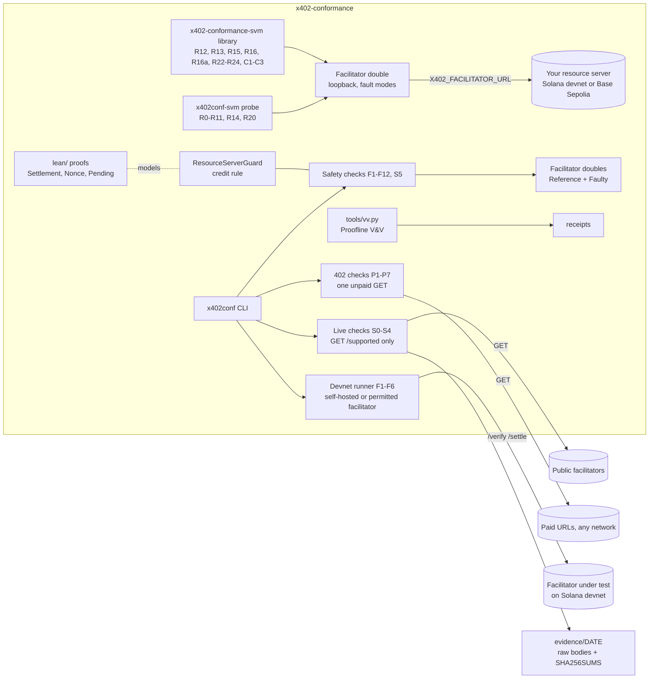

# Architecture

Status: experimental. The latest release is 1.5.0; this page describes `main`. Expect changes.

## Components
| path | role |
|---|---|
| `src/x402conf/spec.py` | Identifiers quoted from the x402 V2 spec and the Solana `exact` scheme (CAIP-2 IDs, error codes), and `CATALOG`: the profile, spec basis, controls and faulty builds of every check |
| `src/x402conf/harness.py` | The checks. `run_live` makes exactly one GET per target (S0-S4); `run_resource` makes one unpaid GET per paid URL (P1-P7). `check_safety` runs F1 to F6 and F10 to F12 against anything that has `verify` and `settle`, F7 to F9 against a double whose simulated chain it can advance between retries, and S5 when the facilitator also has `supported()` |
| `src/x402conf/mock.py` | The `Reference` double, which behaves as the spec asks, and `Faulty` doubles, each reproducing one known failure. `Chain` is the simulated ledger F7 to F9 advance |
| `src/x402conf/fixtures/devnet.json` | Devnet requirements (`solana:EtWTRABZaYq6iMfeYKouRu166VU2xqa1`, devnet USDC) and the test vectors |
| `lean/` | Lean 4 models of the credit rule (`Settlement.lean`), the nonce state machine (`Nonce.lean`), and timeouts, `settlement_pending` reconciliation and concurrent settles (`Pending.lean`), built by `lake build`. `tools/lean_axioms.py` runs `lean/Axioms.lean`, and CI fails on an unexpected axiom |
| `tools/vv.py` | Verifies every Proofline criterion in `proofline.json` and writes receipts |
| `src/x402conf/devnet/` | The devnet runner: F1 to F6 over real `/verify` and `/settle` on Solana devnet, with a self-hosted reference facilitator (`node/`) and its fault-injected builds |
| `ts/` | The `x402-conformance-svm` npm package: the facilitator double, the resource-server and client checks, the Node CLI and the test-framework entry points, with example servers and clients in `ts/example/` |
| `ts/src/double.ts` | The facilitator double: `GET /supported`, `POST /verify` and `POST /settle` on loopback with one switchable fault mode, on Solana devnet and Base Sepolia. It never touches a chain or a key |
| `ts/src/probe.ts` | R0-R10: the paid route under each fault mode of the double |
| `ts/src/cli.ts` | The `x402conf-svm` command: `probe` (R0-R11, R14 with `--crash`, R20 with `--retry`), `resource` (P1-P7) and `demo` |
| `ts/src/catalog.ts` | The profile and spec basis of every check, the same labels as `CATALOG` in `spec.py` |
| `ts/src/index.ts` | The library entry point. R12, R13, R15, R16, R16a, R22 to R24 and C1 to C3 run only through its exports (`probeParallel`, `probeReplicas`, `probeDelivery`, `probeHead`, `probeUnpaidHead`, `probeStatus`, `probeAbort`, `probeMalformedHeader`, `checkClientHandles402`, `checkClientOfferPolicy`, `checkClientKeepsV2`), not the CLI or the Action |
| `ts/src/concurrency.ts` | R12 and R13: parallel requests (eight by default) with one payment-identifier id, and one id sent to two replicas |
| `ts/src/crash.ts` | R14: a crash between a successful `/settle` and the response |
| `ts/src/delivery.ts`, `ts/src/head.ts`, `ts/src/head-unpaid.ts`, `ts/src/status.ts` | R15 (no settlement when the handler fails), R16 (a paid `HEAD` is never settled), R16a (an unpaid `HEAD` gets the same 402 as `GET`) and R22 (the paid response keeps the handler's 2xx status and headers) |
| `ts/src/abort.ts`, `ts/src/header.ts` | R23 (a client abort during settle is recoverable) and R24 (a malformed payment header gets a 4xx) |
| `ts/src/client-status.ts`, `ts/src/client-offers.ts`, `ts/src/client-version.ts` | C1, C2 and C3: a client's handling of a 402, its choice among several offers and its payment version, graded through a recording proxy in front of a paid route |
| `src/x402conf/cli.py` | The `x402conf` command: `live`, `resource`, `offline`, `report` (SARIF, JUnit and `--badge`), `demo`, `pr-comment` and `devnet` |
| `src/x402conf/pytest_plugin.py` | The pytest plugin the package registers: the `x402` fixture, `--x402-report-dir` and `--x402-share` |
| `src/x402conf/types.py` | Typed shapes used by the harness |
| `tools/interdeps.py` | Generates `docs/INTERDEPENDENCY.md`. `--check` fails on a stale map, `--drift` on docs that disagree with the code, and `--gate` on a pull request that leaves a downstream doc, contract or test component neither touched nor acknowledged |
| `tools/verify-sig.mjs` | Checks the owner signature on `proofline.json` against the key pinned in `guard/owner.pub` |
| `vv/claims.json` | The contract tasks claimed as done; `tools/vv.py` fails CI if any of them misses a mandatory criterion |
| `examples/python/` | A stock x402 Python SDK FastAPI server that the pytest plugin test runs |
| `action.yml` | The GitHub Action: live, 402, resource-server and offline checks, a job summary, SARIF and JUnit, a badge file and an opt-in sticky pull request comment (`pr-comment`). It fails closed when a requested run leaves no results, and runs the probe on a pinned Node that never goes on the caller's PATH |
| `ts/src/binding.ts` | R11: payment-to-request binding on a real resource server (two routes, method, query, encoded path, SIWX) |
| `ts/src/retry.ts` | R20: retry double-pay. The client times out before `/settle` answers and retries with a fresh payment under the same key (R20a) or the same signed payment (R20b); `checkClientRetry` grades a client's retry |
| `ts/src/resource.ts` | P1-P7 in Node, a port of `run_resource` that CI checks against the Python CLI |
| `ts/src/testing.ts`, `ts/src/report.ts` | `runConformance()`, the vitest and jest matchers, `assertX402Conformance()` and the shared `x402-conformance.report/1` format every entry point writes |
| `ts/src/mock-server.ts` | The bundled mock resource server behind `x402conf-svm demo` |
| `ts/src/corpus.ts` | Opt-in `--share`: an anonymised corpus case and a pre-filled issue link; nothing is sent |
| `ts/mcp/` | The MCP server and the Vercel AI SDK and LangChain tools, thin entry points into the same checks |
| `ts/docker/`, `ts/ci/gitlab/` | The Docker image (Python CLI, Node probe, MCP server) and the GitLab CI template |
| `corpus/` | The regression corpus: the case and report schemas, the case template, accepted cases in `corpus/cases/` and the shared anonymisation fixture in `corpus/fixtures/` |
| `evidence/` | Dated live results with raw bodies and hashes, and the devnet run in `evidence/devnet` |

## Boundaries
- Live and resource modes are GET-only, and this is enforced in code and tested (`test_live_mode_is_get_only`, `test_resource_mode_is_get_only`).
- A facilitator credential comes only from the environment, is sent only to the one host named with it, and is never printed (`test_auth_header_only_to_its_host_and_never_printed`).
- The suite holds no keys of yours. The devnet runner uses throwaway devnet keypairs from a directory outside the repository (`X402C_KEYS`); they are never committed, and the runner refuses a keys directory inside the repository.
- The devnet runner refuses any network but Solana devnet (checked by genesis hash) and any third-party facilitator without the operator's written permission.
- No mainnet payments, ever.
