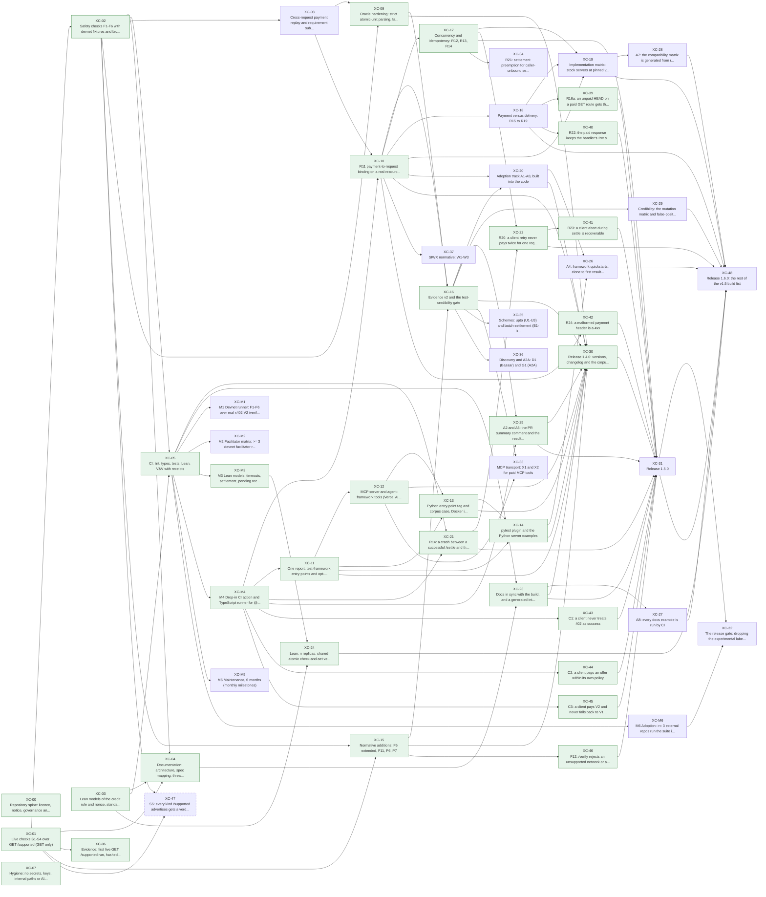
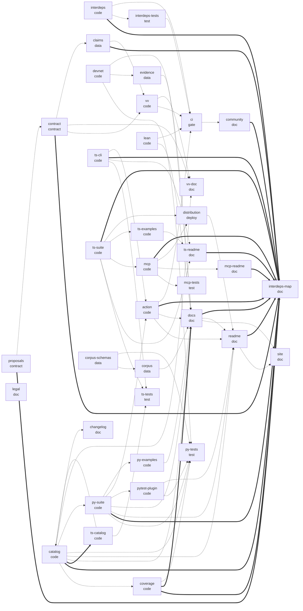

# Interdependency map

Generated by `python3 tools/interdeps.py` from `proofline.json`, the unmerged addenda in `docs/proposals/`, `vv/claims.json`, `src/x402conf/spec.py` and the tracked tree. Don't edit it by hand: `python3 tools/interdeps.py --check` fails in CI when it is stale, and `--drift` fails when the docs and the code disagree on check ids, CLI flags, Action inputs or versions.

Status: done means the task is claimed in `vv/claims.json` and `tools/vv.py` holds it to every mandatory criterion; signed means it is in the owner-signed contract and still open; proposed means it sits in an unmerged addendum and binds nothing yet.

## Task graph

Green boxes are done, plain boxes signed and open, round dashed boxes proposed.

## Tasks

| task | phase | status | depends on | needed by | requirements | criteria | scope |
|---|---|---|---|---|---|---|---|
| XC-00 Repository spine: licence, notice, governance and contract | design | done | - | - | R-OPEN, R-GOV | 11 (command 2, grep 7, pushed 1, scope 1) | `LICENSE`; `NOTICE`; `README.md`; `CONTRIBUTING.md`; `CODE_OF_CONDUCT.md`; `SECURITY.md`; `CHANGELOG.md`; `.gitignore`; `.github/CODEOWNERS`; `.github/ISSUE_TEMPLATE/**`; `.github/pull_request_template.md`; `guard/**`; `proofline.json`; `proofline.json.sig`; `pyproject.toml` |
| XC-01 Live checks S1-S4 over GET /supported (GET only) | implement | done | - | XC-02, XC-04, XC-06, XC-15, XC-47 | R-S1, R-S2, R-S3, R-S4, R-SAFE-GET | 9 (command 7, pushed 1, scope 1) | `src/x402conf/__init__.py`; `src/x402conf/__main__.py`; `src/x402conf/py.typed`; `src/x402conf/spec.py`; `src/x402conf/types.py`; `src/x402conf/harness.py`; `src/x402conf/cli.py`; `tests/test_live.py` |
| XC-02 Safety checks F1-F6 with devnet fixtures and facilitator doubles | implement | done | XC-01 | XC-04, XC-05, XC-08, XC-09, XC-15, XC-47 | R-F1, R-F2, R-F3, R-F4, R-F5, R-F6 | 11 (command 9, pushed 1, scope 1) | `src/x402conf/mock.py`; `src/x402conf/fixtures/**`; `tests/test_offline.py` |
| XC-03 Lean models of the credit rule and nonce, standard axioms only | verify | done | - | XC-04, XC-05, XC-24 | R-LEAN | 13 (command 2, grep 7, metric 2, pushed 1, scope 1) | `lean/lean-toolchain`; `lean/lakefile.toml`; `lean/lake-manifest.json`; `lean/X402Conformance.lean`; `lean/X402Conformance/**`; `lean/Axioms.lean`; `tools/lean_axioms.py` |
| XC-04 Documentation: architecture, spec mapping, threat model, roadmap, V&V | verify | done | XC-01, XC-02, XC-03 | XC-23 | R-DOCS | 16 (command 1, grep 13, pushed 1, scope 1) | `docs/**` |
| XC-05 CI: lint, types, tests, Lean, V&V with receipts | integrate | done | XC-02, XC-03 | XC-21, XC-23, XC-M1, XC-M2, XC-M3, XC-M4, XC-M5, XC-M6 | R-CI | 6 (command 2, grep 2, pushed 1, scope 1) | `.github/workflows/**`; `tools/vv.py`; `tools/verify-sig.mjs`; `vv/claims.json` |
| XC-06 Evidence: first live GET /supported run, hashed and reproducible | verify | done | XC-01 | - | R-EVID | 6 (command 2, file_exists 1, grep 1, pushed 1, scope 1) | `evidence/**`; `tests/test_live.py` |
| XC-07 Hygiene: no secrets, keys, internal paths or AI attribution; commits by mgillr | release | done | - | - | R-HYG | 3 (metric 1, pushed 1, scope 1) | - |
| XC-08 Cross-request payment replay and requirement substitution are rejected | implement | signed | XC-02 | XC-09, XC-10 | R-F10 | 8 (command 8) | `src/x402conf/mock.py`; `src/x402conf/harness.py`; `tests/test_offline.py`; `docs/SPEC.md`; `docs/FIXES.md` |
| XC-09 Oracle hardening: strict atomic-unit parsing, fail closed | implement | done | XC-02, XC-08 | XC-16, XC-30 | R-ORACLE | 5 (command 3, pushed 1, scope 1) | `src/x402conf/mock.py`; `src/x402conf/harness.py`; `tests/test_offline.py`; `ts/src/**`; `ts/test/**` |
| XC-10 R11 payment-to-request binding on a real resource server | implement | done | XC-M4, XC-08 | XC-16, XC-17, XC-18, XC-19, XC-20, XC-30, XC-37, XC-42 | R-R11 | 9 (command 6, grep 1, pushed 1, scope 1) | `ts/**`; `src/x402conf/harness.py`; `docs/SPEC.md`; `docs/FIXES.md`; `README.md` |
| XC-11 One report, test-framework entry points and opt-in corpus sharing | implement | done | XC-M4 | XC-12, XC-13, XC-14, XC-30 | R-ADOPT | 7 (command 3, grep 2, pushed 1, scope 1) | `ts/**`; `docs/USING.md`; `corpus/**`; `.github/ISSUE_TEMPLATE/corpus-case.yml` |
| XC-12 MCP server and agent-framework tools (Vercel AI SDK, LangChain) | implement | done | XC-11 | XC-13, XC-30, XC-33 | R-ADOPT | 5 (command 1, grep 2, pushed 1, scope 1) | `ts/mcp/**`; `docs/USING.md`; `.github/workflows/ci.yml` |
| XC-13 Python entry-point tag and corpus case, Docker image and GitLab CI template | implement | done | XC-11, XC-12 | XC-14, XC-30 | R-ADOPT | 5 (command 1, grep 2, pushed 1, scope 1) | `src/x402conf/cli.py`; `src/x402conf/harness.py`; `tests/test_live.py`; `corpus/fixtures/**`; `ts/docker/**`; `ts/ci/**`; `.github/workflows/ci.yml`; `docs/USING.md` |
| XC-14 pytest plugin and the Python server examples | implement | done | XC-11, XC-13 | XC-26, XC-30 | R-ADOPT | 5 (command 1, grep 2, pushed 1, scope 1) | `src/x402conf/pytest_plugin.py`; `tests/check_pytest_plugin.py`; `examples/**`; `pyproject.toml`; `.github/workflows/ci.yml`; `docs/USING.md` |
| XC-15 Normative additions: F5 extended, F11, P6, P7 | implement | done | XC-02, XC-01 | XC-16, XC-30, XC-46 | R-F5X, R-F11, R-P6, R-P7 | 6 (command 4, pushed 1, scope 1) | `src/x402conf/**`; `tests/**`; `ts/**`; `docs/SPEC.md`; `docs/FIXES.md`; `README.md` |
| XC-16 Evidence v2 and the test-credibility gate | integrate | done | XC-09, XC-10, XC-15 | XC-20, XC-25, XC-29, XC-30, XC-33, XC-35, XC-36 | R-CRED | 4 (command 2, pushed 1, scope 1) | `src/x402conf/**`; `ts/**`; `tests/**`; `tools/vv.py`; `.github/workflows/**`; `docs/**` |
| XC-17 Concurrency and idempotency: R12, R13, R14 | implement | done | XC-10 | XC-19, XC-22, XC-31, XC-34 | R-CONC | 6 (command 4, pushed 1, scope 1) | `ts/**`; `lean/X402Conformance/**`; `docs/**` |
| XC-18 Payment versus delivery: R15 to R19 | implement | signed | XC-10 | XC-19, XC-39, XC-40, XC-48 | R-DELIV | 7 (command 5, pushed 1, scope 1) | `ts/**`; `docs/**` |
| XC-19 Implementation matrix: stock servers at pinned versions | verify | signed | XC-10, XC-17, XC-18 | XC-28, XC-48 | R-MATRIX | 3 (command 1, pushed 1, scope 1) | `evidence/impl-matrix/**`; `docs/MATRIX.md`; `.github/workflows/**`; `ts/**` |
| XC-20 Adoption track A1-A8, built into the code | integrate | signed | XC-10, XC-16 | XC-26, XC-30 | R-ADOPT | 8 (command 5, file_exists 1, pushed 1, scope 1) | `corpus/**`; `examples/**`; `ts/**`; `src/x402conf/**`; `tests/**`; `action.yml`; `.github/**`; `docs/**`; `README.md` |
| XC-21 R14: a crash between a successful /settle and the response | implement | done | XC-05, XC-M4 | XC-22, XC-31 | R-CONC | 8 (command 3, file_exists 1, grep 2, pushed 1, scope 1) | `ts/**`; `src/x402conf/spec.py`; `src/x402conf/cli.py`; `tests/test_offline.py`; `tests/test_live.py`; `action.yml`; `.github/workflows/ci.yml`; `docs/**`; `README.md`; `CHANGELOG.md`; `corpus/cases/**` |
| XC-22 R20: a client retry never pays twice for one request | implement | done | XC-17, XC-21 | XC-41, XC-48 | R-CONC | 8 (command 4, grep 2, pushed 1, scope 1) | `ts/**`; `src/x402conf/spec.py`; `tests/test_offline.py`; `tests/test_live.py`; `action.yml`; `.github/workflows/ci.yml`; `docs/**`; `README.md`; `CHANGELOG.md`; `corpus/cases/**` |
| XC-23 Docs in sync with the build, and a generated interdependency map | integrate | done | XC-04, XC-05 | XC-27, XC-30, XC-31 | R-DOCS | 7 (command 3, grep 2, pushed 1, scope 1) | `README.md`; `CHANGELOG.md`; `CONTRIBUTING.md`; `docs/**`; `ts/README.md`; `ts/mcp/README.md`; `tools/interdeps.py`; `tests/test_interdeps.py`; `.github/workflows/ci.yml` |
| XC-24 Lean: n replicas, shared atomic check-and-set versus partitioned caches | verify | done | XC-03, XC-M3 | XC-48 | R-LEAN | 4 (command 2, pushed 1, scope 1) | `lean/X402Conformance/Replicas.lean`; `lean/X402Conformance.lean`; `lean/Axioms.lean`; `docs/SPEC.md` |
| XC-25 A2 and A5: the PR summary comment and the results badge | integrate | done | XC-M4, XC-16 | XC-30, XC-31 | R-ADOPT | 6 (command 3, grep 1, pushed 1, scope 1) | `action.yml`; `src/x402conf/cli.py`; `src/x402conf/harness.py`; `tests/test_offline.py`; `README.md`; `docs/**` |
| XC-26 A4: framework quickstarts, clone to first result, run in CI | integrate | signed | XC-20, XC-14 | XC-48 | R-ADOPT | 9 (command 6, grep 1, pushed 1, scope 1) | `examples/**`; `tools/quickstart.sh`; `.github/workflows/ci.yml`; `docs/USING.md`; `README.md` |
| XC-27 A8: every docs example is run by CI | integrate | signed | XC-23 | XC-48 | R-ADOPT | 5 (command 2, grep 1, pushed 1, scope 1) | `tools/doc_examples.py`; `tests/test_doc_examples.py`; `.github/workflows/ci.yml`; `README.md`; `docs/**`; `examples/**`; `Makefile.example` |
| XC-28 A7: the compatibility matrix is generated from runs, on a schedule | verify | signed | XC-19 | XC-48 | R-MATRIX | 5 (command 2, grep 1, pushed 1, scope 1) | `tools/compat_matrix.py`; `tests/test_compat_matrix.py`; `docs/compat-matrix.json`; `docs/MATRIX.md`; `.github/workflows/compat-matrix.yml`; `evidence/impl-matrix/**` |
| XC-29 Credibility: the mutation matrix and false-positive handling, published | verify | signed | XC-16 | XC-48 | R-CRED | 6 (command 2, grep 2, pushed 1, scope 1) | `tools/mutation_matrix.py`; `tests/test_mutation_matrix.py`; `docs/site/**`; `docs/FALSE-POSITIVES.md`; `.github/workflows/**` |
| XC-30 Release 1.4.0: versions, changelog and the corpus tag | release | done | XC-09, XC-10, XC-11, XC-12, XC-13, XC-14, XC-15, XC-16, XC-20, XC-23, XC-25 | XC-31 | R-RELEASE | 6 (command 2, grep 2, pushed 1, scope 1) | `pyproject.toml`; `src/x402conf/__init__.py`; `ts/package.json`; `ts/package-lock.json`; `ts/mcp/package.json`; `ts/mcp/package-lock.json`; `ts/mcp/server.json`; `CHANGELOG.md`; `README.md`; `docs/**` |
| XC-31 Release 1.5.0 | release | signed | XC-17, XC-21, XC-23, XC-25, XC-30, XC-39, XC-40, XC-41, XC-42, XC-43, XC-44, XC-45, XC-46 | XC-32, XC-48 | R-RELEASE | 9 (command 6, grep 1, pushed 1, scope 1) | `pyproject.toml`; `src/x402conf/__init__.py`; `ts/package.json`; `ts/package-lock.json`; `ts/mcp/package.json`; `ts/mcp/package-lock.json`; `ts/mcp/server.json`; `CHANGELOG.md`; `README.md`; `docs/**`; `RELEASES.md`; `tools/build_coverage.py`; `tests/test_coverage_doc.py` |
| XC-32 The release gate: dropping the experimental label | monitor | signed | XC-31, XC-M6 | - | R-GATE | 5 (command 1, grep 2, pushed 1, scope 1) | `docs/ROADMAP.md`; `docs/ADOPTION.md`; `README.md`; `docs/site/**` |
| XC-33 MCP transport: X1 and X2 for paid MCP tools | implement | signed | XC-12, XC-16 | - | R-MCP | 6 (command 3, grep 1, pushed 1, scope 1) | `ts/**`; `src/x402conf/spec.py`; `tests/test_offline.py`; `docs/**`; `README.md`; `CHANGELOG.md`; `action.yml`; `corpus/cases/**` |
| XC-34 R21: settlement preemption for caller-unbound settlement (Permit2 on EVM) | implement | signed | XC-17 | - | R-PREEMPT | 5 (command 2, grep 1, pushed 1, scope 1) | `ts/**`; `src/x402conf/spec.py`; `tests/test_offline.py`; `docs/**`; `README.md`; `CHANGELOG.md`; `action.yml`; `corpus/cases/**` |
| XC-35 Schemes: upto (U1-U3) and batch-settlement (B1-B3) | implement | signed | XC-16 | - | R-SCHEMES | 10 (command 7, grep 1, pushed 1, scope 1) | `ts/**`; `src/x402conf/spec.py`; `tests/test_offline.py`; `docs/**`; `README.md`; `CHANGELOG.md`; `action.yml`; `corpus/cases/**` |
| XC-36 Discovery and A2A: D1 (Bazaar) and G1 (A2A) | implement | signed | XC-16 | - | R-DISCOVERY | 6 (command 3, grep 1, pushed 1, scope 1) | `ts/**`; `src/x402conf/spec.py`; `tests/test_offline.py`; `docs/**`; `README.md`; `CHANGELOG.md`; `action.yml`; `corpus/cases/**` |
| XC-37 SIWX normative: W1-W3 | implement | signed | XC-10 | - | R-SIWX | 7 (command 4, grep 1, pushed 1, scope 1) | `ts/**`; `src/x402conf/spec.py`; `tests/test_offline.py`; `docs/**`; `README.md`; `CHANGELOG.md`; `action.yml`; `corpus/cases/**` |
| XC-39 R16a: an unpaid HEAD on a paid GET route gets the same 402 as GET | implement | done | XC-18 | XC-31 | R-DELIV | 6 (command 2, grep 2, pushed 1, scope 1) | `ts/**`; `src/x402conf/spec.py`; `tests/test_offline.py`; `docs/**`; `CHANGELOG.md` |
| XC-40 R22: the paid response keeps the handler's 2xx status and headers | implement | done | XC-18 | XC-31 | R-DELIV | 6 (command 2, grep 2, pushed 1, scope 1) | `ts/**`; `src/x402conf/spec.py`; `tests/test_offline.py`; `docs/**`; `CHANGELOG.md` |
| XC-41 R23: a client abort during settle is recoverable | implement | done | XC-22 | XC-31 | R-CONC | 6 (command 2, grep 2, pushed 1, scope 1) | `ts/**`; `src/x402conf/spec.py`; `tests/test_offline.py`; `docs/**`; `CHANGELOG.md` |
| XC-42 R24: a malformed payment header is a 4xx | implement | done | XC-10 | XC-31 | R-R24 | 6 (command 2, grep 2, pushed 1, scope 1) | `ts/**`; `src/x402conf/spec.py`; `tests/test_offline.py`; `docs/**`; `CHANGELOG.md` |
| XC-43 C1: a client never treats 402 as success | implement | done | XC-M4 | XC-31 | R-C1 | 6 (command 2, grep 2, pushed 1, scope 1) | `ts/**`; `src/x402conf/spec.py`; `tests/test_offline.py`; `docs/**`; `CHANGELOG.md` |
| XC-44 C2: a client pays an offer within its own policy | implement | done | XC-M4 | XC-31 | R-C2 | 6 (command 2, grep 2, pushed 1, scope 1) | `ts/**`; `src/x402conf/spec.py`; `tests/test_offline.py`; `docs/**`; `CHANGELOG.md` |
| XC-45 C3: a client pays V2 and never falls back to V1 when a V2 offer is present | implement | done | XC-M4 | XC-31 | R-C3 | 6 (command 2, grep 2, pushed 1, scope 1) | `ts/**`; `src/x402conf/spec.py`; `tests/test_offline.py`; `docs/**`; `CHANGELOG.md` |
| XC-46 F12: /verify rejects an unsupported network or an asset with no token contract | implement | done | XC-15 | XC-31 | R-F12 | 6 (command 2, grep 2, pushed 1, scope 1) | `src/x402conf/**`; `tests/test_offline.py`; `ts/src/catalog.ts`; `docs/**`; `CHANGELOG.md` |
| XC-47 S5: every kind /supported advertises gets a verdict from /verify | implement | proposed | XC-01, XC-02 | - | R-S5 | 6 (command 2, grep 2, pushed 1, scope 1) | `src/x402conf/**`; `tests/test_offline.py`; `ts/src/catalog.ts`; `docs/**`; `CHANGELOG.md` |
| XC-48 Release 1.6.0: the rest of the v1.5 build list | release | signed | XC-18, XC-19, XC-22, XC-24, XC-26, XC-27, XC-28, XC-29, XC-31 | - | R-RELEASE | 9 (command 6, grep 1, pushed 1, scope 1) | `pyproject.toml`; `src/x402conf/__init__.py`; `ts/package.json`; `ts/package-lock.json`; `ts/mcp/package.json`; `ts/mcp/package-lock.json`; `ts/mcp/server.json`; `CHANGELOG.md`; `README.md`; `docs/**`; `RELEASES.md`; `tools/build_coverage.py`; `tests/test_coverage_doc.py` |
| XC-M1 M1 Devnet runner: F1-F6 over real x402 V2 /verify and /settle on Solana devnet | implement | signed | XC-05 | - | R-GRANT | 5 (command 1, file_exists 1, grep 1, pushed 1, scope 1) | `src/x402conf/devnet/**`; `tests/test_devnet.py`; `evidence/devnet/**` |
| XC-M2 M2 Facilitator matrix: >= 3 devnet facilitator reports, with operator permission | verify | signed | XC-05 | - | R-GRANT | 4 (command 1, grep 1, pushed 1, scope 1) | `evidence/matrix/**`; `docs/MATRIX.md` |
| XC-M3 M3 Lean models: timeouts, settlement_pending reconciliation, concurrent settles | verify | done | XC-05 | XC-24 | R-GRANT | 4 (file_exists 1, grep 1, pushed 1, scope 1) | `lean/X402Conformance/Pending.lean` |
| XC-M4 M4 Drop-in CI action and TypeScript runner for @x402/svm resource servers | integrate | done | XC-05 | XC-10, XC-11, XC-21, XC-25, XC-43, XC-44, XC-45 | R-GRANT | 4 (file_exists 2, pushed 1, scope 1) | `action.yml`; `ts/**` |
| XC-M5 M5 Maintenance, 6 months (monthly milestones) | monitor | signed | XC-05 | - | R-GRANT | 3 (command 1, pushed 1, scope 1) | `docs/MAINTENANCE.md` |
| XC-M6 M6 Adoption: >= 3 external repos run the suite in CI; >= 5 facilitators with published results | monitor | signed | XC-05 | XC-32 | R-GRANT | 4 (command 2, pushed 1, scope 1) | `docs/ADOPTION.md` |

## Checks

Built checks are the entries in `src/x402conf/spec.py` CATALOG (and `ts/src/catalog.ts`, which a test keeps identical). Planned checks are named in a task title and not built yet. The code, tests and docs columns list the tracked files that name the check id.

| check | status | profile | spec basis | upstream | tasks | code | tests | docs |
|---|---|---|---|---|---|---|---|---|
| S0 | built | normative | V2 7.3: GET /supported answers with a SupportedResponse | - | - | action.yml, src/x402conf/cli.py, src/x402conf/harness.py, src/x402conf/spec.py, ts/mcp/src/tools.ts, ts/src/catalog.ts | tests/test_live.py, tests/test_offline.py | README.md, docs/ARCHITECTURE.md, docs/COVERAGE.md, docs/FIXES.md, docs/RELEASES.md, docs/ROADMAP.md, docs/SPEC.md |
| S1 | built | normative | V2 7.3.1 SupportedResponse: kinds, extensions, signers; V1 7.3: kinds | - | XC-01 | action.yml, src/x402conf/cli.py, src/x402conf/harness.py, src/x402conf/spec.py, ts/mcp/src/tools.ts, ts/src/catalog.ts | tests/test_live.py, tests/test_offline.py | README.md, docs/ARCHITECTURE.md, docs/COVERAGE.md, docs/FIXES.md, docs/RELEASES.md, docs/ROADMAP.md, docs/SPEC.md, docs/VV.md |
| S2 | built | normative | V2 11.1: networks are CAIP-2 | - | XC-01 | action.yml, src/x402conf/cli.py, src/x402conf/harness.py, src/x402conf/spec.py, ts/mcp/src/tools.ts, ts/src/catalog.ts | tests/test_live.py, tests/test_offline.py | README.md, docs/ARCHITECTURE.md, docs/COVERAGE.md, docs/FIXES.md, docs/RELEASES.md, docs/ROADMAP.md, docs/SPEC.md, docs/THREAT-MODEL.md, docs/VV.md |
| S3 | built | normative | V2 11.1 and SVM exact: Solana networks use the published CAIP-2 IDs | - | XC-01 | action.yml, src/x402conf/cli.py, src/x402conf/harness.py, src/x402conf/spec.py, ts/mcp/src/tools.ts, ts/src/catalog.ts | tests/test_live.py, tests/test_offline.py | README.md, docs/ARCHITECTURE.md, docs/COVERAGE.md, docs/FIXES.md, docs/RELEASES.md, docs/ROADMAP.md, docs/SPEC.md, docs/THREAT-MODEL.md, docs/VV.md |
| S4 | built | normative | SVM exact: extra.feePayer is the sponsor's public key | - | XC-01 | action.yml, src/x402conf/cli.py, src/x402conf/harness.py, src/x402conf/spec.py, ts/mcp/src/tools.ts, ts/src/catalog.ts | tests/test_live.py, tests/test_offline.py | README.md, docs/ARCHITECTURE.md, docs/COVERAGE.md, docs/FIXES.md, docs/RELEASES.md, docs/ROADMAP.md, docs/SPEC.md, docs/THREAT-MODEL.md, docs/VV.md |
| S5 | built | normative | V2 7.3: /supported lists the payment kinds the facilitator supports; V2 7.1: /verify answers isValid, with invalidReason when it is false | - | XC-47 | action.yml, src/x402conf/cli.py, src/x402conf/harness.py, src/x402conf/mock.py, src/x402conf/spec.py, ts/src/catalog.ts | tests/test_offline.py | README.md, docs/ARCHITECTURE.md, docs/COVERAGE.md, docs/FIXES.md, docs/RELEASES.md, docs/ROADMAP.md, docs/SPEC.md, docs/THREAT-MODEL.md, docs/VV.md |
| P1 | built | normative | V2 HTTP transport: payment required is signalled with HTTP 402 | - | - | action.yml, src/x402conf/cli.py, src/x402conf/harness.py, src/x402conf/pytest_plugin.py, src/x402conf/spec.py, ts/mcp/src/tools.ts, ts/src/catalog.ts, ts/src/cli.ts, ts/src/index.ts, ts/src/resource.ts, ts/src/testing.ts | tests/test_live.py, tests/test_offline.py, ts/test/resource.test.ts, ts/test/testing.test.ts | README.md, docs/ARCHITECTURE.md, docs/COVERAGE.md, docs/FIXES.md, docs/RELEASES.md, docs/ROADMAP.md, docs/SPEC.md, docs/USING.md, docs/VV.md, ts/README.md, ts/mcp/README.md |
| P2 | built | normative | V2 HTTP transport: PAYMENT-REQUIRED carries base64 JSON; V1 5.1 body | - | - | action.yml, src/x402conf/cli.py, src/x402conf/harness.py, src/x402conf/pytest_plugin.py, src/x402conf/spec.py, ts/mcp/src/tools.ts, ts/src/catalog.ts, ts/src/cli.ts, ts/src/index.ts, ts/src/resource.ts, ts/src/testing.ts | tests/test_live.py, tests/test_offline.py, ts/test/resource.test.ts | README.md, docs/ARCHITECTURE.md, docs/COVERAGE.md, docs/FIXES.md, docs/RELEASES.md, docs/ROADMAP.md, docs/SPEC.md, docs/USING.md, docs/VV.md, ts/README.md, ts/mcp/README.md |
| P3 | built | normative | V2 5.1.2: x402Version, resource and accepts are required | - | - | action.yml, src/x402conf/cli.py, src/x402conf/harness.py, src/x402conf/pytest_plugin.py, src/x402conf/spec.py, ts/mcp/src/tools.ts, ts/src/catalog.ts, ts/src/cli.ts, ts/src/index.ts, ts/src/resource.ts, ts/src/testing.ts | tests/test_live.py, tests/test_offline.py, ts/test/resource.test.ts | README.md, docs/ARCHITECTURE.md, docs/COVERAGE.md, docs/FIXES.md, docs/RELEASES.md, docs/ROADMAP.md, docs/SPEC.md, docs/USING.md, docs/VV.md, ts/README.md, ts/mcp/README.md |
| P4 | built | normative | V2 5.1.2: required accepts fields; amount in atomic token units | - | - | action.yml, src/x402conf/cli.py, src/x402conf/harness.py, src/x402conf/pytest_plugin.py, src/x402conf/spec.py, ts/mcp/src/tools.ts, ts/src/catalog.ts, ts/src/cli.ts, ts/src/index.ts, ts/src/report.ts, ts/src/resource.ts, ts/src/testing.ts | tests/test_live.py, tests/test_offline.py, ts/test/resource.test.ts | README.md, docs/ARCHITECTURE.md, docs/COVERAGE.md, docs/FIXES.md, docs/RELEASES.md, docs/ROADMAP.md, docs/SPEC.md, docs/USING.md, docs/VV.md, ts/README.md, ts/mcp/README.md |
| P5 | built | normative | EVM exact: extra.name and extra.version; SVM exact: extra.feePayer | - | - | action.yml, src/x402conf/cli.py, src/x402conf/harness.py, src/x402conf/pytest_plugin.py, src/x402conf/spec.py, ts/mcp/src/tools.ts, ts/src/catalog.ts, ts/src/cli.ts, ts/src/index.ts, ts/src/resource.ts, ts/src/testing.ts | tests/check_pytest_plugin.py, tests/test_live.py, tests/test_offline.py, ts/mcp/test/mcp.test.ts, ts/test/resource.test.ts, ts/test/testing.test.ts | README.md, docs/ARCHITECTURE.md, docs/COVERAGE.md, docs/FIXES.md, docs/RELEASES.md, docs/ROADMAP.md, docs/SPEC.md, docs/THREAT-MODEL.md, docs/USING.md, docs/VV.md, ts/README.md, ts/mcp/README.md |
| P6 | built | resilience | The spec sets no header budget; Node fetch fails above 16 KB of headers and aiohttp near 8 KB | #3803 | XC-15 | action.yml, src/x402conf/cli.py, src/x402conf/harness.py, src/x402conf/pytest_plugin.py, src/x402conf/spec.py, ts/mcp/src/tools.ts, ts/src/catalog.ts, ts/src/cli.ts, ts/src/index.ts, ts/src/resource.ts, ts/src/testing.ts | tests/test_live.py, tests/test_offline.py, ts/test/resource.test.ts | README.md, docs/ARCHITECTURE.md, docs/COVERAGE.md, docs/FIXES.md, docs/RELEASES.md, docs/ROADMAP.md, docs/SPEC.md, docs/USING.md, docs/VV.md, ts/README.md, ts/mcp/README.md |
| P7 | built | normative | V2 6.1: extra.paymentFlow MUST be present when the resolved flow is not authorization (a warning: the upto SVM scheme spec allows omitting it) | - | XC-15 | action.yml, src/x402conf/cli.py, src/x402conf/harness.py, src/x402conf/pytest_plugin.py, src/x402conf/spec.py, ts/mcp/src/tools.ts, ts/src/catalog.ts, ts/src/cli.ts, ts/src/index.ts, ts/src/resource.ts, ts/src/testing.ts | tests/test_live.py, tests/test_offline.py, ts/test/resource.test.ts | README.md, docs/ARCHITECTURE.md, docs/COVERAGE.md, docs/FIXES.md, docs/RELEASES.md, docs/ROADMAP.md, docs/SPEC.md, docs/USING.md, docs/VV.md, ts/README.md, ts/mcp/README.md |
| F1 | built | normative | V2 9 invalid_payload; V2 5.1.2 atomic units; SVM exact: fail closed | - | XC-02, XC-M1 | action.yml, src/x402conf/cli.py, src/x402conf/devnet/__init__.py, src/x402conf/devnet/runner.py, src/x402conf/harness.py, src/x402conf/spec.py, ts/mcp/src/tools.ts, ts/src/catalog.ts | tests/test_devnet.py, tests/test_offline.py | README.md, docs/ARCHITECTURE.md, docs/COVERAGE.md, docs/FIXES.md, docs/MATRIX.md, docs/RELEASES.md, docs/ROADMAP.md, docs/SPEC.md, docs/THREAT-MODEL.md, docs/VV.md |
| F2 | built | normative | SVM exact 1.1 and V2 9: an amount below the requirement is rejected | - | XC-02, XC-M1 | action.yml, src/x402conf/cli.py, src/x402conf/devnet/__init__.py, src/x402conf/devnet/runner.py, src/x402conf/harness.py, src/x402conf/spec.py, ts/mcp/src/tools.ts, ts/src/catalog.ts | tests/test_devnet.py, tests/test_offline.py | README.md, docs/ARCHITECTURE.md, docs/COVERAGE.md, docs/FIXES.md, docs/MATRIX.md, docs/RELEASES.md, docs/ROADMAP.md, docs/SPEC.md, docs/THREAT-MODEL.md, docs/VV.md |
| F3 | built | normative | SVM exact, Duplicate Settlement Mitigation: duplicate_settlement | - | XC-02, XC-M1 | action.yml, src/x402conf/cli.py, src/x402conf/devnet/__init__.py, src/x402conf/devnet/runner.py, src/x402conf/harness.py, src/x402conf/spec.py, ts/mcp/src/tools.ts, ts/src/catalog.ts, ts/src/probe.ts | tests/test_devnet.py, tests/test_offline.py | README.md, docs/ARCHITECTURE.md, docs/COVERAGE.md, docs/FIXES.md, docs/MATRIX.md, docs/RELEASES.md, docs/ROADMAP.md, docs/SPEC.md, docs/THREAT-MODEL.md, docs/VV.md, ts/README.md |
| F4 | built | security-profile | V2 10.1 replay prevention; one memo or nonce, one purchase | - | XC-02, XC-M1 | action.yml, src/x402conf/cli.py, src/x402conf/devnet/__init__.py, src/x402conf/devnet/runner.py, src/x402conf/harness.py, src/x402conf/spec.py, ts/mcp/src/tools.ts, ts/src/catalog.ts | tests/test_devnet.py, tests/test_offline.py | README.md, docs/ARCHITECTURE.md, docs/COVERAGE.md, docs/FIXES.md, docs/MATRIX.md, docs/RELEASES.md, docs/ROADMAP.md, docs/SPEC.md, docs/THREAT-MODEL.md, docs/VV.md |
| F5 | built | normative | V2 9: settlement_pending is non-terminal and MUST carry transaction and network | - | XC-02, XC-15, XC-M1 | action.yml, src/x402conf/cli.py, src/x402conf/devnet/__init__.py, src/x402conf/devnet/runner.py, src/x402conf/harness.py, src/x402conf/spec.py, ts/mcp/src/tools.ts, ts/src/catalog.ts, ts/src/probe.ts | tests/test_devnet.py, tests/test_offline.py | README.md, docs/ARCHITECTURE.md, docs/COVERAGE.md, docs/FIXES.md, docs/MATRIX.md, docs/RELEASES.md, docs/ROADMAP.md, docs/SPEC.md, docs/THREAT-MODEL.md, docs/VV.md, ts/README.md |
| F6 | built | normative | Solana guide: a retry cannot settle or fulfil the same purchase twice; SVM exact: fail closed | - | XC-02, XC-M1 | action.yml, src/x402conf/cli.py, src/x402conf/devnet/__init__.py, src/x402conf/devnet/runner.py, src/x402conf/harness.py, src/x402conf/spec.py, ts/mcp/src/tools.ts, ts/src/catalog.ts, ts/src/probe.ts | tests/test_devnet.py, tests/test_offline.py | README.md, docs/ARCHITECTURE.md, docs/COVERAGE.md, docs/FIXES.md, docs/MATRIX.md, docs/RELEASES.md, docs/ROADMAP.md, docs/SPEC.md, docs/THREAT-MODEL.md, docs/VV.md, ts/README.md |
| F7 | built | normative | V2 9 settlement_pending: retry reaches the final outcome | - | - | action.yml, src/x402conf/cli.py, src/x402conf/harness.py, src/x402conf/spec.py, ts/mcp/src/tools.ts, ts/src/catalog.ts | tests/test_offline.py | README.md, docs/ARCHITECTURE.md, docs/COVERAGE.md, docs/FIXES.md, docs/RELEASES.md, docs/ROADMAP.md, docs/SPEC.md, docs/THREAT-MODEL.md, docs/VV.md |
| F8 | built | normative | V2 9 invalid_transaction_state is terminal | - | - | action.yml, src/x402conf/cli.py, src/x402conf/harness.py, src/x402conf/spec.py, ts/mcp/src/tools.ts, ts/src/catalog.ts, ts/src/probe.ts | tests/test_offline.py | README.md, docs/ARCHITECTURE.md, docs/COVERAGE.md, docs/FIXES.md, docs/RELEASES.md, docs/ROADMAP.md, docs/SPEC.md, docs/THREAT-MODEL.md, docs/VV.md, ts/README.md |
| F9 | built | resilience | SVM exact 2.1.2: a transient failure fails closed and stays retryable | - | - | action.yml, src/x402conf/cli.py, src/x402conf/harness.py, src/x402conf/spec.py, ts/mcp/src/tools.ts, ts/src/catalog.ts, ts/src/probe.ts | tests/test_offline.py | README.md, docs/ARCHITECTURE.md, docs/COVERAGE.md, docs/FIXES.md, docs/RELEASES.md, docs/ROADMAP.md, docs/SPEC.md, docs/THREAT-MODEL.md, docs/VV.md, ts/README.md |
| F10 | built | security-profile | V2 5.1.2 and 5.2.2: a payment is verified against the requirements it was quoted under | - | - | action.yml, src/x402conf/cli.py, src/x402conf/harness.py, src/x402conf/spec.py, ts/mcp/src/tools.ts, ts/src/catalog.ts | tests/test_offline.py | README.md, docs/ARCHITECTURE.md, docs/COVERAGE.md, docs/FIXES.md, docs/RELEASES.md, docs/ROADMAP.md, docs/SPEC.md, docs/THREAT-MODEL.md, docs/VV.md |
| F11 | built | normative | V2 7.1: /verify MUST NOT commit payment state | - | XC-15 | action.yml, src/x402conf/cli.py, src/x402conf/harness.py, src/x402conf/spec.py, ts/mcp/src/tools.ts, ts/src/catalog.ts | tests/test_offline.py | README.md, docs/ARCHITECTURE.md, docs/COVERAGE.md, docs/FIXES.md, docs/RELEASES.md, docs/ROADMAP.md, docs/SPEC.md, docs/THREAT-MODEL.md, docs/VV.md |
| F12 | built | security-profile | V2 7.1 and 7.3: /verify checks a payment against the kinds /supported advertises; an asset is a token contract on the network | - | XC-46 | action.yml, src/x402conf/cli.py, src/x402conf/harness.py, src/x402conf/spec.py, ts/src/catalog.ts | tests/test_offline.py | README.md, docs/ARCHITECTURE.md, docs/COVERAGE.md, docs/FIXES.md, docs/RELEASES.md, docs/ROADMAP.md, docs/SPEC.md, docs/THREAT-MODEL.md, docs/VV.md |
| R0 | built | normative | V2 HTTP transport: an unpaid request gets 402 with PAYMENT-REQUIRED | - | - | action.yml, src/x402conf/pytest_plugin.py, src/x402conf/spec.py, ts/example/server.ts, ts/mcp/src/tools.ts, ts/src/catalog.ts, ts/src/cli.ts, ts/src/crash.ts, ts/src/probe.ts, ts/src/testing.ts | tests/test_live.py, ts/test/delivery.test.ts, ts/test/probe.test.ts, ts/test/testing.test.ts | README.md, docs/ARCHITECTURE.md, docs/COVERAGE.md, docs/FIXES.md, docs/RELEASES.md, docs/ROADMAP.md, docs/SPEC.md, docs/USING.md, docs/VV.md, ts/README.md, ts/mcp/README.md |
| R1 | built | normative | V2 7.2: the resource server settles through its facilitator | - | - | action.yml, src/x402conf/pytest_plugin.py, src/x402conf/spec.py, ts/mcp/src/tools.ts, ts/src/catalog.ts, ts/src/cli.ts, ts/src/crash.ts, ts/src/probe.ts, ts/src/testing.ts | tests/test_offline.py, ts/test/delivery.test.ts, ts/test/probe.test.ts, ts/test/testing.test.ts | README.md, docs/ARCHITECTURE.md, docs/COVERAGE.md, docs/FIXES.md, docs/RELEASES.md, docs/ROADMAP.md, docs/SPEC.md, docs/USING.md, docs/VV.md, ts/README.md, ts/mcp/README.md |
| R2 | built | normative | F3, F5, F6, F8 and F9 applied to a running resource server | - | - | action.yml, src/x402conf/pytest_plugin.py, src/x402conf/spec.py, ts/mcp/src/tools.ts, ts/src/catalog.ts, ts/src/cli.ts, ts/src/probe.ts, ts/src/testing.ts | tests/check_pytest_plugin.py, ts/mcp/test/mcp.test.ts, ts/test/delivery.test.ts, ts/test/probe.test.ts, ts/test/testing.test.ts | README.md, docs/ARCHITECTURE.md, docs/COVERAGE.md, docs/FIXES.md, docs/RELEASES.md, docs/ROADMAP.md, docs/SPEC.md, docs/USING.md, docs/VV.md, ts/README.md, ts/mcp/README.md |
| R3 | built | resilience | F3, F5, F6, F8 and F9 applied to a running resource server | - | - | action.yml, src/x402conf/pytest_plugin.py, src/x402conf/spec.py, ts/example/express-server.ts, ts/mcp/src/tools.ts, ts/src/catalog.ts, ts/src/cli.ts, ts/src/probe.ts, ts/src/testing.ts | tests/check_pytest_plugin.py, tests/test_coverage_doc.py, tests/test_offline.py, ts/mcp/test/mcp.test.ts, ts/test/delivery.test.ts, ts/test/probe.test.ts, ts/test/testing.test.ts | README.md, docs/ARCHITECTURE.md, docs/COVERAGE.md, docs/FIXES.md, docs/RELEASES.md, docs/ROADMAP.md, docs/SPEC.md, docs/USING.md, docs/VV.md, ts/README.md, ts/mcp/README.md |
| R4 | built | resilience | F3, F5, F6, F8 and F9 applied to a running resource server | - | - | action.yml, src/x402conf/pytest_plugin.py, src/x402conf/spec.py, ts/mcp/src/tools.ts, ts/src/catalog.ts, ts/src/cli.ts, ts/src/probe.ts, ts/src/testing.ts | tests/check_pytest_plugin.py, ts/mcp/test/mcp.test.ts, ts/test/delivery.test.ts, ts/test/probe.test.ts, ts/test/testing.test.ts | README.md, docs/ARCHITECTURE.md, docs/COVERAGE.md, docs/FIXES.md, docs/RELEASES.md, docs/ROADMAP.md, docs/SPEC.md, docs/USING.md, docs/VV.md, ts/README.md, ts/mcp/README.md |
| R5 | built | resilience | F3, F5, F6, F8 and F9 applied to a running resource server | - | - | action.yml, src/x402conf/pytest_plugin.py, src/x402conf/spec.py, ts/mcp/src/tools.ts, ts/src/catalog.ts, ts/src/cli.ts, ts/src/probe.ts, ts/src/testing.ts | tests/check_pytest_plugin.py, ts/mcp/test/mcp.test.ts, ts/test/delivery.test.ts, ts/test/probe.test.ts, ts/test/testing.test.ts | README.md, docs/ARCHITECTURE.md, docs/COVERAGE.md, docs/FIXES.md, docs/RELEASES.md, docs/ROADMAP.md, docs/SPEC.md, docs/USING.md, docs/VV.md, ts/README.md, ts/mcp/README.md |
| R6 | built | resilience | F3, F5, F6, F8 and F9 applied to a running resource server | - | - | action.yml, src/x402conf/pytest_plugin.py, src/x402conf/spec.py, ts/mcp/src/tools.ts, ts/src/catalog.ts, ts/src/cli.ts, ts/src/probe.ts, ts/src/testing.ts | tests/check_pytest_plugin.py, ts/mcp/test/mcp.test.ts, ts/test/delivery.test.ts, ts/test/probe.test.ts, ts/test/testing.test.ts | README.md, docs/ARCHITECTURE.md, docs/COVERAGE.md, docs/FIXES.md, docs/RELEASES.md, docs/ROADMAP.md, docs/SPEC.md, docs/USING.md, docs/VV.md, ts/README.md, ts/mcp/README.md |
| R7 | built | resilience | F3, F5, F6, F8 and F9 applied to a running resource server | - | - | action.yml, src/x402conf/pytest_plugin.py, src/x402conf/spec.py, ts/mcp/src/tools.ts, ts/src/catalog.ts, ts/src/cli.ts, ts/src/probe.ts, ts/src/testing.ts | tests/check_pytest_plugin.py, ts/mcp/test/mcp.test.ts, ts/test/delivery.test.ts, ts/test/probe.test.ts, ts/test/testing.test.ts | README.md, docs/ARCHITECTURE.md, docs/COVERAGE.md, docs/FIXES.md, docs/RELEASES.md, docs/ROADMAP.md, docs/SPEC.md, docs/USING.md, docs/VV.md, ts/README.md, ts/mcp/README.md |
| R8 | built | normative | F3, F5, F6, F8 and F9 applied to a running resource server | - | - | action.yml, src/x402conf/pytest_plugin.py, src/x402conf/spec.py, ts/mcp/src/tools.ts, ts/src/catalog.ts, ts/src/cli.ts, ts/src/probe.ts, ts/src/testing.ts | tests/check_pytest_plugin.py, ts/mcp/test/mcp.test.ts, ts/test/delivery.test.ts, ts/test/probe.test.ts, ts/test/testing.test.ts | README.md, docs/ARCHITECTURE.md, docs/COVERAGE.md, docs/FIXES.md, docs/RELEASES.md, docs/ROADMAP.md, docs/SPEC.md, docs/USING.md, docs/VV.md, ts/README.md, ts/mcp/README.md |
| R9 | built | normative | F3, F5, F6, F8 and F9 applied to a running resource server | - | - | action.yml, src/x402conf/pytest_plugin.py, src/x402conf/spec.py, ts/mcp/src/tools.ts, ts/src/catalog.ts, ts/src/cli.ts, ts/src/probe.ts, ts/src/testing.ts | tests/check_pytest_plugin.py, ts/mcp/test/mcp.test.ts, ts/test/delivery.test.ts, ts/test/probe.test.ts, ts/test/testing.test.ts | README.md, docs/ARCHITECTURE.md, docs/COVERAGE.md, docs/FIXES.md, docs/RELEASES.md, docs/ROADMAP.md, docs/SPEC.md, docs/USING.md, docs/VV.md, ts/README.md, ts/mcp/README.md |
| R10 | built | normative | V2 HTTP transport: settlement results go in PAYMENT-RESPONSE | - | - | action.yml, src/x402conf/pytest_plugin.py, src/x402conf/spec.py, ts/example/server.ts, ts/mcp/src/tools.ts, ts/src/catalog.ts, ts/src/cli.ts, ts/src/probe.ts, ts/src/testing.ts | tests/test_coverage_doc.py, ts/test/delivery.test.ts, ts/test/probe.test.ts, ts/test/testing.test.ts | README.md, docs/ARCHITECTURE.md, docs/COVERAGE.md, docs/FIXES.md, docs/RELEASES.md, docs/ROADMAP.md, docs/SPEC.md, docs/USING.md, docs/VV.md, ts/README.md, ts/mcp/README.md |
| R11 | built | normative | control: each route is served and settled once with its own payment | - | XC-10 | action.yml, src/x402conf/cli.py, src/x402conf/spec.py, ts/example/binding-server.ts, ts/mcp/src/tools.ts, ts/src/binding.ts, ts/src/catalog.ts, ts/src/cli.ts | tests/test_offline.py, ts/test/binding.test.ts, ts/test/probe.test.ts | README.md, docs/ARCHITECTURE.md, docs/COVERAGE.md, docs/FIXES.md, docs/RELEASES.md, docs/ROADMAP.md, docs/SPEC.md, docs/VV.md, ts/README.md |
| R11a | built | normative | V2 5.2.2: accepted is matched against the route's own requirements | - | - | action.yml, src/x402conf/spec.py, ts/example/binding-server.ts, ts/src/binding.ts, ts/src/catalog.ts, ts/src/cli.ts, ts/src/report.ts | tests/test_offline.py, ts/mcp/test/mcp.test.ts, ts/test/binding.test.ts, ts/test/probe.test.ts | README.md, docs/COVERAGE.md, docs/FIXES.md, docs/RELEASES.md, docs/ROADMAP.md, docs/SPEC.md, docs/VV.md, ts/README.md, ts/mcp/README.md |
| R11b | built | normative | V2 5.1.2 and 9: recipient, asset and network must match | - | - | action.yml, src/x402conf/spec.py, ts/example/binding-server.ts, ts/src/binding.ts, ts/src/catalog.ts, ts/src/cli.ts | tests/test_offline.py, ts/test/binding.test.ts, ts/test/probe.test.ts | README.md, docs/COVERAGE.md, docs/FIXES.md, docs/ROADMAP.md, docs/SPEC.md, docs/VV.md, ts/README.md |
| R11c | built | security-profile | a route priced by method is priced for the method used | - | - | action.yml, src/x402conf/spec.py, ts/example/binding-server.ts, ts/src/binding.ts, ts/src/catalog.ts, ts/src/cli.ts | tests/test_offline.py, ts/test/binding.test.ts, ts/test/probe.test.ts | README.md, docs/COVERAGE.md, docs/FIXES.md, docs/ROADMAP.md, docs/SPEC.md, docs/VV.md, ts/README.md |
| R11d | built | security-profile | a route priced by query is priced for the query sent | - | - | action.yml, src/x402conf/spec.py, ts/example/binding-server.ts, ts/src/binding.ts, ts/src/catalog.ts, ts/src/cli.ts | tests/test_offline.py, ts/test/binding.test.ts, ts/test/probe.test.ts | README.md, docs/COVERAGE.md, docs/FIXES.md, docs/ROADMAP.md, docs/SPEC.md, docs/VV.md, ts/README.md |
| R11e | built | security-profile | payment middleware and framework must agree on the path | - | - | action.yml, src/x402conf/spec.py, ts/example/binding-server.ts, ts/src/binding.ts, ts/src/catalog.ts, ts/src/cli.ts | tests/test_offline.py, ts/test/binding.test.ts, ts/test/probe.test.ts | README.md, docs/COVERAGE.md, docs/FIXES.md, docs/ROADMAP.md, docs/SPEC.md, docs/VV.md, ts/README.md |
| R11f | built | security-profile | sign-in-with-x: access is for the requested resource the server priced and settled | #3838 | - | action.yml, src/x402conf/spec.py, ts/example/binding-server.ts, ts/src/binding.ts, ts/src/catalog.ts, ts/src/cli.ts | tests/test_offline.py, ts/test/binding.test.ts | README.md, docs/COVERAGE.md, docs/FIXES.md, docs/RELEASES.md, docs/ROADMAP.md, docs/SPEC.md, docs/VV.md, ts/README.md |
| R12 | built | security-profile | payment-identifier: the id is an idempotency key that deduplicates requests, so parallel requests with one id are charged once | - | XC-17 | src/x402conf/spec.py, ts/example/replica-server.ts, ts/src/catalog.ts, ts/src/concurrency.ts, ts/src/index.ts | tests/test_offline.py, ts/test/concurrency.test.ts | README.md, docs/ARCHITECTURE.md, docs/COVERAGE.md, docs/FIXES.md, docs/RELEASES.md, docs/ROADMAP.md, docs/SPEC.md, docs/USING.md, docs/VV.md, ts/README.md |
| R13 | built | resilience | payment-identifier: the id deduplicates requests for the service, not per process, so its replicas charge one id once | - | XC-17 | src/x402conf/spec.py, ts/example/replica-server.ts, ts/src/catalog.ts, ts/src/concurrency.ts, ts/src/index.ts | tests/test_offline.py, ts/test/concurrency.test.ts | README.md, docs/ARCHITECTURE.md, docs/COVERAGE.md, docs/FIXES.md, docs/RELEASES.md, docs/ROADMAP.md, docs/SPEC.md, docs/USING.md, docs/VV.md, ts/README.md |
| R14 | built | resilience | payment-identifier: same id, same payload returns the cached response; V2 6.1: in the authorization flow funds move only after the resource completes; V2 9: a transaction is surfaced so the caller can reconcile | - | XC-17, XC-21 | action.yml, src/x402conf/cli.py, src/x402conf/spec.py, ts/example/crash-server.ts, ts/src/catalog.ts, ts/src/cli.ts, ts/src/crash.ts, ts/src/double.ts, ts/src/index.ts | tests/test_live.py, tests/test_offline.py, ts/test/delivery.test.ts | README.md, docs/ARCHITECTURE.md, docs/COVERAGE.md, docs/FIXES.md, docs/RELEASES.md, docs/ROADMAP.md, docs/SPEC.md, docs/VV.md, ts/README.md |
| R15 | built | normative | V2 6.1: in the authorization flow funds move only after the resource completes successfully; a failed, redirected or thrown request is not settled | - | XC-18 | src/x402conf/spec.py, ts/example/delivery-server.ts, ts/src/catalog.ts, ts/src/delivery.ts, ts/src/index.ts, ts/src/status.ts | tests/test_offline.py, ts/test/handler-failure.test.ts, ts/test/handler-status.test.ts | README.md, docs/ARCHITECTURE.md, docs/COVERAGE.md, docs/FIXES.md, docs/RELEASES.md, docs/ROADMAP.md, docs/SPEC.md, docs/USING.md, docs/VV.md, ts/README.md |
| R16 | built | security-profile | RFC 9110 9.3.2: a HEAD response carries no content, so a HEAD carrying a payment has nothing to deliver and is not settled | - | XC-18 | src/x402conf/spec.py, ts/example/head-server.ts, ts/src/catalog.ts, ts/src/head.ts, ts/src/index.ts | tests/test_offline.py, ts/test/head.test.ts | README.md, docs/ARCHITECTURE.md, docs/COVERAGE.md, docs/FIXES.md, docs/RELEASES.md, docs/ROADMAP.md, docs/SPEC.md, docs/USING.md, docs/VV.md, ts/README.md |
| R16a | built | security-profile | the paywall covers every method that reaches the protected handler: RFC 9110 9.3.2 HEAD is GET without the content, so an unpaid HEAD is answered 402 | - | XC-39 | src/x402conf/spec.py, ts/example/head-unpaid-server.ts, ts/src/catalog.ts, ts/src/head-unpaid.ts | tests/test_offline.py, ts/test/head-unpaid.test.ts | README.md, docs/ARCHITECTURE.md, docs/COVERAGE.md, docs/FIXES.md, docs/RELEASES.md, docs/ROADMAP.md, docs/SPEC.md, docs/USING.md, docs/VV.md, ts/README.md |
| R17 | planned | - | - | - | XC-18 | - | - | README.md, docs/COVERAGE.md, docs/ROADMAP.md, docs/VV.md |
| R18 | planned | - | - | - | XC-18 | - | - | README.md, docs/COVERAGE.md, docs/ROADMAP.md, docs/VV.md |
| R19 | planned | - | - | - | XC-18 | - | - | README.md, docs/COVERAGE.md, docs/ROADMAP.md, docs/VV.md |
| R20 | built | security-profile | control: the route answers 402 with an exact offer the probe can pay | - | XC-22 | action.yml, src/x402conf/spec.py, ts/example/retry-server.ts, ts/src/catalog.ts, ts/src/cli.ts, ts/src/double.ts, ts/src/retry.ts | tests/test_offline.py, ts/test/retry.test.ts | README.md, docs/ARCHITECTURE.md, docs/COVERAGE.md, docs/FIXES.md, docs/RELEASES.md, docs/ROADMAP.md, docs/SPEC.md, docs/USING.md, docs/VV.md, ts/README.md |
| R20a | built | security-profile | payment-identifier: a retry with the same id and a fresh payment is not charged again | - | - | action.yml, src/x402conf/spec.py, ts/src/catalog.ts, ts/src/cli.ts, ts/src/retry.ts | tests/test_offline.py, ts/test/retry.test.ts | README.md, docs/ARCHITECTURE.md, docs/COVERAGE.md, docs/FIXES.md, docs/ROADMAP.md, docs/SPEC.md, docs/VV.md, ts/README.md |
| R20b | built | security-profile | a retry resending the same signed payment is settled once and gets the original result | - | - | action.yml, src/x402conf/spec.py, ts/example/client-offers-clients.ts, ts/example/retry-clients.ts, ts/src/catalog.ts, ts/src/cli.ts, ts/src/retry.ts | tests/test_offline.py, ts/test/retry.test.ts | README.md, docs/ARCHITECTURE.md, docs/COVERAGE.md, docs/FIXES.md, docs/ROADMAP.md, docs/SPEC.md, docs/VV.md, ts/README.md |
| R21 | planned | - | - | - | XC-34 | - | - | docs/VV.md |
| R22 | built | normative | after a successful settle the client receives the handler's own 2xx status code and headers, such as Location; a 201 stays a 201 and a 202 stays a 202, never a rewritten 200; a paid 3xx is not settled (R15) | - | XC-40 | src/x402conf/spec.py, ts/src/catalog.ts, ts/src/index.ts, ts/src/status.ts | tests/test_offline.py, ts/test/handler-status.test.ts | README.md, docs/ARCHITECTURE.md, docs/COVERAGE.md, docs/FIXES.md, docs/RELEASES.md, docs/ROADMAP.md, docs/SPEC.md, docs/USING.md, docs/VV.md, ts/README.md |
| R23 | built | security-profile | a client that disconnects while /settle is in flight is not charged, or a resend of the same payment gets the settled result and is not charged again | - | XC-41 | src/x402conf/spec.py, ts/example/retry-server.ts, ts/src/abort.ts, ts/src/catalog.ts | tests/test_offline.py, ts/test/abort.test.ts | README.md, docs/ARCHITECTURE.md, docs/COVERAGE.md, docs/FIXES.md, docs/RELEASES.md, docs/ROADMAP.md, docs/SPEC.md, docs/USING.md, docs/VV.md, ts/README.md |
| R24 | built | resilience | V2 HTTP transport, Error Handling: Invalid Payment (a malformed payment payload) is 400, Payment Required and Payment Failed are 402, and Server Error (500) is for the server's own failures | - | XC-42 | src/x402conf/spec.py, ts/example/header-server.ts, ts/src/catalog.ts, ts/src/header.ts | tests/test_offline.py, ts/test/malformed-header.test.ts | README.md, docs/ARCHITECTURE.md, docs/COVERAGE.md, docs/FIXES.md, docs/RELEASES.md, docs/ROADMAP.md, docs/SPEC.md, docs/USING.md, docs/VV.md, ts/README.md |
| B1 | planned | - | - | - | XC-35 | - | - | docs/VV.md |
| B2 | planned | - | - | - | XC-35 | - | - | docs/VV.md |
| B3 | planned | - | - | - | XC-35 | - | - | docs/VV.md |
| D1 | planned | - | - | - | XC-36 | - | - | docs/VV.md |
| G1 | planned | - | - | - | XC-36 | - | - | docs/VV.md |
| U1 | planned | - | - | - | XC-35 | - | - | docs/VV.md |
| U2 | planned | - | - | - | XC-35 | - | - | docs/VV.md |
| U3 | planned | - | - | - | XC-35 | - | - | docs/VV.md |
| W1 | planned | - | - | - | XC-37 | - | - | docs/VV.md |
| W2 | planned | - | - | - | XC-37 | - | - | docs/VV.md |
| W3 | planned | - | - | - | XC-37 | - | - | docs/VV.md |
| X1 | planned | - | - | - | XC-33 | - | - | docs/VV.md |
| X2 | planned | - | - | - | XC-33 | - | - | docs/VV.md |
| C1 | built | security-profile | V2 4 and HTTP transport: a 402 is Payment Required or Payment Failed, not Success, so a client pays and retries or raises an error | - | XC-43 | src/x402conf/spec.py, ts/example/client-status-clients.ts, ts/src/catalog.ts, ts/src/client-status.ts | tests/test_offline.py, ts/test/client-status.test.ts | README.md, docs/ARCHITECTURE.md, docs/COVERAGE.md, docs/FIXES.md, docs/RELEASES.md, docs/ROADMAP.md, docs/SPEC.md, docs/USING.md, docs/VV.md, ts/README.md |
| C2 | built | security-profile | given several offers a client pays one within its own networks and maximum amount, not the first; V2 12.1: spending controls are implementation-specific | - | XC-44 | src/x402conf/spec.py, ts/example/client-offers-clients.ts, ts/src/catalog.ts, ts/src/client-offers.ts | tests/test_offline.py, ts/test/client-offers.test.ts | README.md, docs/ARCHITECTURE.md, docs/COVERAGE.md, docs/FIXES.md, docs/RELEASES.md, docs/ROADMAP.md, docs/SPEC.md, docs/USING.md, docs/VV.md, ts/README.md |
| C3 | built | security-profile | V2 HTTP transport: PAYMENT-REQUIRED is canonical; V2 5.2.2 accepted is Required, and a V1 payload (V1 5.2.2) has none | - | XC-45 | src/x402conf/spec.py, ts/example/client-version-clients.ts, ts/src/catalog.ts, ts/src/client-version.ts | tests/test_offline.py, ts/test/client-version.test.ts | README.md, docs/ARCHITECTURE.md, docs/COVERAGE.md, docs/FIXES.md, docs/RELEASES.md, docs/ROADMAP.md, docs/SPEC.md, docs/USING.md, docs/VV.md, ts/README.md |

Upstream references are issue and PR numbers in x402-foundation/x402.

## Components

Every tracked file belongs to one component (`COMPONENTS` in `tools/interdeps.py`, first match wins). An update edge means the downstream component changes in the same change, a review edge means it is read and changed if the change reaches it. The PR gate (`--gate`) fails only when a touched component's direct downstream doc, contract or test component is neither touched nor acknowledged with `Interdeps-Ack: <component> - <reason>`; everything else it reaches is listed for review.

| component | kind | covers | what |
|---|---|---|---|
| interdeps | code | `tools/interdeps.py` | this map's generator, drift check and PR gate |
| interdeps-map | doc | `docs/INTERDEPENDENCY.md` | this map |
| interdeps-tests | test | `tests/test_interdeps.py` | the generator's tests |
| coverage | code | `tools/build_coverage.py` | the generator of the check table in docs/COVERAGE.md |
| contract | contract | `proofline.json`; `proofline.json.sig`; `guard/owner.pub` | the owner-signed contract, its signature and key |
| proposals | contract | `docs/proposals/**` | proposed, unsigned contract addenda |
| claims | data | `vv/claims.json` | the tasks claimed done |
| vv | code | `tools/vv.py`; `tools/verify-sig.mjs` | the V&V runner and the signature check |
| vv-doc | doc | `docs/VV.md` | the V&V matrix |
| catalog | code | `src/x402conf/spec.py`; `src/x402conf/types.py` | the check catalogue and its types |
| pytest-plugin | code | `src/x402conf/pytest_plugin.py` | the pytest plugin |
| devnet | code | `src/x402conf/devnet/**`; `src/x402conf/fixtures/**` | the devnet runner, its node helpers and fixtures |
| py-suite | code | `src/x402conf/**`; `pyproject.toml` | the Python suite: CLI, harness, mock and package |
| py-tests | test | `tests/**` | the Python tests |
| py-examples | code | `examples/**` | the Python example server |
| ts-catalog | code | `ts/src/catalog.ts` | the TypeScript catalogue, kept identical to the Python one |
| ts-cli | code | `ts/src/cli.ts` | the x402conf-svm CLI |
| ts-suite | code | `ts/src/**`; `ts/package.json`; `ts/package-lock.json`; `ts/tsconfig.json`; `ts/LICENSE` | the TypeScript suite, library and matchers |
| ts-tests | test | `ts/test/**`; `ts/vitest/**`; `ts/vitest.config.mjs` | the TypeScript tests and the vitest matchers |
| ts-examples | code | `ts/example/**` | the TypeScript example servers |
| ts-readme | doc | `ts/README.md` | the npm package README |
| mcp-readme | doc | `ts/mcp/README.md` | the MCP package README |
| mcp-tests | test | `ts/mcp/test/**` | the MCP tests |
| mcp | code | `ts/mcp/**` | the MCP server and the AI SDK and LangChain tools |
| action | code | `action.yml` | the GitHub Action |
| distribution | deploy | `ts/docker/**`; `ts/ci/**`; `.github/workflows/mcp-registry.yml`; `.github/workflows/pages.yml` | the Docker image, the GitLab CI component, the MCP Registry and Pages publishing |
| site | doc | `docs/site/**` | the project site |
| lean | code | `lean/**`; `tools/lean_axioms.py` | the Lean models and the axiom check |
| corpus-schemas | data | `corpus/*.schema.json` | the corpus case and report schemas |
| corpus | data | `corpus/**` | the corpus of anonymised cases and its fixtures |
| evidence | data | `evidence/**` | hashed evidence from live and devnet runs |
| readme | doc | `README.md`; `RELEASES.md` | the project README and the release map |
| changelog | doc | `CHANGELOG.md` | the changelog |
| docs | doc | `docs/**` | architecture, spec mapping, threat model, usage, adoption, matrix and roadmap |
| community | doc | `CONTRIBUTING.md`; `CODE_OF_CONDUCT.md`; `SECURITY.md`; `.github/ISSUE_TEMPLATE/**`; `.github/pull_request_template.md`; `.github/CODEOWNERS` | contributing, conduct, security and templates |
| legal | doc | `LICENSE`; `NOTICE` | the licence and notice |
| ci | gate | `.github/workflows/ci.yml`; `.github/truedone.yml`; `.gitignore` | CI: lint, tests, Lean, the TS and MCP builds, V&V, red-green and this map |

| from | to | kind |
|---|---|---|
| interdeps | interdeps-map | update |
| interdeps | interdeps-tests | review |
| interdeps | ci | review |
| interdeps-tests | ci | review |
| coverage | interdeps-map | update |
| coverage | docs | update |
| coverage | py-tests | review |
| catalog | coverage | review |
| contract | interdeps-map | update |
| contract | vv | review |
| contract | vv-doc | review |
| contract | claims | review |
| proposals | interdeps-map | update |
| proposals | contract | review |
| claims | interdeps-map | update |
| claims | vv | review |
| vv | ci | review |
| vv | vv-doc | review |
| catalog | interdeps-map | update |
| catalog | ts-catalog | update |
| catalog | docs | review |
| catalog | readme | review |
| catalog | py-tests | review |
| catalog | py-suite | review |
| catalog | vv-doc | review |
| catalog | changelog | review |
| ts-catalog | ts-tests | review |
| ts-catalog | catalog | review |
| py-suite | py-tests | review |
| py-suite | interdeps-map | update |
| py-suite | readme | review |
| py-suite | docs | review |
| py-suite | pytest-plugin | review |
| py-suite | action | review |
| py-suite | py-examples | review |
| devnet | py-tests | review |
| devnet | evidence | review |
| devnet | docs | review |
| pytest-plugin | py-tests | review |
| pytest-plugin | readme | review |
| ts-cli | ts-tests | review |
| ts-cli | ts-readme | review |
| ts-cli | interdeps-map | update |
| ts-cli | action | review |
| ts-suite | ts-tests | review |
| ts-suite | ts-readme | review |
| ts-suite | mcp | review |
| ts-suite | ts-examples | review |
| ts-suite | distribution | review |
| ts-suite | interdeps-map | update |
| mcp | mcp-tests | review |
| mcp | mcp-readme | review |
| mcp | distribution | review |
| mcp | interdeps-map | update |
| action | readme | review |
| action | docs | review |
| action | interdeps-map | update |
| action | ci | review |
| lean | docs | review |
| lean | ci | review |
| corpus-schemas | corpus | review |
| corpus-schemas | py-tests | review |
| corpus | docs | review |
| evidence | docs | review |
| py-examples | docs | review |
| ts-examples | ts-readme | review |
| readme | site | review |
| docs | site | review |
| docs | readme | review |
| docs | interdeps-map | update |
| readme | interdeps-map | update |
| ts-readme | interdeps-map | update |
| mcp-readme | interdeps-map | update |
| community | interdeps-map | update |
| ci | community | review |
| distribution | readme | review |

## Entry points

Every entry point is a thin wrapper over the same suite and corpus.

| entry point | code | in this tree | how users reach it |
|---|---|---|---|
| CLI x402conf (PyPI) | `src/x402conf/cli.py` | yes | `pip install x402-conformance` |
| CLI x402-conformance-svm (npm) | `ts/src/cli.ts` | yes | `npx x402-conformance-svm` |
| GitHub Action | `action.yml` | yes | `uses: atsp-protocol/x402-conformance@v1` |
| TypeScript library and matchers | `ts/src/testing.ts` | yes | `import from x402-conformance-svm` |
| MCP server | `ts/mcp/src/server.ts` | yes | `npx x402-conformance-mcp` |
| Vercel AI SDK tools | `ts/mcp/src/ai-sdk.ts` | yes | `x402-conformance-mcp/ai-sdk` |
| LangChain.js tools | `ts/mcp/src/langchain.ts` | yes | `x402-conformance-mcp/langchain` |
| pytest plugin | `src/x402conf/pytest_plugin.py` | yes | `pytest -p x402conf` |
| Docker image | `ts/docker/Dockerfile` | yes | `docker run ghcr.io/atsp-protocol/x402-conformance` |
| GitLab CI component | `ts/ci/gitlab/x402-conformance.yml` | not yet | `include: component` |

## CLI flags and Action inputs

| surface | names |
|---|---|
| pytest | `--x402-report-dir`, `--x402-share` |
| x402conf | `--badge`, `--dir`, `--evidence`, `--facilitator`, `--fail-on-error`, `--fault`, `--faults`, `--help`, `--junit`, `--keys`, `--operator-permission`, `--rpc`, `--sarif`, `--share`, `--version` |
| x402conf-svm | `--by-method`, `--by-query`, `--cheap`, `--crash`, `--crash-kill`, `--crash-restart`, `--expensive`, `--fault`, `--help`, `--network`, `--out`, `--param`, `--port`, `--resource`, `--retry`, `--share`, `--siwx-cheap`, `--siwx-expensive`, `--start`, `--url`, `--version` |
| action.yml inputs | `binding-cheap-url`, `binding-expensive-url`, `binding-method-url`, `binding-param-url`, `binding-query-urls`, `binding-siwx-urls`, `crash`, `crash-kill`, `crash-restart`, `facilitator-auth-host`, `facilitators`, `fail-on-error`, `github-token`, `network`, `offline`, `port`, `pr-comment`, `resource-url`, `resources`, `results-dir`, `retry`, `start` |

## Versions

| file | version |
|---|---|
| `pyproject.toml` | 1.5.0 |
| `src/x402conf/__init__.py` | 1.5.0 |
| `ts/mcp/package-lock.json` | 1.5.0 |
| `ts/mcp/package-lock.json packages[""]` | 1.5.0 |
| `ts/mcp/package.json` | 1.5.0 |
| `ts/mcp/server.json` | 1.5.0 |
| `ts/mcp/server.json packages[0]` | 1.5.0 |
| `ts/mcp/server.json packages[1]` | 1.5.0 |
| `ts/package-lock.json` | 1.5.0 |
| `ts/package-lock.json packages[""]` | 1.5.0 |
| `ts/package.json` | 1.5.0 |
