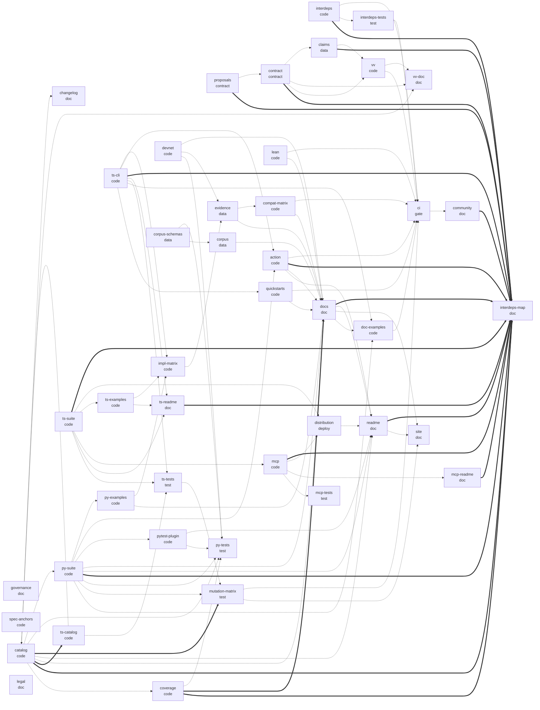

# Interdependency map

Generated by `python3 tools/interdeps.py` from `proofline.json`, the unmerged addenda in `docs/proposals/`, `vv/claims.json`, `src/x402conf/spec.py` and the tracked tree. Don't edit it by hand: `python3 tools/interdeps.py --check` fails in CI when it is stale, and `--drift` fails when the docs and the code disagree on check ids, CLI flags, Action inputs or versions.

Status: done means the task is claimed in `vv/claims.json` and `tools/vv.py` holds it to every mandatory criterion; signed means it is in the owner-signed contract and still open; proposed means it sits in an unmerged addendum and binds nothing yet.

## Task graph

```mermaid
graph LR
  XC_00["XC-00<br/>Repository spine: licence, notice, governance an..."]
  XC_01["XC-01<br/>Live checks S1-S4 over GET /supported (GET only)"]
  XC_02["XC-02<br/>Safety checks F1-F6 with devnet fixtures and fac..."]
  XC_03["XC-03<br/>Lean models of the credit rule and nonce, standa..."]
  XC_04["XC-04<br/>Documentation: architecture, spec mapping, threa..."]
  XC_05["XC-05<br/>CI: lint, types, tests, Lean, V&V with receipts"]
  XC_06["XC-06<br/>Evidence: first live GET /supported run, hashed..."]
  XC_07["XC-07<br/>Hygiene: no secrets, keys, internal paths or AI..."]
  XC_08["XC-08<br/>Cross-request payment replay and requirement sub..."]
  XC_09["XC-09<br/>Oracle hardening: strict atomic-unit parsing, fa..."]
  XC_10["XC-10<br/>R11 payment-to-request binding on a real resourc..."]
  XC_11["XC-11<br/>One report, test-framework entry points and opt-..."]
  XC_12["XC-12<br/>MCP server and agent-framework tools (Vercel AI..."]
  XC_13["XC-13<br/>Python entry-point tag and corpus case, Docker i..."]
  XC_14["XC-14<br/>pytest plugin and the Python server examples"]
  XC_15["XC-15<br/>Normative additions: F5 extended, F11, P6, P7"]
  XC_16["XC-16<br/>Evidence v2 and the test-credibility gate"]
  XC_17["XC-17<br/>Concurrency and idempotency: R12, R13, R14"]
  XC_18["XC-18<br/>Payment versus delivery: R15 to R19"]
  XC_19["XC-19<br/>Implementation matrix: stock servers at pinned v..."]
  XC_20["XC-20<br/>Adoption track A1-A8, built into the code"]
  XC_21["XC-21<br/>R14: a crash between a successful /settle and th..."]
  XC_22["XC-22<br/>R20: a client retry never pays twice for one req..."]
  XC_23["XC-23<br/>Docs in sync with the build, and a generated int..."]
  XC_24["XC-24<br/>Lean: n replicas, shared atomic check-and-set ve..."]
  XC_25["XC-25<br/>A2 and A5: the PR summary comment and the result..."]
  XC_26["XC-26<br/>A4: framework quickstarts, clone to first result..."]
  XC_27["XC-27<br/>A8: every docs example is run by CI"]
  XC_28["XC-28<br/>A7: the compatibility matrix is generated from r..."]
  XC_29["XC-29<br/>Credibility: the mutation matrix and false-posit..."]
  XC_30["XC-30<br/>Release 1.4.0: versions, changelog and the corpu..."]
  XC_31["XC-31<br/>Release 1.5.0"]
  XC_32["XC-32<br/>The release gate: dropping the experimental labe..."]
  XC_33["XC-33<br/>MCP transport: X1 and X2 for paid MCP tools"]
  XC_34["XC-34<br/>R21: settlement preemption for caller-unbound se..."]
  XC_35["XC-35<br/>Schemes: upto (U1-U3) and batch-settlement (B1-B..."]
  XC_36["XC-36<br/>Discovery and A2A: D1 (Bazaar) and G1 (A2A)"]
  XC_37["XC-37<br/>SIWX normative: W1-W3"]
  XC_38["XC-38<br/>R20c: a same-id re-signed retry is graded as a s..."]
  XC_39["XC-39<br/>R16a: an unpaid HEAD on a paid GET route gets th..."]
  XC_40["XC-40<br/>R22: the paid response keeps the handler's 2xx s..."]
  XC_41["XC-41<br/>R23: a client abort during settle is recoverable"]
  XC_42["XC-42<br/>R24: a malformed payment header is a 4xx"]
  XC_43["XC-43<br/>C1: a client never treats 402 as success"]
  XC_44["XC-44<br/>C2: a client pays an offer within its own policy"]
  XC_45["XC-45<br/>C3: a client pays V2 and never falls back to V1..."]
  XC_46["XC-46<br/>F12: /verify rejects an unsupported network or a..."]
  XC_47["XC-47<br/>S5: every kind /supported advertises gets a verd..."]
  XC_48["XC-48<br/>Release 1.6.0: the rest of the v1.5 build list"]
  XC_49["XC-49<br/>F13: a payment whose asset differs from the requ..."]
  XC_50["XC-50<br/>F14: a payment authorized for another network is..."]
  XC_51["XC-51<br/>Self-hosted open-source facilitators as matrix c..."]
  XC_52["XC-52<br/>A static per-implementation scoreboard on the Pa..."]
  XC_53["XC-53<br/>Governance and stewardship, and check ids that n..."]
  XC_54["XC-54<br/>Coverage ledger: every facilitator, chain, langu..."]
  XC_55["XC-55<br/>Spec-clause anchors pinned to upstream commits,..."]
  XC_56["XC-56<br/>Cross-SDK parity oracle: one vector set, every o..."]
  XC_57["XC-57<br/>Parity backtest on historical cross-SDK fixes, a..."]
  XC_58["XC-58<br/>F15, F16, C4: checks from public findings (malfo..."]
  XC_59["XC-59<br/>F17-F19: the USENIX 2026 rules the suite does no..."]
  XC_60["XC-60<br/>EVM: exact (EIP-3009 and Permit2) verify-only on..."]
  XC_61["XC-61<br/>Solana: verify-only F checks on every SVM-capabl..."]
  XC_62["XC-62<br/>Stellar: an exact client and verify-only checks..."]
  XC_63["XC-63<br/>Move chains: Aptos and Sui exact verify-only"]
  XC_64["XC-64<br/>Account chains: NEAR, Hedera, Algorand, Concordi..."]
  XC_65["XC-65<br/>XRPL, TON and Cardano: exact verify-only across..."]
  XC_66["XC-66<br/>Spec-only families: Starknet, Canton, Lightning..."]
  XC_67["XC-67<br/>auth-capture scheme (EVM): capture, void and dou..."]
  XC_68["XC-68<br/>TypeScript: every upstream server and client sur..."]
  XC_69["XC-69<br/>Go: gin, echo, net/http servers and the Go clien..."]
  XC_70["XC-70<br/>Python: httpx and requests clients, MCP, and the..."]
  XC_71["XC-71<br/>Java: the V1 servlet filter and client under a V..."]
  XC_72["XC-72<br/>Third-party SDKs: Rust (x402-rs axum, reqwest),..."]
  XC_73["XC-73<br/>Open-source facilitators, batch B (EVM): at leas..."]
  XC_74["XC-74<br/>Open-source facilitators, batch C (non-EVM): Sui..."]
  XC_75["XC-75<br/>Extensions: gas sponsoring, offer-and-receipt, b..."]
  XC_76["XC-76<br/>Industry matrix v2: a faceted, evidence-only sco..."]
  XC_77["XC-77<br/>Server and client checks on every chain family t..."]
  XC_78["XC-78<br/>Coverage closure: every inventoried facilitator,..."]
  XC_79["XC-79<br/>Dexter: the open-source build of a hosted facili..."]
  XC_80["XC-80<br/>Hosted-only facilitators: documented out-of-reac..."]
  XC_81["XC-81<br/>Coverage decisions recorded by the owner: no exc..."]
  XC_82["XC-82<br/>Spec traceability: every check classified as nor..."]
  XC_83["XC-83<br/>An offline CI job template another repo can past..."]
  XC_84["XC-84<br/>Yank x402-conformance 1.3.0 and 1.3.1 on PyPI, w..."]
  XC_85["XC-85<br/>P9 and P10: a seller's discovery metadata is con..."]
  XC_86["XC-86<br/>R16a amendment: an unpaid HEAD refused with 405..."]
  XC_87["XC-87<br/>C2 and C3 not applicable to a client declared no..."]
  XC_88["XC-88<br/>Polite pacing for live targets: --min-interval a..."]
  XC_89["XC-89<br/>x402conf-svm mcp: X1 and the offer checks on one..."]
  XC_90["XC-90<br/>R24: null, empty and non-object payment headers,..."]
  XC_91["XC-91<br/>.NET / C#: a harness that builds a .NET x402 SDK..."]
  XC_92["XC-92<br/>Merchant and paid-API rows on opt-in: a passive,..."]
  XC_93["XC-93<br/>Matrix rows: Environment, passed/run counts, ver..."]
  XC_94["XC-94<br/>Run it yourself: the Action's evidence mode, an..."]
  XC_95["XC-95<br/>Attribution and credit: the 'Tested with x402-co..."]
  XC_96["XC-96<br/>Opt-in matrix: projects add their own details (f..."]
  XC_97["XC-97<br/>Free run program: a free initial run and release..."]
  XC_98["XC-98<br/>Two tiers: External-verified runs from the queue..."]
  XC_110["XC-110<br/>External modes for R16a and R24 in the tier-1 qu..."]
  XC_123["XC-123<br/>F14a: an EIP-3009 signature over a domain withou..."]
  XC_124["XC-124<br/>The live pacing test derives its request count i..."]
  XC_125["XC-125<br/>The vv job is sharded by task across a matrix an..."]
  XC_M1["XC-M1<br/>M1 Devnet runner: F1-F6 over real x402 V2 /verif..."]
  XC_M2["XC-M2<br/>M2 Facilitator matrix: >= 3 devnet facilitator r..."]
  XC_M3["XC-M3<br/>M3 Lean models: timeouts, settlement_pending rec..."]
  XC_M4["XC-M4<br/>M4 Drop-in CI action and TypeScript runner for @..."]
  XC_M5["XC-M5<br/>M5 Maintenance, 6 months (monthly milestones)"]
  XC_M6["XC-M6<br/>M6 Adoption: >= 3 external repos run the suite i..."]
  XC_01 --> XC_02
  XC_01 --> XC_04
  XC_02 --> XC_04
  XC_03 --> XC_04
  XC_02 --> XC_05
  XC_03 --> XC_05
  XC_01 --> XC_06
  XC_02 --> XC_08
  XC_02 --> XC_09
  XC_08 --> XC_09
  XC_M4 --> XC_10
  XC_08 --> XC_10
  XC_M4 --> XC_11
  XC_11 --> XC_12
  XC_11 --> XC_13
  XC_12 --> XC_13
  XC_11 --> XC_14
  XC_13 --> XC_14
  XC_02 --> XC_15
  XC_01 --> XC_15
  XC_09 --> XC_16
  XC_10 --> XC_16
  XC_15 --> XC_16
  XC_10 --> XC_17
  XC_10 --> XC_18
  XC_10 --> XC_19
  XC_17 --> XC_19
  XC_18 --> XC_19
  XC_10 --> XC_20
  XC_16 --> XC_20
  XC_05 --> XC_21
  XC_M4 --> XC_21
  XC_17 --> XC_22
  XC_21 --> XC_22
  XC_04 --> XC_23
  XC_05 --> XC_23
  XC_03 --> XC_24
  XC_M3 --> XC_24
  XC_M4 --> XC_25
  XC_16 --> XC_25
  XC_20 --> XC_26
  XC_14 --> XC_26
  XC_23 --> XC_27
  XC_19 --> XC_28
  XC_16 --> XC_29
  XC_09 --> XC_30
  XC_10 --> XC_30
  XC_11 --> XC_30
  XC_12 --> XC_30
  XC_13 --> XC_30
  XC_14 --> XC_30
  XC_15 --> XC_30
  XC_16 --> XC_30
  XC_20 --> XC_30
  XC_23 --> XC_30
  XC_25 --> XC_30
  XC_17 --> XC_31
  XC_21 --> XC_31
  XC_23 --> XC_31
  XC_25 --> XC_31
  XC_30 --> XC_31
  XC_39 --> XC_31
  XC_40 --> XC_31
  XC_41 --> XC_31
  XC_42 --> XC_31
  XC_43 --> XC_31
  XC_44 --> XC_31
  XC_45 --> XC_31
  XC_46 --> XC_31
  XC_31 --> XC_32
  XC_M6 --> XC_32
  XC_12 --> XC_33
  XC_16 --> XC_33
  XC_17 --> XC_34
  XC_16 --> XC_35
  XC_16 --> XC_36
  XC_10 --> XC_37
  XC_22 --> XC_38
  XC_18 --> XC_39
  XC_18 --> XC_40
  XC_22 --> XC_41
  XC_10 --> XC_42
  XC_M4 --> XC_43
  XC_M4 --> XC_44
  XC_M4 --> XC_45
  XC_15 --> XC_46
  XC_01 --> XC_47
  XC_02 --> XC_47
  XC_18 --> XC_48
  XC_19 --> XC_48
  XC_22 --> XC_48
  XC_24 --> XC_48
  XC_26 --> XC_48
  XC_27 --> XC_48
  XC_28 --> XC_48
  XC_29 --> XC_48
  XC_31 --> XC_48
  XC_49 --> XC_48
  XC_50 --> XC_48
  XC_08 --> XC_49
  XC_08 --> XC_50
  XC_M1 --> XC_51
  XC_46 --> XC_51
  XC_49 --> XC_51
  XC_50 --> XC_51
  XC_28 --> XC_52
  XC_29 --> XC_52
  XC_51 --> XC_52
  XC_00 --> XC_53
  XC_23 --> XC_53
  XC_52 --> XC_54
  XC_53 --> XC_54
  XC_53 --> XC_55
  XC_55 --> XC_56
  XC_56 --> XC_57
  XC_53 --> XC_58
  XC_56 --> XC_58
  XC_55 --> XC_59
  XC_51 --> XC_59
  XC_51 --> XC_60
  XC_54 --> XC_60
  XC_51 --> XC_61
  XC_54 --> XC_61
  XC_51 --> XC_62
  XC_54 --> XC_62
  XC_51 --> XC_63
  XC_54 --> XC_63
  XC_51 --> XC_64
  XC_54 --> XC_64
  XC_51 --> XC_65
  XC_54 --> XC_65
  XC_54 --> XC_66
  XC_55 --> XC_66
  XC_35 --> XC_67
  XC_54 --> XC_67
  XC_56 --> XC_68
  XC_54 --> XC_68
  XC_56 --> XC_69
  XC_54 --> XC_69
  XC_56 --> XC_70
  XC_54 --> XC_70
  XC_56 --> XC_71
  XC_54 --> XC_71
  XC_56 --> XC_72
  XC_54 --> XC_72
  XC_51 --> XC_73
  XC_54 --> XC_73
  XC_60 --> XC_73
  XC_61 --> XC_74
  XC_62 --> XC_74
  XC_63 --> XC_74
  XC_64 --> XC_74
  XC_54 --> XC_74
  XC_55 --> XC_75
  XC_34 --> XC_75
  XC_52 --> XC_76
  XC_54 --> XC_76
  XC_55 --> XC_76
  XC_56 --> XC_76
  XC_54 --> XC_77
  XC_68 --> XC_77
  XC_70 --> XC_77
  XC_54 --> XC_78
  XC_56 --> XC_78
  XC_57 --> XC_78
  XC_58 --> XC_78
  XC_59 --> XC_78
  XC_60 --> XC_78
  XC_61 --> XC_78
  XC_62 --> XC_78
  XC_63 --> XC_78
  XC_64 --> XC_78
  XC_65 --> XC_78
  XC_66 --> XC_78
  XC_67 --> XC_78
  XC_68 --> XC_78
  XC_69 --> XC_78
  XC_70 --> XC_78
  XC_71 --> XC_78
  XC_72 --> XC_78
  XC_73 --> XC_78
  XC_74 --> XC_78
  XC_75 --> XC_78
  XC_76 --> XC_78
  XC_77 --> XC_78
  XC_51 --> XC_79
  XC_54 --> XC_79
  XC_61 --> XC_79
  XC_54 --> XC_80
  XC_54 --> XC_81
  XC_53 --> XC_82
  XC_55 --> XC_82
  XC_26 --> XC_83
  XC_16 --> XC_85
  XC_23 --> XC_85
  XC_39 --> XC_86
  XC_44 --> XC_87
  XC_45 --> XC_87
  XC_11 --> XC_87
  XC_01 --> XC_88
  XC_11 --> XC_88
  XC_42 --> XC_88
  XC_39 --> XC_88
  XC_33 --> XC_89
  XC_88 --> XC_89
  XC_42 --> XC_90
  XC_28 --> XC_91
  XC_54 --> XC_91
  XC_93 --> XC_91
  XC_96 --> XC_91
  XC_54 --> XC_92
  XC_85 --> XC_92
  XC_88 --> XC_92
  XC_93 --> XC_92
  XC_96 --> XC_92
  XC_28 --> XC_93
  XC_53 --> XC_93
  XC_54 --> XC_93
  XC_12 --> XC_94
  XC_25 --> XC_94
  XC_54 --> XC_94
  XC_93 --> XC_94
  XC_25 --> XC_95
  XC_52 --> XC_95
  XC_93 --> XC_95
  XC_94 --> XC_95
  XC_12 --> XC_96
  XC_25 --> XC_96
  XC_93 --> XC_96
  XC_94 --> XC_96
  XC_95 --> XC_96
  XC_94 --> XC_97
  XC_95 --> XC_97
  XC_96 --> XC_97
  XC_94 --> XC_98
  XC_96 --> XC_98
  XC_97 --> XC_98
  XC_42 --> XC_110
  XC_86 --> XC_110
  XC_88 --> XC_110
  XC_98 --> XC_110
  XC_50 --> XC_123
  XC_88 --> XC_124
  XC_05 --> XC_125
  XC_05 --> XC_M1
  XC_05 --> XC_M2
  XC_05 --> XC_M3
  XC_05 --> XC_M4
  XC_05 --> XC_M5
  XC_05 --> XC_M6
  classDef done fill:#e6f4ea,stroke:#2e7d32
  classDef proposed stroke-dasharray: 4 3
  class XC_00,XC_01,XC_02,XC_03,XC_04,XC_05,XC_06,XC_07,XC_08,XC_09,XC_10,XC_11,XC_12,XC_13,XC_14,XC_15,XC_16,XC_17,XC_18,XC_19,XC_20,XC_21,XC_22,XC_23,XC_24,XC_25,XC_26,XC_27,XC_28,XC_29,XC_30,XC_31,XC_39,XC_40,XC_41,XC_42,XC_43,XC_44,XC_45,XC_46,XC_48,XC_49,XC_50,XC_123,XC_124,XC_125,XC_M1,XC_M3,XC_M4 done
```

Green boxes are done, plain boxes signed and open, round dashed boxes proposed.

## Tasks

| task | phase | status | depends on | needed by | requirements | criteria | scope |
|---|---|---|---|---|---|---|---|
| XC-00 Repository spine: licence, notice, governance and contract | design | done | - | XC-53 | R-OPEN, R-GOV | 11 (command 2, grep 7, pushed 1, scope 1) | `LICENSE`; `NOTICE`; `README.md`; `CONTRIBUTING.md`; `CODE_OF_CONDUCT.md`; `SECURITY.md`; `CHANGELOG.md`; `.gitignore`; `.github/CODEOWNERS`; `.github/ISSUE_TEMPLATE/**`; `.github/pull_request_template.md`; `guard/**`; `proofline.json`; `proofline.json.sig`; `pyproject.toml` |
| XC-01 Live checks S1-S4 over GET /supported (GET only) | implement | done | - | XC-02, XC-04, XC-06, XC-15, XC-47, XC-88 | R-S1, R-S2, R-S3, R-S4, R-SAFE-GET | 9 (command 7, pushed 1, scope 1) | `src/x402conf/__init__.py`; `src/x402conf/__main__.py`; `src/x402conf/py.typed`; `src/x402conf/spec.py`; `src/x402conf/types.py`; `src/x402conf/harness.py`; `src/x402conf/cli.py`; `tests/test_live.py` |
| XC-02 Safety checks F1-F6 with devnet fixtures and facilitator doubles | implement | done | XC-01 | XC-04, XC-05, XC-08, XC-09, XC-15, XC-47 | R-F1, R-F2, R-F3, R-F4, R-F5, R-F6 | 11 (command 9, pushed 1, scope 1) | `src/x402conf/mock.py`; `src/x402conf/fixtures/**`; `tests/test_offline.py` |
| XC-03 Lean models of the credit rule and nonce, standard axioms only | verify | done | - | XC-04, XC-05, XC-24 | R-LEAN | 13 (command 2, grep 7, metric 2, pushed 1, scope 1) | `lean/lean-toolchain`; `lean/lakefile.toml`; `lean/lake-manifest.json`; `lean/X402Conformance.lean`; `lean/X402Conformance/**`; `lean/Axioms.lean`; `tools/lean_axioms.py` |
| XC-04 Documentation: architecture, spec mapping, threat model, roadmap, V&V | verify | done | XC-01, XC-02, XC-03 | XC-23 | R-DOCS | 16 (command 1, grep 13, pushed 1, scope 1) | `docs/**` |
| XC-05 CI: lint, types, tests, Lean, V&V with receipts | integrate | done | XC-02, XC-03 | XC-21, XC-23, XC-125, XC-M1, XC-M2, XC-M3, XC-M4, XC-M5, XC-M6 | R-CI | 6 (command 2, grep 2, pushed 1, scope 1) | `.github/workflows/**`; `tools/vv.py`; `tools/verify-sig.mjs`; `vv/claims.json` |
| XC-06 Evidence: first live GET /supported run, hashed and reproducible | verify | done | XC-01 | - | R-EVID | 6 (command 2, file_exists 1, grep 1, pushed 1, scope 1) | `evidence/**`; `tests/test_live.py` |
| XC-07 Hygiene: no secrets, keys, internal paths or AI attribution; commits by mgillr | release | done | - | - | R-HYG | 3 (metric 1, pushed 1, scope 1) | - |
| XC-08 Cross-request payment replay and requirement substitution are rejected | implement | done | XC-02 | XC-09, XC-10, XC-49, XC-50 | R-F10 | 8 (command 8) | `src/x402conf/mock.py`; `src/x402conf/harness.py`; `tests/test_offline.py`; `docs/SPEC.md`; `docs/FIXES.md` |
| XC-09 Oracle hardening: strict atomic-unit parsing, fail closed | implement | done | XC-02, XC-08 | XC-16, XC-30 | R-ORACLE | 5 (command 3, pushed 1, scope 1) | `src/x402conf/mock.py`; `src/x402conf/harness.py`; `tests/test_offline.py`; `ts/src/**`; `ts/test/**` |
| XC-10 R11 payment-to-request binding on a real resource server | implement | done | XC-M4, XC-08 | XC-16, XC-17, XC-18, XC-19, XC-20, XC-30, XC-37, XC-42 | R-R11 | 9 (command 6, grep 1, pushed 1, scope 1) | `ts/**`; `src/x402conf/harness.py`; `docs/SPEC.md`; `docs/FIXES.md`; `README.md` |
| XC-11 One report, test-framework entry points and opt-in corpus sharing | implement | done | XC-M4 | XC-12, XC-13, XC-14, XC-30, XC-87, XC-88 | R-ADOPT | 7 (command 3, grep 2, pushed 1, scope 1) | `ts/**`; `docs/USING.md`; `corpus/**`; `.github/ISSUE_TEMPLATE/corpus-case.yml` |
| XC-12 MCP server and agent-framework tools (Vercel AI SDK, LangChain) | implement | done | XC-11 | XC-13, XC-30, XC-33, XC-94, XC-96 | R-ADOPT | 5 (command 1, grep 2, pushed 1, scope 1) | `ts/mcp/**`; `docs/USING.md`; `.github/workflows/ci.yml` |
| XC-13 Python entry-point tag and corpus case, Docker image and GitLab CI template | implement | done | XC-11, XC-12 | XC-14, XC-30 | R-ADOPT | 5 (command 1, grep 2, pushed 1, scope 1) | `src/x402conf/cli.py`; `src/x402conf/harness.py`; `tests/test_live.py`; `corpus/fixtures/**`; `ts/docker/**`; `ts/ci/**`; `.github/workflows/ci.yml`; `docs/USING.md` |
| XC-14 pytest plugin and the Python server examples | implement | done | XC-11, XC-13 | XC-26, XC-30 | R-ADOPT | 5 (command 1, grep 2, pushed 1, scope 1) | `src/x402conf/pytest_plugin.py`; `tests/check_pytest_plugin.py`; `examples/**`; `pyproject.toml`; `.github/workflows/ci.yml`; `docs/USING.md` |
| XC-15 Normative additions: F5 extended, F11, P6, P7 | implement | done | XC-02, XC-01 | XC-16, XC-30, XC-46 | R-F5X, R-F11, R-P6, R-P7 | 6 (command 4, pushed 1, scope 1) | `src/x402conf/**`; `tests/**`; `ts/**`; `docs/SPEC.md`; `docs/FIXES.md`; `README.md` |
| XC-16 Evidence v2 and the test-credibility gate | integrate | done | XC-09, XC-10, XC-15 | XC-20, XC-25, XC-29, XC-30, XC-33, XC-35, XC-36, XC-85 | R-CRED | 4 (command 2, pushed 1, scope 1) | `src/x402conf/**`; `ts/**`; `tests/**`; `tools/vv.py`; `.github/workflows/**`; `docs/**` |
| XC-17 Concurrency and idempotency: R12, R13, R14 | implement | done | XC-10 | XC-19, XC-22, XC-31, XC-34 | R-CONC | 6 (command 4, pushed 1, scope 1) | `ts/**`; `lean/X402Conformance/**`; `docs/**` |
| XC-18 Payment versus delivery: R15 to R19 | implement | done | XC-10 | XC-19, XC-39, XC-40, XC-48 | R-DELIV | 7 (command 5, pushed 1, scope 1) | `ts/**`; `docs/**` |
| XC-19 Implementation matrix: stock servers at pinned versions | verify | done | XC-10, XC-17, XC-18 | XC-28, XC-48 | R-MATRIX | 3 (command 1, pushed 1, scope 1) | `evidence/impl-matrix/**`; `docs/MATRIX.md`; `.github/workflows/**`; `ts/**` |
| XC-20 Adoption track A1-A8, built into the code | integrate | done | XC-10, XC-16 | XC-26, XC-30 | R-ADOPT | 8 (command 5, file_exists 1, pushed 1, scope 1) | `corpus/**`; `examples/**`; `ts/**`; `src/x402conf/**`; `tests/**`; `action.yml`; `.github/**`; `docs/**`; `README.md` |
| XC-21 R14: a crash between a successful /settle and the response | implement | done | XC-05, XC-M4 | XC-22, XC-31 | R-CONC | 8 (command 3, file_exists 1, grep 2, pushed 1, scope 1) | `ts/**`; `src/x402conf/spec.py`; `src/x402conf/cli.py`; `tests/test_offline.py`; `tests/test_live.py`; `action.yml`; `.github/workflows/ci.yml`; `docs/**`; `README.md`; `CHANGELOG.md`; `corpus/cases/**` |
| XC-22 R20: a client retry never pays twice for one request | implement | done | XC-17, XC-21 | XC-38, XC-41, XC-48 | R-CONC | 8 (command 4, grep 2, pushed 1, scope 1) | `ts/**`; `src/x402conf/spec.py`; `tests/test_offline.py`; `tests/test_live.py`; `action.yml`; `.github/workflows/ci.yml`; `docs/**`; `README.md`; `CHANGELOG.md`; `corpus/cases/**` |
| XC-23 Docs in sync with the build, and a generated interdependency map | integrate | done | XC-04, XC-05 | XC-27, XC-30, XC-31, XC-53, XC-85 | R-DOCS | 7 (command 3, grep 2, pushed 1, scope 1) | `README.md`; `CHANGELOG.md`; `CONTRIBUTING.md`; `docs/**`; `ts/README.md`; `ts/mcp/README.md`; `tools/interdeps.py`; `tests/test_interdeps.py`; `.github/workflows/ci.yml` |
| XC-24 Lean: n replicas, shared atomic check-and-set versus partitioned caches | verify | done | XC-03, XC-M3 | XC-48 | R-LEAN | 4 (command 2, pushed 1, scope 1) | `lean/X402Conformance/Replicas.lean`; `lean/X402Conformance.lean`; `lean/Axioms.lean`; `docs/SPEC.md` |
| XC-25 A2 and A5: the PR summary comment and the results badge | integrate | done | XC-M4, XC-16 | XC-30, XC-31, XC-94, XC-95, XC-96 | R-ADOPT | 6 (command 3, grep 1, pushed 1, scope 1) | `action.yml`; `src/x402conf/cli.py`; `src/x402conf/harness.py`; `tests/test_offline.py`; `README.md`; `docs/**` |
| XC-26 A4: framework quickstarts, clone to first result, run in CI | integrate | done | XC-20, XC-14 | XC-48, XC-83 | R-ADOPT | 9 (command 6, grep 1, pushed 1, scope 1) | `examples/**`; `tools/quickstart.sh`; `.github/workflows/ci.yml`; `docs/USING.md`; `README.md` |
| XC-27 A8: every docs example is run by CI | integrate | done | XC-23 | XC-48 | R-ADOPT | 5 (command 2, grep 1, pushed 1, scope 1) | `tools/doc_examples.py`; `tests/test_doc_examples.py`; `.github/workflows/ci.yml`; `README.md`; `docs/**`; `examples/**`; `Makefile.example` |
| XC-28 A7: the compatibility matrix is generated from runs, on a schedule | verify | done | XC-19 | XC-48, XC-52, XC-91, XC-93 | R-MATRIX | 5 (command 2, grep 1, pushed 1, scope 1) | `tools/compat_matrix.py`; `tests/test_compat_matrix.py`; `docs/compat-matrix.json`; `docs/MATRIX.md`; `.github/workflows/compat-matrix.yml`; `evidence/impl-matrix/**` |
| XC-29 Credibility: the mutation matrix and false-positive handling, published | verify | done | XC-16 | XC-48, XC-52 | R-CRED | 6 (command 2, grep 2, pushed 1, scope 1) | `tools/mutation_matrix.py`; `tests/test_mutation_matrix.py`; `docs/site/**`; `docs/FALSE-POSITIVES.md`; `.github/workflows/**` |
| XC-30 Release 1.4.0: versions, changelog and the corpus tag | release | done | XC-09, XC-10, XC-11, XC-12, XC-13, XC-14, XC-15, XC-16, XC-20, XC-23, XC-25 | XC-31 | R-RELEASE | 6 (command 2, grep 2, pushed 1, scope 1) | `pyproject.toml`; `src/x402conf/__init__.py`; `ts/package.json`; `ts/package-lock.json`; `ts/mcp/package.json`; `ts/mcp/package-lock.json`; `ts/mcp/server.json`; `CHANGELOG.md`; `README.md`; `docs/**` |
| XC-31 Release 1.5.0 | release | done | XC-17, XC-21, XC-23, XC-25, XC-30, XC-39, XC-40, XC-41, XC-42, XC-43, XC-44, XC-45, XC-46 | XC-32, XC-48 | R-RELEASE | 9 (command 6, grep 1, pushed 1, scope 1) | `pyproject.toml`; `src/x402conf/__init__.py`; `ts/package.json`; `ts/package-lock.json`; `ts/mcp/package.json`; `ts/mcp/package-lock.json`; `ts/mcp/server.json`; `CHANGELOG.md`; `README.md`; `docs/**`; `RELEASES.md`; `tools/build_coverage.py`; `tests/test_coverage_doc.py` |
| XC-32 The release gate: dropping the experimental label | monitor | signed | XC-31, XC-M6 | - | R-GATE | 5 (command 1, grep 2, pushed 1, scope 1) | `docs/ROADMAP.md`; `docs/ADOPTION.md`; `README.md`; `docs/site/**` |
| XC-33 MCP transport: X1 and X2 for paid MCP tools | implement | signed | XC-12, XC-16 | XC-89 | R-MCP | 6 (command 3, grep 1, pushed 1, scope 1) | `ts/**`; `src/x402conf/spec.py`; `tests/test_offline.py`; `docs/**`; `README.md`; `CHANGELOG.md`; `action.yml`; `corpus/cases/**` |
| XC-34 R21: settlement preemption for caller-unbound settlement (Permit2 on EVM) | implement | signed | XC-17 | XC-75 | R-PREEMPT | 5 (command 2, grep 1, pushed 1, scope 1) | `ts/**`; `src/x402conf/spec.py`; `tests/test_offline.py`; `docs/**`; `README.md`; `CHANGELOG.md`; `action.yml`; `corpus/cases/**` |
| XC-35 Schemes: upto (U1-U3) and batch-settlement (B1-B3) | implement | signed | XC-16 | XC-67 | R-SCHEMES | 10 (command 7, grep 1, pushed 1, scope 1) | `ts/**`; `src/x402conf/spec.py`; `tests/test_offline.py`; `docs/**`; `README.md`; `CHANGELOG.md`; `action.yml`; `corpus/cases/**` |
| XC-36 Discovery and A2A: D1 (Bazaar) and G1 (A2A) | implement | signed | XC-16 | - | R-DISCOVERY | 6 (command 3, grep 1, pushed 1, scope 1) | `ts/**`; `src/x402conf/spec.py`; `tests/test_offline.py`; `docs/**`; `README.md`; `CHANGELOG.md`; `action.yml`; `corpus/cases/**` |
| XC-37 SIWX normative: W1-W3 | implement | signed | XC-10 | - | R-SIWX | 7 (command 4, grep 1, pushed 1, scope 1) | `ts/**`; `src/x402conf/spec.py`; `tests/test_offline.py`; `docs/**`; `README.md`; `CHANGELOG.md`; `action.yml`; `corpus/cases/**` |
| XC-38 R20c: a same-id re-signed retry is graded as a safe refusal | implement | signed | XC-22 | - | R-CONC | 11 (command 4, grep 5, pushed 1, scope 1) | `ts/src/retry.ts`; `ts/src/catalog.ts`; `ts/src/cli.ts`; `ts/src/double.ts`; `ts/test/retry.test.ts`; `src/x402conf/spec.py`; `src/x402conf/cli.py`; `tests/test_offline.py`; `docs/**`; `README.md`; `CHANGELOG.md`; `corpus/cases/**` |
| XC-39 R16a: an unpaid HEAD on a paid GET route gets the same 402 as GET | implement | done | XC-18 | XC-31, XC-86, XC-88 | R-DELIV | 6 (command 2, grep 2, pushed 1, scope 1) | `ts/**`; `src/x402conf/spec.py`; `tests/test_offline.py`; `docs/**`; `CHANGELOG.md` |
| XC-40 R22: the paid response keeps the handler's 2xx status and headers | implement | done | XC-18 | XC-31 | R-DELIV | 6 (command 2, grep 2, pushed 1, scope 1) | `ts/**`; `src/x402conf/spec.py`; `tests/test_offline.py`; `docs/**`; `CHANGELOG.md` |
| XC-41 R23: a client abort during settle is recoverable | implement | done | XC-22 | XC-31 | R-CONC | 6 (command 2, grep 2, pushed 1, scope 1) | `ts/**`; `src/x402conf/spec.py`; `tests/test_offline.py`; `docs/**`; `CHANGELOG.md` |
| XC-42 R24: a malformed payment header is a 4xx | implement | done | XC-10 | XC-31, XC-88, XC-90, XC-110 | R-R24 | 6 (command 2, grep 2, pushed 1, scope 1) | `ts/**`; `src/x402conf/spec.py`; `tests/test_offline.py`; `docs/**`; `CHANGELOG.md` |
| XC-43 C1: a client never treats 402 as success | implement | done | XC-M4 | XC-31 | R-C1 | 6 (command 2, grep 2, pushed 1, scope 1) | `ts/**`; `src/x402conf/spec.py`; `tests/test_offline.py`; `docs/**`; `CHANGELOG.md` |
| XC-44 C2: a client pays an offer within its own policy | implement | done | XC-M4 | XC-31, XC-87 | R-C2 | 6 (command 2, grep 2, pushed 1, scope 1) | `ts/**`; `src/x402conf/spec.py`; `tests/test_offline.py`; `docs/**`; `CHANGELOG.md` |
| XC-45 C3: a client pays V2 and never falls back to V1 when a V2 offer is present | implement | done | XC-M4 | XC-31, XC-87 | R-C3 | 6 (command 2, grep 2, pushed 1, scope 1) | `ts/**`; `src/x402conf/spec.py`; `tests/test_offline.py`; `docs/**`; `CHANGELOG.md` |
| XC-46 F12: /verify rejects an unsupported network or an asset with no token contract | implement | done | XC-15 | XC-31, XC-51 | R-F12 | 6 (command 2, grep 2, pushed 1, scope 1) | `src/x402conf/**`; `tests/test_offline.py`; `ts/src/catalog.ts`; `docs/**`; `CHANGELOG.md` |
| XC-47 S5: every kind /supported advertises gets a verdict from /verify | implement | signed | XC-01, XC-02 | - | R-S5 | 6 (command 2, grep 2, pushed 1, scope 1) | `src/x402conf/**`; `tests/test_offline.py`; `ts/src/catalog.ts`; `docs/**`; `CHANGELOG.md` |
| XC-48 Release 1.6.0: the rest of the v1.5 build list | release | done | XC-18, XC-19, XC-22, XC-24, XC-26, XC-27, XC-28, XC-29, XC-31, XC-49, XC-50 | - | R-RELEASE | 9 (command 6, grep 1, pushed 1, scope 1) | `pyproject.toml`; `src/x402conf/__init__.py`; `ts/package.json`; `ts/package-lock.json`; `ts/mcp/package.json`; `ts/mcp/package-lock.json`; `ts/mcp/server.json`; `CHANGELOG.md`; `README.md`; `docs/**`; `RELEASES.md`; `tools/build_coverage.py`; `tests/test_coverage_doc.py` |
| XC-49 F13: a payment whose asset differs from the requirement's asset is rejected (asset substitution) | implement | done | XC-08 | XC-48, XC-51 | R-F10 | 3 (command 3) | `src/x402conf/mock.py`; `src/x402conf/harness.py`; `src/x402conf/spec.py`; `tests/test_offline.py`; `ts/src/catalog.ts`; `tools/build_coverage.py`; `docs/**`; `CHANGELOG.md` |
| XC-50 F14: a payment authorized for another network is rejected (facilitator-layer network substitution) | implement | done | XC-08 | XC-48, XC-51, XC-123 | R-F10 | 3 (command 3) | `src/x402conf/mock.py`; `src/x402conf/harness.py`; `src/x402conf/spec.py`; `tests/test_offline.py`; `ts/src/catalog.ts`; `tools/build_coverage.py`; `docs/**`; `CHANGELOG.md` |
| XC-51 Self-hosted open-source facilitators as matrix columns: verify-only F checks over real /verify on Base Sepolia, loopback only | verify | signed | XC-M1, XC-46, XC-49, XC-50 | XC-52, XC-59, XC-60, XC-61, XC-62, XC-63, XC-64, XC-65, XC-73, XC-79 | R-MATRIX, R-SAFE-GET | 12 (command 8, grep 2, pushed 1, scope 1) | `src/x402conf/devnet/**`; `src/x402conf/cli.py`; `tests/test_devnet.py`; `tests/test_self_hosted_matrix.py`; `tools/self_hosted_matrix.py`; `tools/interdeps.py`; `evidence/self-hosted/**`; `.github/workflows/ci.yml`; `docs/**`; `README.md`; `CHANGELOG.md` |
| XC-52 A static per-implementation scoreboard on the Pages site, generated from committed evidence, never a certification | integrate | signed | XC-28, XC-29, XC-51 | XC-54, XC-76, XC-95 | R-MATRIX, R-ADOPT | 9 (command 4, grep 3, pushed 1, scope 1) | `tools/scoreboard.py`; `tests/test_scoreboard.py`; `docs/site/**`; `.github/workflows/ci.yml`; `.github/workflows/compat-matrix.yml`; `docs/**`; `README.md`; `CHANGELOG.md` |
| XC-53 Governance and stewardship, and check ids that never change meaning | design | signed | XC-00, XC-23 | XC-54, XC-55, XC-58, XC-82, XC-93 | R-GOV, R-OPEN | 9 (command 4, file_exists 1, grep 2, pushed 1, scope 1) | `GOVERNANCE.md`; `README.md`; `CONTRIBUTING.md`; `tools/check_ids.py`; `tests/test_check_ids.py`; `docs/check-ids.json`; `.github/workflows/ci.yml`; `docs/**`; `CHANGELOG.md` |
| XC-54 Coverage ledger: every facilitator, chain, language, scheme, transport and extension has evidence, a task, or a stated out-of-reach reason | verify | signed | XC-52, XC-53 | XC-60, XC-61, XC-62, XC-63, XC-64, XC-65, XC-66, XC-67, XC-68, XC-69, XC-70, XC-71, XC-72, XC-73, XC-74, XC-76, XC-77, XC-78, XC-79, XC-80, XC-81, XC-91, XC-92, XC-93, XC-94 | R-MATRIX, R-EVID | 8 (command 4, grep 2, pushed 1, scope 1) | `tools/coverage_ledger.py`; `tools/evidence_guard.py`; `tests/test_coverage_ledger.py`; `tests/test_evidence_guard.py`; `docs/coverage-ledger.json`; `docs/COVERAGE.md`; `.github/workflows/ci.yml`; `docs/**`; `CHANGELOG.md` |
| XC-55 Spec-clause anchors pinned to upstream commits, a spec-drift report, and a crosswalk to the USENIX 2026 facilitator rules | design | signed | XC-53 | XC-56, XC-59, XC-66, XC-75, XC-76, XC-82 | R-GOV, R-CRED | 7 (command 4, grep 1, pushed 1, scope 1) | `tools/spec_anchors.py`; `tests/test_spec_anchors.py`; `docs/spec-snapshots/**`; `docs/crosswalk/**`; `docs/check-ids.json`; `src/x402conf/spec.py`; `.github/workflows/ci.yml`; `docs/**`; `CHANGELOG.md` |
| XC-56 Cross-SDK parity oracle: one vector set, every official SDK library, offline, with spec anchors | implement | signed | XC-55 | XC-57, XC-58, XC-68, XC-69, XC-70, XC-71, XC-72, XC-76, XC-78 | R-ORACLE, R-MATRIX | 10 (command 7, grep 1, pushed 1, scope 1) | `src/x402conf/parity/**`; `src/x402conf/cli.py`; `ts/parity-harness/**`; `examples/python/parity_harness.py`; `examples/go/parity/**`; `tools/parity_report.py`; `tests/test_parity.py`; `docs/parity/**`; `docs/PARITY.md`; `evidence/parity/**`; `.github/workflows/ci.yml`; `docs/**`; `README.md`; `CHANGELOG.md` |
| XC-57 Parity backtest on historical cross-SDK fixes, and a nightly read-only shadow run against upstream main | verify | signed | XC-56 | XC-78 | R-EVID, R-ADOPT | 5 (command 3, pushed 1, scope 1) | `tools/parity_backtest.py`; `tests/test_parity_backtest.py`; `docs/parity/**`; `evidence/parity/**`; `.github/workflows/parity-nightly.yml`; `docs/**`; `CHANGELOG.md` |
| XC-58 F15, F16, C4: checks from public findings (malformed input never 5xx, no wildcard network accept, resume never re-pays) | implement | signed | XC-53, XC-56 | XC-78 | R-F1, R-F12, R-CONC | 8 (command 5, grep 1, pushed 1, scope 1) | `src/x402conf/**`; `ts/**`; `tests/test_offline.py`; `docs/parity/vectors.json`; `docs/COVERAGE.md`; `docs/SPEC.md`; `docs/check-ids.json`; `docs/**`; `CHANGELOG.md` |
| XC-59 F17-F19: the USENIX 2026 rules the suite does not test yet (sponsor-cost bounds, re-verify at settle, execution-template allow-list) | implement | signed | XC-55, XC-51 | XC-78 | R-F10, R-SAFE-GET | 8 (command 6, pushed 1, scope 1) | `src/x402conf/**`; `tests/test_offline.py`; `tests/test_devnet.py`; `evidence/self-hosted/**`; `docs/crosswalk/**`; `docs/COVERAGE.md`; `docs/SPEC.md`; `docs/check-ids.json`; `docs/**`; `CHANGELOG.md` |
| XC-60 EVM: exact (EIP-3009 and Permit2) verify-only on every SDK-default EVM testnet | verify | signed | XC-51, XC-54 | XC-73, XC-78 | R-MATRIX, R-SAFE-GET | 7 (command 5, pushed 1, scope 1) | `src/x402conf/devnet/**`; `src/x402conf/cli.py`; `tests/test_devnet_families.py`; `evidence/self-hosted/evm/**`; `tools/self_hosted_matrix.py`; `docs/coverage-ledger.json`; `docs/MATRIX.md`; `docs/COVERAGE.md`; `docs/**`; `CHANGELOG.md` |
| XC-61 Solana: verify-only F checks on every SVM-capable self-hosted column | verify | signed | XC-51, XC-54 | XC-74, XC-78, XC-79 | R-MATRIX, R-SAFE-GET | 7 (command 5, pushed 1, scope 1) | `src/x402conf/devnet/**`; `src/x402conf/cli.py`; `tests/test_devnet_families.py`; `evidence/self-hosted/svm/**`; `tools/self_hosted_matrix.py`; `docs/coverage-ledger.json`; `docs/MATRIX.md`; `docs/COVERAGE.md`; `docs/**`; `CHANGELOG.md` |
| XC-62 Stellar: an exact client and verify-only checks on Stellar testnet | verify | signed | XC-51, XC-54 | XC-74, XC-78 | R-MATRIX, R-SAFE-GET | 7 (command 5, pushed 1, scope 1) | `src/x402conf/devnet/**`; `src/x402conf/cli.py`; `tests/test_devnet_families.py`; `evidence/self-hosted/stellar/**`; `tools/self_hosted_matrix.py`; `docs/coverage-ledger.json`; `docs/MATRIX.md`; `docs/COVERAGE.md`; `docs/**`; `CHANGELOG.md` |
| XC-63 Move chains: Aptos and Sui exact verify-only | verify | signed | XC-51, XC-54 | XC-74, XC-78 | R-MATRIX, R-SAFE-GET | 7 (command 5, pushed 1, scope 1) | `src/x402conf/devnet/**`; `src/x402conf/cli.py`; `tests/test_devnet_families.py`; `evidence/self-hosted/move/**`; `tools/self_hosted_matrix.py`; `docs/coverage-ledger.json`; `docs/MATRIX.md`; `docs/COVERAGE.md`; `docs/**`; `CHANGELOG.md` |
| XC-64 Account chains: NEAR, Hedera, Algorand, Concordium, Keeta, Casper verify-only | verify | signed | XC-51, XC-54 | XC-74, XC-78 | R-MATRIX, R-SAFE-GET | 7 (command 5, pushed 1, scope 1) | `src/x402conf/devnet/**`; `src/x402conf/cli.py`; `tests/test_devnet_families.py`; `evidence/self-hosted/account/**`; `tools/self_hosted_matrix.py`; `docs/coverage-ledger.json`; `docs/MATRIX.md`; `docs/COVERAGE.md`; `docs/**`; `CHANGELOG.md` |
| XC-65 XRPL, TON and Cardano: exact verify-only across every transfer method | verify | signed | XC-51, XC-54 | XC-78 | R-MATRIX, R-SAFE-GET | 7 (command 5, pushed 1, scope 1) | `src/x402conf/devnet/**`; `src/x402conf/cli.py`; `tests/test_devnet_families.py`; `evidence/self-hosted/utxo-ledger/**`; `tools/self_hosted_matrix.py`; `docs/coverage-ledger.json`; `docs/MATRIX.md`; `docs/COVERAGE.md`; `docs/**`; `CHANGELOG.md` |
| XC-66 Spec-only families: Starknet, Canton, Lightning as offline profiles, live only where an open implementation exists | implement | signed | XC-54, XC-55 | XC-78 | R-MATRIX | 5 (command 3, pushed 1, scope 1) | `src/x402conf/**`; `tests/test_offline.py`; `corpus/fixtures/**`; `docs/coverage-ledger.json`; `docs/**`; `CHANGELOG.md` |
| XC-67 auth-capture scheme (EVM): capture, void and double-capture checks, settles explicitly allowed on Base Sepolia | implement | signed | XC-35, XC-54 | XC-78 | R-SCHEMES | 6 (command 4, pushed 1, scope 1) | `src/x402conf/**`; `tests/test_offline.py`; `tests/test_devnet.py`; `evidence/self-hosted/auth-capture/**`; `docs/**`; `CHANGELOG.md` |
| XC-68 TypeScript: every upstream server and client surface in the matrix | verify | signed | XC-56, XC-54 | XC-77, XC-78 | R-MATRIX, R-ADOPT | 6 (command 4, pushed 1, scope 1) | `examples/next/**`; `examples/fastify/**`; `ts/**`; `tools/compat_matrix.py`; `tests/test_compat_matrix.py`; `evidence/impl-matrix/**`; `docs/compat-matrix.json`; `docs/MATRIX.md`; `docs/coverage-ledger.json`; `docs/**`; `CHANGELOG.md` |
| XC-69 Go: gin, echo, net/http servers and the Go client in the matrix | verify | signed | XC-56, XC-54 | XC-78 | R-MATRIX, R-ADOPT | 6 (command 4, pushed 1, scope 1) | `examples/go/**`; `tools/compat_matrix.py`; `tests/test_compat_matrix.py`; `evidence/impl-matrix/**`; `docs/compat-matrix.json`; `docs/MATRIX.md`; `docs/coverage-ledger.json`; `docs/**`; `CHANGELOG.md` |
| XC-70 Python: httpx and requests clients, MCP, and the TON/SVM mechanisms | verify | signed | XC-56, XC-54 | XC-77, XC-78 | R-MATRIX, R-ADOPT | 6 (command 4, pushed 1, scope 1) | `examples/python/**`; `tools/compat_matrix.py`; `tests/test_compat_matrix.py`; `evidence/impl-matrix/**`; `docs/compat-matrix.json`; `docs/MATRIX.md`; `docs/coverage-ledger.json`; `docs/**`; `CHANGELOG.md` |
| XC-71 Java: the V1 servlet filter and client under a V1 profile | verify | signed | XC-56, XC-54 | XC-78 | R-MATRIX, R-ADOPT | 6 (command 4, pushed 1, scope 1) | `examples/java/**`; `tools/compat_matrix.py`; `tests/test_compat_matrix.py`; `evidence/impl-matrix/**`; `docs/compat-matrix.json`; `docs/MATRIX.md`; `docs/coverage-ledger.json`; `docs/**`; `CHANGELOG.md` |
| XC-72 Third-party SDKs: Rust (x402-rs axum, reqwest), Ruby (x402-rails), Elixir (raxol_payments), PipRail, Mogami Java | verify | signed | XC-56, XC-54 | XC-78 | R-MATRIX, R-ADOPT | 6 (command 4, pushed 1, scope 1) | `examples/rust/**`; `examples/ruby/**`; `examples/elixir/**`; `examples/piprail/**`; `examples/mogami/**`; `tools/compat_matrix.py`; `tests/test_compat_matrix.py`; `evidence/impl-matrix/**`; `docs/compat-matrix.json`; `docs/MATRIX.md`; `docs/coverage-ledger.json`; `docs/**`; `CHANGELOG.md` |
| XC-73 Open-source facilitators, batch B (EVM): at least 12 more self-hosted columns | verify | signed | XC-51, XC-54, XC-60 | XC-78 | R-MATRIX, R-SAFE-GET | 6 (command 4, pushed 1, scope 1) | `tools/self_hosted_matrix.py`; `evidence/self-hosted/batch-b/**`; `docs/MATRIX.md`; `docs/coverage-ledger.json`; `docs/**`; `CHANGELOG.md` |
| XC-74 Open-source facilitators, batch C (non-EVM): Sui, NEAR, Stellar, Solana and others | verify | signed | XC-61, XC-62, XC-63, XC-64, XC-54 | XC-78 | R-MATRIX, R-SAFE-GET | 6 (command 4, pushed 1, scope 1) | `tools/self_hosted_matrix.py`; `evidence/self-hosted/batch-c/**`; `docs/MATRIX.md`; `docs/coverage-ledger.json`; `docs/**`; `CHANGELOG.md` |
| XC-75 Extensions: gas sponsoring, offer-and-receipt, builder-code, HTTP message signatures, auth hints | implement | signed | XC-55, XC-34 | XC-78 | R-SCHEMES | 5 (command 3, pushed 1, scope 1) | `src/x402conf/**`; `tests/test_offline.py`; `corpus/fixtures/**`; `docs/**`; `CHANGELOG.md` |
| XC-76 Industry matrix v2: a faceted, evidence-only scoreboard with parity and coverage views | integrate | signed | XC-52, XC-54, XC-55, XC-56 | XC-78 | R-MATRIX, R-ADOPT | 7 (command 4, grep 1, pushed 1, scope 1) | `tools/scoreboard.py`; `tests/test_scoreboard.py`; `docs/site/**`; `docs/**`; `CHANGELOG.md` |
| XC-77 Server and client checks on every chain family the SDKs serve (not only Base Sepolia and Solana) | verify | signed | XC-54, XC-68, XC-70 | XC-78 | R-MATRIX | 6 (command 4, pushed 1, scope 1) | `src/x402conf/**`; `ts/**`; `tests/test_offline.py`; `tools/compat_matrix.py`; `tests/test_compat_matrix.py`; `evidence/impl-matrix/**`; `docs/compat-matrix.json`; `docs/**`; `CHANGELOG.md` |
| XC-78 Coverage closure: every inventoried facilitator, chain, language, scheme and extension has evidence or a stated reason | release | signed | XC-54, XC-56, XC-57, XC-58, XC-59, XC-60, XC-61, XC-62, XC-63, XC-64, XC-65, XC-66, XC-67, XC-68, XC-69, XC-70, XC-71, XC-72, XC-73, XC-74, XC-75, XC-76, XC-77 | - | R-RELEASE, R-MATRIX | 4 (command 2, pushed 1, scope 1) | `docs/coverage-ledger.json`; `README.md`; `docs/**`; `CHANGELOG.md` |
| XC-79 Dexter: the open-source build of a hosted facilitator as a self-hosted column | verify | signed | XC-51, XC-54, XC-61 | - | R-MATRIX, R-SAFE-GET | 6 (command 4, pushed 1, scope 1) | `tools/self_hosted_matrix.py`; `evidence/self-hosted/dexter/**`; `docs/MATRIX.md`; `docs/coverage-ledger.json`; `docs/**`; `CHANGELOG.md` |
| XC-80 Hosted-only facilitators: documented out-of-reach rows and an operator-permission track | verify | signed | XC-54 | - | R-MATRIX, R-SAFE-GET | 7 (command 4, grep 1, pushed 1, scope 1) | `tools/coverage_ledger.py`; `tests/test_coverage_ledger.py`; `docs/coverage-ledger.json`; `docs/COVERAGE.md`; `CHANGELOG.md` |
| XC-81 Coverage decisions recorded by the owner: no exclusions; live settle on Solana devnet and Base Sepolia, fixtures for Canton, Lightning and mainnet-only defaults, a Starknet Sepolia path | design | signed | XC-54 | - | R-MATRIX | 9 (command 5, grep 2, pushed 1, scope 1) | `docs/coverage-decisions.json`; `docs/coverage-ledger.json`; `docs/COVERAGE.md`; `tools/coverage_ledger.py`; `tests/test_coverage_ledger.py`; `CHANGELOG.md` |
| XC-82 Spec traceability: every check classified as normative (a spec clause) or hardening (beyond the spec) | design | signed | XC-53, XC-55 | - | R-SPEC | 8 (command 3, grep 3, pushed 1, scope 1) | `tools/traceability.py`; `tests/test_traceability.py`; `docs/traceability.json`; `docs/TRACEABILITY.md`; `docs/COVERAGE.md`; `README.md`; `.github/workflows/ci.yml`; `CHANGELOG.md` |
| XC-83 An offline CI job template another repo can paste in: no wallet, no funds, no secrets | implement | signed | XC-26 | - | R-ADOPT | 7 (command 2, file_exists 1, grep 2, pushed 1, scope 1) | `docs/ci/**`; `docs/USING.md`; `.github/workflows/ci.yml`; `tests/test_ci_template.py`; `CHANGELOG.md` |
| XC-84 Yank x402-conformance 1.3.0 and 1.3.1 on PyPI, with a reason pointing to 1.4.0 | release | signed | - | - | R-RELEASE | 5 (command 2, grep 1, pushed 1, scope 1) | `evidence/registry/pypi-yank-1.3.json`; `docs/RELEASES.md`; `CHANGELOG.md` |
| XC-85 P9 and P10: a seller's discovery metadata is consistent with its own schema and its live 402 | implement | signed | XC-16, XC-23 | XC-92 | R-DISCOVERY | 8 (command 4, grep 2, pushed 1, scope 1) | `src/x402conf/discovery.py`; `src/x402conf/harness.py`; `src/x402conf/cli.py`; `src/x402conf/spec.py`; `tests/test_discovery_pacing.py`; `tests/test_offline.py`; `ts/src/catalog.ts`; `tools/build_coverage.py`; `docs/**`; `README.md`; `CHANGELOG.md` |
| XC-86 R16a amendment: an unpaid HEAD refused with 405 never reaches the handler and passes | implement | signed | XC-39 | XC-110 | R-DELIV | 6 (command 2, grep 2, pushed 1, scope 1) | `ts/src/head-unpaid.ts`; `ts/example/head-unpaid-server.ts`; `ts/test/head-unpaid.test.ts`; `ts/src/index.ts`; `docs/**`; `README.md`; `CHANGELOG.md` |
| XC-87 C2 and C3 not applicable to a client declared not to sign, shown as N/A in every report | implement | signed | XC-44, XC-45, XC-11 | - | R-C2, R-C3 | 7 (command 4, grep 1, pushed 1, scope 1) | `ts/src/client-offers.ts`; `ts/src/client-version.ts`; `ts/src/probe.ts`; `ts/src/report.ts`; `ts/src/index.ts`; `ts/test/client-offers.test.ts`; `ts/test/client-version.test.ts`; `src/x402conf/cli.py`; `tests/test_discovery_pacing.py`; `docs/**`; `README.md`; `CHANGELOG.md` |
| XC-88 Polite pacing for live targets: --min-interval and --max-requests on every live request, logged | implement | signed | XC-01, XC-11, XC-42, XC-39 | XC-89, XC-92, XC-110, XC-124 | R-SAFE-GET, R-R24 | 7 (command 4, grep 1, pushed 1, scope 1) | `src/x402conf/pacing.py`; `src/x402conf/cli.py`; `src/x402conf/harness.py`; `ts/src/pace.ts`; `ts/src/cli.ts`; `ts/src/header.ts`; `ts/src/resource.ts`; `ts/src/index.ts`; `ts/test/pace.test.ts`; `tests/test_discovery_pacing.py`; `tools/build_coverage.py`; `docs/**`; `README.md`; `CHANGELOG.md` |
| XC-89 x402conf-svm mcp: X1 and the offer checks on one unpaid call of a paid MCP tool, paced | implement | signed | XC-33, XC-88 | - | R-MCP, R-SAFE-GET | 8 (command 5, grep 1, pushed 1, scope 1) | `ts/src/mcp-transport.ts`; `ts/src/mcp-seller.ts`; `ts/src/cli.ts`; `ts/src/index.ts`; `ts/example/mcp-server.ts`; `ts/test/mcp-seller.test.ts`; `tools/build_coverage.py`; `docs/**`; `README.md`; `ts/README.md`; `CHANGELOG.md` |
| XC-90 R24: null, empty and non-object payment headers, and the V1 X-PAYMENT header | implement | signed | XC-42 | - | R24 | 5 (command 5) | `ts/src/header.ts`; `ts/test/malformed-header.test.ts`; `ts/example/**`; `docs/SPEC.md`; `docs/COVERAGE.md`; `README.md`; `CHANGELOG.md`; `corpus/cases/**` |
| XC-91 .NET / C#: a harness that builds a .NET x402 SDK from source and runs server R0-R10 and client C1-C3 locally against testnet fixtures, rows on opt-in | verify | signed | XC-28, XC-54, XC-93, XC-96 | - | R-MATRIX, R-ADOPT | 9 (command 7, pushed 1, scope 1) | `examples/dotnet/**`; `tests/test_dotnet_harness.py`; `.github/workflows/impl-matrix.yml`; `docs/coverage-ledger.json`; `docs/COVERAGE.md`; `README.md`; `CHANGELOG.md` |
| XC-92 Merchant and paid-API rows on opt-in: a passive, unpaid 402-challenge check (P1-P7), testnet where offered, run only for a merchant that accepted | verify | signed | XC-54, XC-85, XC-88, XC-93, XC-96 | - | R-MATRIX, R-SAFE-GET, R-ADOPT | 9 (command 6, grep 1, pushed 1, scope 1) | `tools/merchant_rows.py`; `tests/test_merchant_rows.py`; `tools/evidence_guard.py`; `tests/test_evidence_guard.py`; `docs/MATRIX.md`; `docs/coverage-ledger.json`; `docs/COVERAGE.md`; `README.md`; `CHANGELOG.md` |
| XC-93 Matrix rows: Environment, passed/run counts, version, release alignment, date and evidence on every listed row, a compact MATRIX.md, rerun and missing-check links | integrate | signed | XC-28, XC-53, XC-54 | XC-91, XC-92, XC-94, XC-95, XC-96 | R-MATRIX, R-ADOPT | 9 (command 7, pushed 1, scope 1) | `tools/compat_matrix.py`; `tests/test_compat_matrix.py`; `tools/matrix_rows.py`; `tests/test_matrix_rows.py`; `docs/compat-matrix.json`; `docs/MATRIX.md`; `docs/COVERAGE.md`; `docs/INTERDEPENDENCY.md`; `GOVERNANCE.md`; `README.md`; `CHANGELOG.md` |
| XC-94 Run it yourself: the Action's evidence mode, an 'Add or update my row' issue form, and the path from a run to a matrix-row PR | integrate | signed | XC-12, XC-25, XC-54, XC-93 | XC-95, XC-96, XC-97, XC-98 | R-ADOPT, R-MATRIX, R-SAFE-GET | 10 (command 8, pushed 1, scope 1) | `action.yml`; `src/x402conf/cli.py`; `tests/test_offline.py`; `tools/row_from_evidence.py`; `tests/test_row_from_evidence.py`; `tools/evidence_guard.py`; `tests/test_evidence_guard.py`; `.github/ISSUE_TEMPLATE/matrix-row.yml`; `.github/ISSUE_TEMPLATE/config.yml`; `.github/workflows/ci.yml`; `docs/RUN-IT-YOURSELF.md`; `docs/MATRIX.md`; `docs/USING.md`; `docs/**`; `README.md`; `CONTRIBUTING.md`; `CHANGELOG.md` |
| XC-95 Attribution and credit: the 'Tested with x402-conformance' badge, CC BY 4.0 for public results, provenance in every run, NOTICE and CITATION.cff | integrate | signed | XC-25, XC-52, XC-93, XC-94 | XC-96, XC-97 | R-ADOPT, R-OPEN | 13 (command 11, pushed 1, scope 1) | `tools/compat_matrix.py`; `tests/test_compat_matrix.py`; `tools/interdeps.py`; `ts/src/report.ts`; `.github/workflows/ci.yml`; `tools/matrix_rows.py`; `tests/test_matrix_rows.py`; `tests/test_row_from_evidence.py`; `docs/site/badge/**`; `docs/site/**`; `docs/BADGE.md`; `DATA-LICENSE`; `NOTICE`; `CITATION.cff`; `src/x402conf/provenance.py`; `src/x402conf/cli.py`; `src/x402conf/harness.py`; `tests/test_offline.py`; `ts/src/provenance.ts`; `ts/src/cli.ts`; `ts/test/provenance.test.ts`; `action.yml`; `.github/ISSUE_TEMPLATE/matrix-row.yml`; `docs/MATRIX.md`; `docs/**`; `README.md`; `CHANGELOG.md` |
| XC-96 Opt-in matrix: projects add their own details (form, schema, validating workflow to a PR), a compact MATRIX.md and a searchable Pages table, an example row, badges, and weekly freshness with release alignment | integrate | signed | XC-12, XC-25, XC-93, XC-94, XC-95 | XC-91, XC-92, XC-97, XC-98 | R-ADOPT, R-MATRIX, R-OPEN | 14 (command 12, pushed 1, scope 1) | `.github/ISSUE_TEMPLATE/matrix-row.yml`; `.github/workflows/matrix-row.yml`; `.github/workflows/matrix-freshness.yml`; `.github/workflows/ci.yml`; `matrix/**`; `tools/matrix_rows.py`; `tools/matrix_freshness.py`; `tests/test_matrix_rows.py`; `tools/row_from_evidence.py`; `tests/test_row_from_evidence.py`; `tools/compat_matrix.py`; `tests/test_compat_matrix.py`; `tools/interdeps.py`; `src/x402conf/cli.py`; `docs/templates/**`; `docs/site/matrix/**`; `docs/site/badge/**`; `docs/compat-matrix.json`; `docs/MATRIX.md`; `docs/RUN-IT-YOURSELF.md`; `docs/BADGE.md`; `docs/INTERDEPENDENCY.md`; `docs/**`; `CONTRIBUTING.md`; `README.md`; `CHANGELOG.md` |
| XC-97 Free run program: a free initial run and release reruns for six months, a notify hook, a run queue with caps and no spend, full results privately first | integrate | signed | XC-94, XC-95, XC-96 | XC-98 | R-ADOPT, R-MATRIX, R-SAFE-GET | 12 (command 10, pushed 1, scope 1) | `.github/workflows/run-queue.yml`; `.github/workflows/matrix-freshness.yml`; `.github/ISSUE_TEMPLATE/matrix-row.yml`; `tools/run_queue.py`; `tests/test_run_queue.py`; `tools/matrix_rows.py`; `tools/matrix_freshness.py`; `tests/test_matrix_rows.py`; `matrix/**`; `action.yml`; `docs/templates/**`; `docs/MATRIX.md`; `docs/RUN-IT-YOURSELF.md`; `docs/BADGE.md`; `docs/site/**`; `docs/INTERDEPENDENCY.md`; `tools/interdeps.py`; `docs/**`; `CONTRIBUTING.md`; `README.md`; `CHANGELOG.md`; `NOTICE`; `DATA-LICENSE`; `CITATION.cff` |
| XC-98 Two tiers: External-verified runs from the queue against the public testnet endpoint, and Full suite (self-hosted) listed from a verified, signed attestation of the project's own CI run | integrate | signed | XC-94, XC-96, XC-97 | XC-110 | R-ADOPT, R-MATRIX, R-SAFE-GET | 11 (command 9, pushed 1, scope 1) | `src/x402conf/tiers.py`; `tools/attestation.py`; `tests/test_attestation.py`; `tests/tier1_run.json`; `tools/run_queue.py`; `tests/test_run_queue.py`; `tools/matrix_rows.py`; `tools/matrix_freshness.py`; `tests/test_matrix_rows.py`; `tools/row_from_evidence.py`; `tools/compat_matrix.py`; `tools/interdeps.py`; `.github/workflows/run-queue.yml`; `.github/workflows/matrix-freshness.yml`; `.github/workflows/matrix-row.yml`; `.github/workflows/ci.yml`; `.github/ISSUE_TEMPLATE/matrix-row.yml`; `action.yml`; `matrix/**`; `docs/templates/**`; `docs/MATRIX.md`; `docs/RUN-IT-YOURSELF.md`; `docs/BADGE.md`; `docs/site/**`; `docs/INTERDEPENDENCY.md`; `CHANGELOG.md` |
| XC-110 External modes for R16a and R24 in the tier-1 queue: one unpaid HEAD with the operator's permission and five malformed-header GETs against the public testnet endpoint | integrate | signed | XC-42, XC-86, XC-88, XC-98 | - | R-SAFE-GET, R-R24, R-DELIV, R-MATRIX | 10 (command 8, pushed 1, scope 1) | `src/x402conf/external.py`; `src/x402conf/harness.py`; `src/x402conf/cli.py`; `src/x402conf/tiers.py`; `ts/src/head-unpaid.ts`; `ts/src/cli.ts`; `ts/test/head-unpaid.test.ts`; `ts/README.md`; `tests/test_external.py`; `tests/tier1_run.json`; `tests/test_attestation.py`; `tests/test_matrix_rows.py`; `tests/test_run_queue.py`; `tools/matrix_rows.py`; `tools/run_queue.py`; `tools/row_from_evidence.py`; `tools/compat_matrix.py`; `.github/workflows/run-queue.yml`; `.github/ISSUE_TEMPLATE/matrix-row.yml`; `matrix/schema/row.schema.json`; `docs/MATRIX.md`; `docs/RUN-IT-YOURSELF.md`; `docs/BADGE.md`; `docs/USING.md`; `docs/templates/**`; `docs/site/**`; `docs/INTERDEPENDENCY.md`; `README.md`; `CHANGELOG.md` |
| XC-123 F14a: an EIP-3009 signature over a domain without chainId, replayed from one network onto another, is rejected | implement | done | XC-50 | - | R-F10 | 10 (command 8, pushed 1, scope 1) | `src/x402conf/eip712.py`; `src/x402conf/mock.py`; `src/x402conf/harness.py`; `src/x402conf/spec.py`; `tests/test_offline.py`; `ts/src/catalog.ts`; `tools/build_coverage.py`; `docs/**`; `README.md`; `CHANGELOG.md` |
| XC-124 The live pacing test derives its request count instead of asserting 7 | implement | done | XC-88 | - | R-SAFE-GET, R-R24 | 5 (command 3, pushed 1, scope 1) | `ts/test/pace.test.ts`; `CHANGELOG.md` |
| XC-125 The vv job is sharded by task across a matrix and the shard receipts merge into one strict verdict | implement | done | XC-05 | - | R-CI | 9 (command 5, grep 1, metric 1, pushed 1, scope 1) | `tools/vv.py`; `tests/test_vv_shard.py`; `.github/workflows/ci.yml`; `docs/VV.md`; `docs/ARCHITECTURE.md`; `docs/INTERDEPENDENCY.md`; `CHANGELOG.md`; `evidence/XC-125.json` |
| XC-M1 M1 Devnet runner: F1-F6 over real x402 V2 /verify and /settle on Solana devnet | implement | done | XC-05 | XC-51 | R-GRANT | 5 (command 1, file_exists 1, grep 1, pushed 1, scope 1) | `src/x402conf/devnet/**`; `tests/test_devnet.py`; `evidence/devnet/**` |
| XC-M2 M2 Facilitator matrix: >= 3 devnet facilitator reports, with operator permission | verify | signed | XC-05 | - | R-GRANT | 4 (command 1, grep 1, pushed 1, scope 1) | `evidence/matrix/**`; `docs/MATRIX.md` |
| XC-M3 M3 Lean models: timeouts, settlement_pending reconciliation, concurrent settles | verify | done | XC-05 | XC-24 | R-GRANT | 4 (file_exists 1, grep 1, pushed 1, scope 1) | `lean/X402Conformance/Pending.lean` |
| XC-M4 M4 Drop-in CI action and TypeScript runner for @x402/svm resource servers | integrate | done | XC-05 | XC-10, XC-11, XC-21, XC-25, XC-43, XC-44, XC-45 | R-GRANT | 4 (file_exists 2, pushed 1, scope 1) | `action.yml`; `ts/**` |
| XC-M5 M5 Maintenance, 6 months (monthly milestones) | monitor | signed | XC-05 | - | R-GRANT | 3 (command 1, pushed 1, scope 1) | `docs/MAINTENANCE.md` |
| XC-M6 M6 Adoption: >= 3 external repos run the suite in CI; >= 5 facilitators with published results | monitor | signed | XC-05 | XC-32 | R-GRANT | 4 (command 2, pushed 1, scope 1) | `docs/ADOPTION.md` |

## Checks

Built checks are the entries in `src/x402conf/spec.py` CATALOG (and `ts/src/catalog.ts`, which a test keeps identical). Planned checks are named in a task title and not built yet. The code, tests and docs columns list the tracked files that name the check id.

| check | status | profile | spec basis | upstream | tasks | code | tests | docs |
|---|---|---|---|---|---|---|---|---|
| S0 | built | normative | V2 7.3: GET /supported answers with a SupportedResponse | - | - | action.yml, src/x402conf/cli.py, src/x402conf/harness.py, src/x402conf/spec.py, ts/mcp/src/tools.ts, ts/src/catalog.ts | tests/test_attestation.py, tests/test_live.py, tests/test_offline.py, tests/test_spec_anchors.py | README.md, docs/ARCHITECTURE.md, docs/COVERAGE.md, docs/FIXES.md, docs/RELEASES.md, docs/ROADMAP.md, docs/SPEC.md |
| S1 | built | normative | V2 7.3.1 SupportedResponse: kinds, extensions, signers; V1 7.3: kinds | - | XC-01 | action.yml, src/x402conf/cli.py, src/x402conf/harness.py, src/x402conf/spec.py, ts/mcp/src/tools.ts, ts/src/catalog.ts | tests/test_live.py, tests/test_offline.py | README.md, docs/ARCHITECTURE.md, docs/COVERAGE.md, docs/FIXES.md, docs/RELEASES.md, docs/ROADMAP.md, docs/RUN-IT-YOURSELF.md, docs/SPEC.md, docs/USING.md, docs/VV.md |
| S2 | built | normative | V2 11.1: networks are CAIP-2 | - | XC-01 | action.yml, src/x402conf/cli.py, src/x402conf/harness.py, src/x402conf/spec.py, ts/mcp/src/tools.ts, ts/src/catalog.ts | tests/test_live.py, tests/test_offline.py | README.md, docs/ARCHITECTURE.md, docs/COVERAGE.md, docs/FIXES.md, docs/RELEASES.md, docs/ROADMAP.md, docs/RUN-IT-YOURSELF.md, docs/SPEC.md, docs/THREAT-MODEL.md, docs/USING.md, docs/VV.md |
| S3 | built | normative | V2 11.1 and SVM exact: Solana networks use the published CAIP-2 IDs | - | XC-01 | action.yml, src/x402conf/cli.py, src/x402conf/harness.py, src/x402conf/spec.py, ts/mcp/src/tools.ts, ts/src/catalog.ts | tests/test_live.py, tests/test_offline.py | README.md, docs/ARCHITECTURE.md, docs/COVERAGE.md, docs/FIXES.md, docs/RELEASES.md, docs/ROADMAP.md, docs/RUN-IT-YOURSELF.md, docs/SPEC.md, docs/THREAT-MODEL.md, docs/USING.md, docs/VV.md |
| S4 | built | normative | SVM exact: extra.feePayer is the sponsor's public key | - | XC-01 | action.yml, src/x402conf/cli.py, src/x402conf/harness.py, src/x402conf/spec.py, ts/mcp/src/tools.ts, ts/src/catalog.ts | tests/test_live.py, tests/test_offline.py | README.md, docs/ARCHITECTURE.md, docs/COVERAGE.md, docs/FALSE-POSITIVES.md, docs/FIXES.md, docs/RELEASES.md, docs/ROADMAP.md, docs/RUN-IT-YOURSELF.md, docs/SPEC.md, docs/THREAT-MODEL.md, docs/USING.md, docs/VV.md |
| S5 | built | normative | V2 7.3: /supported lists the payment kinds the facilitator supports; V2 7.1: /verify answers isValid, with invalidReason when it is false | - | XC-47 | action.yml, src/x402conf/cli.py, src/x402conf/harness.py, src/x402conf/mock.py, src/x402conf/spec.py, ts/src/catalog.ts | tests/test_offline.py | README.md, docs/ARCHITECTURE.md, docs/COVERAGE.md, docs/FIXES.md, docs/RELEASES.md, docs/ROADMAP.md, docs/SPEC.md, docs/THREAT-MODEL.md, docs/USING.md, docs/VV.md |
| P1 | built | normative | V2 HTTP transport: payment required is signalled with HTTP 402 | - | XC-92 | action.yml, src/x402conf/cli.py, src/x402conf/external.py, src/x402conf/harness.py, src/x402conf/pytest_plugin.py, src/x402conf/spec.py, src/x402conf/tiers.py, ts/mcp/src/tools.ts, ts/src/catalog.ts, ts/src/cli.ts, ts/src/index.ts, ts/src/mcp-seller.ts, ts/src/resource.ts, ts/src/testing.ts | tests/test_live.py, tests/test_offline.py, tests/test_spec_anchors.py, ts/test/pace.test.ts, ts/test/resource.test.ts, ts/test/testing.test.ts | README.md, docs/ARCHITECTURE.md, docs/COVERAGE.md, docs/FIXES.md, docs/MATRIX.md, docs/RELEASES.md, docs/ROADMAP.md, docs/RUN-IT-YOURSELF.md, docs/SPEC.md, docs/USING.md, docs/VV.md, ts/README.md, ts/mcp/README.md |
| P2 | built | normative | V2 HTTP transport: PAYMENT-REQUIRED carries base64 JSON; V1 5.1 body | - | XC-92 | action.yml, src/x402conf/cli.py, src/x402conf/external.py, src/x402conf/harness.py, src/x402conf/pytest_plugin.py, src/x402conf/spec.py, src/x402conf/tiers.py, ts/mcp/src/tools.ts, ts/src/catalog.ts, ts/src/cli.ts, ts/src/index.ts, ts/src/mcp-seller.ts, ts/src/resource.ts, ts/src/testing.ts | tests/test_live.py, tests/test_offline.py, ts/test/pace.test.ts, ts/test/resource.test.ts | README.md, docs/ARCHITECTURE.md, docs/COVERAGE.md, docs/FIXES.md, docs/MATRIX.md, docs/RELEASES.md, docs/ROADMAP.md, docs/RUN-IT-YOURSELF.md, docs/SPEC.md, docs/USING.md, docs/VV.md, ts/README.md, ts/mcp/README.md |
| P3 | built | normative | V2 5.1.2: x402Version, resource and accepts are required | - | XC-92 | action.yml, src/x402conf/cli.py, src/x402conf/external.py, src/x402conf/harness.py, src/x402conf/pytest_plugin.py, src/x402conf/spec.py, src/x402conf/tiers.py, ts/mcp/src/tools.ts, ts/src/catalog.ts, ts/src/cli.ts, ts/src/index.ts, ts/src/mcp-seller.ts, ts/src/resource.ts, ts/src/testing.ts | tests/test_live.py, tests/test_offline.py, ts/test/mcp-seller.test.ts, ts/test/pace.test.ts, ts/test/resource.test.ts | README.md, docs/ARCHITECTURE.md, docs/COVERAGE.md, docs/FIXES.md, docs/MATRIX.md, docs/RELEASES.md, docs/ROADMAP.md, docs/RUN-IT-YOURSELF.md, docs/SPEC.md, docs/USING.md, docs/VV.md, ts/README.md, ts/mcp/README.md |
| P4 | built | normative | V2 5.1.2: required accepts fields; amount in atomic token units | - | XC-92 | action.yml, src/x402conf/cli.py, src/x402conf/external.py, src/x402conf/harness.py, src/x402conf/pytest_plugin.py, src/x402conf/spec.py, src/x402conf/tiers.py, ts/mcp/src/tools.ts, ts/src/catalog.ts, ts/src/cli.ts, ts/src/index.ts, ts/src/mcp-seller.ts, ts/src/report.ts, ts/src/resource.ts, ts/src/testing.ts | tests/test_live.py, tests/test_offline.py, ts/test/mcp-seller.test.ts, ts/test/pace.test.ts, ts/test/resource.test.ts | README.md, docs/ARCHITECTURE.md, docs/COVERAGE.md, docs/FIXES.md, docs/MATRIX.md, docs/RELEASES.md, docs/ROADMAP.md, docs/RUN-IT-YOURSELF.md, docs/SPEC.md, docs/USING.md, docs/VV.md, ts/README.md, ts/mcp/README.md |
| P5 | built | normative | EVM exact: extra.name and extra.version; SVM exact: extra.feePayer | - | XC-92 | action.yml, src/x402conf/cli.py, src/x402conf/external.py, src/x402conf/harness.py, src/x402conf/pytest_plugin.py, src/x402conf/spec.py, src/x402conf/tiers.py, ts/mcp/src/tools.ts, ts/src/catalog.ts, ts/src/cli.ts, ts/src/index.ts, ts/src/mcp-seller.ts, ts/src/resource.ts, ts/src/testing.ts | tests/check_pytest_plugin.py, tests/test_live.py, tests/test_offline.py, ts/mcp/test/mcp.test.ts, ts/test/mcp-seller.test.ts, ts/test/pace.test.ts, ts/test/resource.test.ts, ts/test/testing.test.ts | README.md, docs/ARCHITECTURE.md, docs/COVERAGE.md, docs/FIXES.md, docs/MATRIX.md, docs/RELEASES.md, docs/ROADMAP.md, docs/RUN-IT-YOURSELF.md, docs/SPEC.md, docs/THREAT-MODEL.md, docs/USING.md, docs/VV.md, ts/README.md, ts/mcp/README.md |
| P6 | built | resilience | The spec sets no header budget; Node fetch fails above 16 KB of headers and aiohttp near 8 KB | #3803 | XC-15, XC-92 | action.yml, src/x402conf/cli.py, src/x402conf/external.py, src/x402conf/harness.py, src/x402conf/pytest_plugin.py, src/x402conf/spec.py, src/x402conf/tiers.py, ts/mcp/src/tools.ts, ts/src/catalog.ts, ts/src/cli.ts, ts/src/index.ts, ts/src/mcp-seller.ts, ts/src/resource.ts, ts/src/testing.ts | tests/test_live.py, tests/test_offline.py, ts/test/pace.test.ts, ts/test/resource.test.ts | README.md, docs/ARCHITECTURE.md, docs/COVERAGE.md, docs/FALSE-POSITIVES.md, docs/FIXES.md, docs/MATRIX.md, docs/RELEASES.md, docs/ROADMAP.md, docs/RUN-IT-YOURSELF.md, docs/SPEC.md, docs/USING.md, docs/VV.md, ts/README.md, ts/mcp/README.md |
| P7 | built | normative | V2 6.1: extra.paymentFlow MUST be present when the resolved flow is not authorization (a warning: the upto SVM scheme spec allows omitting it) | - | XC-15, XC-92 | action.yml, src/x402conf/cli.py, src/x402conf/external.py, src/x402conf/harness.py, src/x402conf/pytest_plugin.py, src/x402conf/spec.py, src/x402conf/tiers.py, ts/mcp/src/tools.ts, ts/src/catalog.ts, ts/src/cli.ts, ts/src/index.ts, ts/src/mcp-seller.ts, ts/src/resource.ts, ts/src/schemes.ts, ts/src/testing.ts | tests/test_live.py, tests/test_offline.py, ts/test/mcp-seller.test.ts, ts/test/pace.test.ts, ts/test/resource.test.ts | README.md, docs/ARCHITECTURE.md, docs/COVERAGE.md, docs/FALSE-POSITIVES.md, docs/FIXES.md, docs/MATRIX.md, docs/RELEASES.md, docs/ROADMAP.md, docs/RUN-IT-YOURSELF.md, docs/SPEC.md, docs/USING.md, docs/VV.md, ts/README.md, ts/mcp/README.md |
| P9 | built | normative | bazaar extension, Schema Validation: schema is JSON Schema Draft 2020-12 with same-document $ref only, and facilitators MUST validate info against schema before cataloging | - | XC-85 | src/x402conf/cli.py, src/x402conf/discovery.py, src/x402conf/harness.py, src/x402conf/spec.py, src/x402conf/tiers.py, ts/src/catalog.ts | tests/test_discovery_pacing.py, tests/test_offline.py | README.md, docs/ARCHITECTURE.md, docs/COVERAGE.md, docs/FIXES.md, docs/MATRIX.md, docs/RUN-IT-YOURSELF.md, docs/SPEC.md, docs/USING.md, docs/VV.md |
| P10 | built | resilience | draft-hawkins-x402-dns-discovery 3.2: resources are HTTPS on the manifest's own host, and a manifest that diverges from the live endpoint is a misconfiguration (a warning; the runtime 402 is authoritative) | - | XC-85 | src/x402conf/cli.py, src/x402conf/discovery.py, src/x402conf/harness.py, src/x402conf/spec.py, src/x402conf/tiers.py, ts/src/catalog.ts | tests/test_discovery_pacing.py, tests/test_offline.py | README.md, docs/ARCHITECTURE.md, docs/COVERAGE.md, docs/FIXES.md, docs/MATRIX.md, docs/RUN-IT-YOURSELF.md, docs/SPEC.md, docs/USING.md, docs/VV.md |
| F1 | built | normative | V2 9 invalid_payload; V2 5.1.2 atomic units; SVM exact: fail closed | - | XC-02, XC-M1 | action.yml, src/x402conf/cli.py, src/x402conf/devnet/__init__.py, src/x402conf/devnet/runner.py, src/x402conf/harness.py, src/x402conf/spec.py, ts/mcp/src/tools.ts, ts/src/catalog.ts | tests/test_check_ids.py, tests/test_devnet.py, tests/test_mutation_matrix.py, tests/test_offline.py, tests/test_spec_anchors.py | README.md, docs/ARCHITECTURE.md, docs/COVERAGE.md, docs/FIXES.md, docs/RELEASES.md, docs/ROADMAP.md, docs/SPEC.md, docs/THREAT-MODEL.md, docs/USING.md, docs/VV.md |
| F2 | built | normative | SVM exact 1.1 and V2 9: an amount below the requirement is rejected | - | XC-02, XC-M1 | action.yml, src/x402conf/cli.py, src/x402conf/devnet/__init__.py, src/x402conf/devnet/runner.py, src/x402conf/harness.py, src/x402conf/spec.py, ts/mcp/src/tools.ts, ts/src/catalog.ts | tests/test_devnet.py, tests/test_mutation_matrix.py, tests/test_offline.py | README.md, docs/ARCHITECTURE.md, docs/COVERAGE.md, docs/FIXES.md, docs/RELEASES.md, docs/ROADMAP.md, docs/SPEC.md, docs/THREAT-MODEL.md, docs/USING.md, docs/VV.md |
| F3 | built | normative | SVM exact, Duplicate Settlement Mitigation: duplicate_settlement | - | XC-02, XC-M1 | action.yml, src/x402conf/cli.py, src/x402conf/devnet/__init__.py, src/x402conf/devnet/runner.py, src/x402conf/harness.py, src/x402conf/spec.py, ts/mcp/src/tools.ts, ts/src/catalog.ts, ts/src/probe.ts | tests/test_devnet.py, tests/test_offline.py | README.md, docs/ARCHITECTURE.md, docs/COVERAGE.md, docs/FIXES.md, docs/RELEASES.md, docs/ROADMAP.md, docs/SPEC.md, docs/THREAT-MODEL.md, docs/USING.md, docs/VV.md, ts/README.md |
| F4 | built | security-profile | V2 10.1 replay prevention; one memo or nonce, one purchase | - | XC-02, XC-M1 | action.yml, src/x402conf/cli.py, src/x402conf/devnet/__init__.py, src/x402conf/devnet/runner.py, src/x402conf/harness.py, src/x402conf/spec.py, ts/mcp/src/tools.ts, ts/src/catalog.ts | tests/test_devnet.py, tests/test_offline.py | README.md, docs/ARCHITECTURE.md, docs/COVERAGE.md, docs/FIXES.md, docs/RELEASES.md, docs/ROADMAP.md, docs/SPEC.md, docs/THREAT-MODEL.md, docs/USING.md, docs/VV.md |
| F5 | built | normative | V2 9: settlement_pending is non-terminal and MUST carry transaction and network | - | XC-02, XC-15, XC-M1 | action.yml, src/x402conf/cli.py, src/x402conf/devnet/__init__.py, src/x402conf/devnet/runner.py, src/x402conf/harness.py, src/x402conf/spec.py, ts/mcp/src/tools.ts, ts/src/catalog.ts, ts/src/probe.ts | tests/test_devnet.py, tests/test_offline.py | README.md, docs/ARCHITECTURE.md, docs/COVERAGE.md, docs/FIXES.md, docs/RELEASES.md, docs/ROADMAP.md, docs/SPEC.md, docs/THREAT-MODEL.md, docs/USING.md, docs/VV.md, ts/README.md |
| F6 | built | normative | Solana guide: a retry cannot settle or fulfil the same purchase twice; SVM exact: fail closed | - | XC-02, XC-M1 | action.yml, src/x402conf/cli.py, src/x402conf/devnet/__init__.py, src/x402conf/devnet/runner.py, src/x402conf/harness.py, src/x402conf/spec.py, ts/mcp/src/tools.ts, ts/src/catalog.ts, ts/src/probe.ts | tests/test_devnet.py, tests/test_offline.py | README.md, docs/ARCHITECTURE.md, docs/COVERAGE.md, docs/FIXES.md, docs/RELEASES.md, docs/ROADMAP.md, docs/SPEC.md, docs/THREAT-MODEL.md, docs/USING.md, docs/VV.md, ts/README.md |
| F7 | built | normative | V2 9 settlement_pending: retry reaches the final outcome | - | - | action.yml, src/x402conf/cli.py, src/x402conf/harness.py, src/x402conf/spec.py, ts/mcp/src/tools.ts, ts/src/catalog.ts | tests/test_offline.py | README.md, docs/ARCHITECTURE.md, docs/COVERAGE.md, docs/FIXES.md, docs/RELEASES.md, docs/ROADMAP.md, docs/SPEC.md, docs/THREAT-MODEL.md, docs/USING.md, docs/VV.md |
| F8 | built | normative | V2 9 invalid_transaction_state is terminal | - | - | action.yml, src/x402conf/cli.py, src/x402conf/harness.py, src/x402conf/spec.py, ts/mcp/src/tools.ts, ts/src/catalog.ts, ts/src/probe.ts | tests/test_offline.py | README.md, docs/ARCHITECTURE.md, docs/COVERAGE.md, docs/FIXES.md, docs/RELEASES.md, docs/ROADMAP.md, docs/SPEC.md, docs/THREAT-MODEL.md, docs/USING.md, docs/VV.md, ts/README.md |
| F9 | built | resilience | SVM exact 2.1.2: a transient failure fails closed and stays retryable | - | - | action.yml, src/x402conf/cli.py, src/x402conf/harness.py, src/x402conf/spec.py, ts/mcp/src/tools.ts, ts/src/catalog.ts, ts/src/probe.ts | tests/test_offline.py | README.md, docs/ARCHITECTURE.md, docs/COVERAGE.md, docs/FIXES.md, docs/RELEASES.md, docs/ROADMAP.md, docs/SPEC.md, docs/THREAT-MODEL.md, docs/USING.md, docs/VV.md, ts/README.md |
| F10 | built | security-profile | V2 5.1.2 and 5.2.2: a payment is verified against the requirements it was quoted under | - | - | action.yml, src/x402conf/cli.py, src/x402conf/harness.py, src/x402conf/spec.py, ts/mcp/src/tools.ts, ts/src/catalog.ts | tests/test_offline.py | README.md, docs/ARCHITECTURE.md, docs/COVERAGE.md, docs/FIXES.md, docs/RELEASES.md, docs/ROADMAP.md, docs/SPEC.md, docs/THREAT-MODEL.md, docs/USING.md, docs/VV.md |
| F11 | built | normative | V2 7.1: /verify MUST NOT commit payment state | - | XC-15 | action.yml, src/x402conf/cli.py, src/x402conf/harness.py, src/x402conf/spec.py, ts/mcp/src/tools.ts, ts/src/catalog.ts | tests/test_offline.py | README.md, docs/ARCHITECTURE.md, docs/COVERAGE.md, docs/FIXES.md, docs/RELEASES.md, docs/ROADMAP.md, docs/SPEC.md, docs/THREAT-MODEL.md, docs/USING.md, docs/VV.md |
| F12 | built | security-profile | V2 7.1 and 7.3: /verify checks a payment against the kinds /supported advertises; an asset is a token contract on the network | - | XC-46 | action.yml, src/x402conf/cli.py, src/x402conf/harness.py, src/x402conf/spec.py, ts/src/catalog.ts | tests/test_offline.py | README.md, docs/ARCHITECTURE.md, docs/COVERAGE.md, docs/FIXES.md, docs/RELEASES.md, docs/ROADMAP.md, docs/SPEC.md, docs/THREAT-MODEL.md, docs/USING.md, docs/VV.md |
| F13 | built | security-profile | V2 5.1.2: a payment settles the asset the requirement names; the amount and recipient alone do not bind the asset, so a different mint at the same price is a distinct payment | - | XC-49 | src/x402conf/harness.py, src/x402conf/spec.py, ts/src/catalog.ts | tests/test_offline.py | README.md, docs/ARCHITECTURE.md, docs/COVERAGE.md, docs/FIXES.md, docs/RELEASES.md, docs/ROADMAP.md, docs/SPEC.md, docs/USING.md, docs/VV.md |
| F14 | built | security-profile | V2 5.1.2 and 11.1: the verifier binds the payment's authorized network to the requirement; a payment authorized for one network is not valid against a requirement on another, even when amount, asset and payTo match (facilitator-layer network substitution) | - | XC-50 | src/x402conf/harness.py, src/x402conf/spec.py, ts/src/catalog.ts | tests/test_offline.py | README.md, docs/ARCHITECTURE.md, docs/COVERAGE.md, docs/FIXES.md, docs/RELEASES.md, docs/ROADMAP.md, docs/SPEC.md, docs/USING.md, docs/VV.md |
| F14a | built | security-profile | EIP-712 and EVM exact (EIP-3009): a signature is bound to a chain only by the domain's chainId; an authorization signed over a domain without chainId is valid on every chain with the same token address, so the verifier requires the domain's chainId to be the requirement's network and rejects a chainless domain replayed on another network | - | XC-123 | src/x402conf/eip712.py, src/x402conf/harness.py, src/x402conf/mock.py, src/x402conf/spec.py, ts/src/catalog.ts | tests/test_offline.py | README.md, docs/ARCHITECTURE.md, docs/COVERAGE.md, docs/FIXES.md, docs/ROADMAP.md, docs/VV.md |
| F15 | built | resilience | V2 9: a non-object, empty-object or authorization-less payload is invalid_payload (HTTP 400, or isValid false), never an HTTP 5xx and never an uncaught exception | - | XC-58 | src/x402conf/harness.py, src/x402conf/spec.py, ts/src/catalog.ts | tests/test_offline.py | README.md, docs/ARCHITECTURE.md, docs/COVERAGE.md, docs/FIXES.md, docs/ROADMAP.md, docs/SPEC.md, docs/USING.md, docs/VV.md |
| F16 | built | security-profile | V2 7.3 and 11.1: a facilitator registered for one testnet does not accept a requirement for a different network in the same family; a family wildcard is not a registration | - | XC-58 | src/x402conf/harness.py, src/x402conf/spec.py, ts/src/catalog.ts | tests/test_offline.py | README.md, docs/ARCHITECTURE.md, docs/COVERAGE.md, docs/FIXES.md, docs/ROADMAP.md, docs/SPEC.md, docs/USING.md, docs/VV.md |
| F17 | planned | - | - | - | XC-59 | - | - | docs/ROADMAP.md, docs/VV.md |
| F18 | planned | - | - | - | XC-59 | - | - | docs/ROADMAP.md, docs/VV.md |
| F19 | planned | - | - | - | XC-59 | - | - | docs/ROADMAP.md, docs/VV.md |
| R0 | built | normative | V2 HTTP transport: an unpaid request gets 402 with PAYMENT-REQUIRED | - | XC-91 | action.yml, src/x402conf/pytest_plugin.py, src/x402conf/spec.py, ts/example/server.ts, ts/mcp/src/tools.ts, ts/src/catalog.ts, ts/src/cli.ts, ts/src/crash.ts, ts/src/mcp-transport.ts, ts/src/probe.ts, ts/src/testing.ts | tests/test_attestation.py, tests/test_evidence_guard.py, tests/test_live.py, tests/test_mutation_matrix.py, ts/test/delivery.test.ts, ts/test/probe.test.ts, ts/test/testing.test.ts | README.md, docs/ARCHITECTURE.md, docs/COVERAGE.md, docs/FIXES.md, docs/MATRIX.md, docs/RELEASES.md, docs/ROADMAP.md, docs/RUN-IT-YOURSELF.md, docs/SPEC.md, docs/USING.md, docs/VV.md, ts/README.md, ts/mcp/README.md |
| R1 | built | normative | V2 7.2: the resource server settles through its facilitator | - | XC-91 | action.yml, src/x402conf/pytest_plugin.py, src/x402conf/spec.py, ts/mcp/src/tools.ts, ts/src/catalog.ts, ts/src/cli.ts, ts/src/crash.ts, ts/src/mcp-transport.ts, ts/src/probe.ts, ts/src/testing.ts | tests/test_offline.py, ts/test/delivery.test.ts, ts/test/probe.test.ts, ts/test/testing.test.ts | README.md, docs/ARCHITECTURE.md, docs/COVERAGE.md, docs/FIXES.md, docs/MATRIX.md, docs/RELEASES.md, docs/ROADMAP.md, docs/RUN-IT-YOURSELF.md, docs/SPEC.md, docs/USING.md, docs/VV.md, ts/README.md, ts/mcp/README.md |
| R2 | built | normative | F3, F5, F6, F8 and F9 applied to a running resource server | - | XC-91 | action.yml, src/x402conf/pytest_plugin.py, src/x402conf/spec.py, ts/mcp/src/tools.ts, ts/src/catalog.ts, ts/src/cli.ts, ts/src/mcp-transport.ts, ts/src/probe.ts, ts/src/testing.ts | tests/check_pytest_plugin.py, tests/test_attestation.py, ts/mcp/test/mcp.test.ts, ts/test/delivery.test.ts, ts/test/ports.test.ts, ts/test/probe.test.ts, ts/test/testing.test.ts | README.md, docs/ARCHITECTURE.md, docs/COVERAGE.md, docs/FIXES.md, docs/MATRIX.md, docs/RELEASES.md, docs/ROADMAP.md, docs/RUN-IT-YOURSELF.md, docs/SPEC.md, docs/USING.md, docs/VV.md, ts/README.md, ts/mcp/README.md |
| R3 | built | resilience | F3, F5, F6, F8 and F9 applied to a running resource server | - | XC-91 | action.yml, src/x402conf/pytest_plugin.py, src/x402conf/spec.py, ts/example/express-server.ts, ts/mcp/src/tools.ts, ts/src/catalog.ts, ts/src/cli.ts, ts/src/mcp-transport.ts, ts/src/probe.ts, ts/src/testing.ts | tests/check_pytest_plugin.py, tests/test_attestation.py, tests/test_coverage_doc.py, tests/test_offline.py, ts/mcp/test/mcp.test.ts, ts/test/delivery.test.ts, ts/test/probe.test.ts, ts/test/testing.test.ts | README.md, docs/ARCHITECTURE.md, docs/COVERAGE.md, docs/FIXES.md, docs/MATRIX.md, docs/RELEASES.md, docs/ROADMAP.md, docs/RUN-IT-YOURSELF.md, docs/SPEC.md, docs/USING.md, docs/VV.md, ts/README.md, ts/mcp/README.md |
| R4 | built | resilience | F3, F5, F6, F8 and F9 applied to a running resource server | - | XC-91 | action.yml, src/x402conf/pytest_plugin.py, src/x402conf/spec.py, ts/mcp/src/tools.ts, ts/src/catalog.ts, ts/src/cli.ts, ts/src/mcp-transport.ts, ts/src/probe.ts, ts/src/testing.ts | tests/check_pytest_plugin.py, ts/mcp/test/mcp.test.ts, ts/test/delivery.test.ts, ts/test/probe.test.ts, ts/test/testing.test.ts | README.md, docs/ARCHITECTURE.md, docs/COVERAGE.md, docs/FIXES.md, docs/MATRIX.md, docs/RELEASES.md, docs/ROADMAP.md, docs/RUN-IT-YOURSELF.md, docs/SPEC.md, docs/USING.md, docs/VV.md, ts/README.md, ts/mcp/README.md |
| R5 | built | resilience | F3, F5, F6, F8 and F9 applied to a running resource server | - | XC-91 | action.yml, src/x402conf/pytest_plugin.py, src/x402conf/spec.py, ts/mcp/src/tools.ts, ts/src/catalog.ts, ts/src/cli.ts, ts/src/mcp-transport.ts, ts/src/probe.ts, ts/src/testing.ts | tests/check_pytest_plugin.py, ts/mcp/test/mcp.test.ts, ts/test/delivery.test.ts, ts/test/probe.test.ts, ts/test/testing.test.ts | README.md, docs/ARCHITECTURE.md, docs/COVERAGE.md, docs/FIXES.md, docs/MATRIX.md, docs/RELEASES.md, docs/ROADMAP.md, docs/RUN-IT-YOURSELF.md, docs/SPEC.md, docs/USING.md, docs/VV.md, ts/README.md, ts/mcp/README.md |
| R6 | built | resilience | F3, F5, F6, F8 and F9 applied to a running resource server | - | XC-91 | action.yml, src/x402conf/pytest_plugin.py, src/x402conf/spec.py, ts/mcp/src/tools.ts, ts/src/catalog.ts, ts/src/cli.ts, ts/src/mcp-transport.ts, ts/src/probe.ts, ts/src/testing.ts | tests/check_pytest_plugin.py, ts/mcp/test/mcp.test.ts, ts/test/delivery.test.ts, ts/test/probe.test.ts, ts/test/testing.test.ts | README.md, docs/ARCHITECTURE.md, docs/COVERAGE.md, docs/FIXES.md, docs/MATRIX.md, docs/RELEASES.md, docs/ROADMAP.md, docs/RUN-IT-YOURSELF.md, docs/SPEC.md, docs/USING.md, docs/VV.md, ts/README.md, ts/mcp/README.md |
| R7 | built | resilience | F3, F5, F6, F8 and F9 applied to a running resource server | - | XC-91 | action.yml, src/x402conf/pytest_plugin.py, src/x402conf/spec.py, ts/mcp/src/tools.ts, ts/src/catalog.ts, ts/src/cli.ts, ts/src/mcp-transport.ts, ts/src/probe.ts, ts/src/testing.ts | tests/check_pytest_plugin.py, ts/mcp/test/mcp.test.ts, ts/test/delivery.test.ts, ts/test/probe.test.ts, ts/test/testing.test.ts | README.md, docs/ARCHITECTURE.md, docs/COVERAGE.md, docs/FIXES.md, docs/MATRIX.md, docs/RELEASES.md, docs/ROADMAP.md, docs/RUN-IT-YOURSELF.md, docs/SPEC.md, docs/USING.md, docs/VV.md, ts/README.md, ts/mcp/README.md |
| R8 | built | normative | F3, F5, F6, F8 and F9 applied to a running resource server | - | XC-91 | action.yml, src/x402conf/pytest_plugin.py, src/x402conf/spec.py, ts/mcp/src/tools.ts, ts/src/catalog.ts, ts/src/cli.ts, ts/src/mcp-transport.ts, ts/src/probe.ts, ts/src/testing.ts | tests/check_pytest_plugin.py, ts/mcp/test/mcp.test.ts, ts/test/delivery.test.ts, ts/test/probe.test.ts, ts/test/testing.test.ts | README.md, docs/ARCHITECTURE.md, docs/COVERAGE.md, docs/FIXES.md, docs/MATRIX.md, docs/RELEASES.md, docs/ROADMAP.md, docs/RUN-IT-YOURSELF.md, docs/SPEC.md, docs/USING.md, docs/VV.md, ts/README.md, ts/mcp/README.md |
| R9 | built | normative | F3, F5, F6, F8 and F9 applied to a running resource server | - | XC-91 | action.yml, src/x402conf/pytest_plugin.py, src/x402conf/spec.py, ts/mcp/src/tools.ts, ts/src/catalog.ts, ts/src/cli.ts, ts/src/mcp-transport.ts, ts/src/probe.ts, ts/src/testing.ts | tests/check_pytest_plugin.py, ts/mcp/test/mcp.test.ts, ts/test/delivery.test.ts, ts/test/probe.test.ts, ts/test/testing.test.ts | README.md, docs/ARCHITECTURE.md, docs/COVERAGE.md, docs/FIXES.md, docs/MATRIX.md, docs/RELEASES.md, docs/ROADMAP.md, docs/RUN-IT-YOURSELF.md, docs/SPEC.md, docs/USING.md, docs/VV.md, ts/README.md, ts/mcp/README.md |
| R10 | built | normative | V2 HTTP transport: settlement results go in PAYMENT-RESPONSE | - | XC-91 | action.yml, src/x402conf/pytest_plugin.py, src/x402conf/spec.py, ts/example/server.ts, ts/mcp/src/tools.ts, ts/src/catalog.ts, ts/src/cli.ts, ts/src/mcp-transport.ts, ts/src/probe.ts, ts/src/testing.ts | tests/test_coverage_doc.py, ts/test/delivery.test.ts, ts/test/probe.test.ts, ts/test/testing.test.ts | README.md, docs/ARCHITECTURE.md, docs/COVERAGE.md, docs/FIXES.md, docs/MATRIX.md, docs/RELEASES.md, docs/ROADMAP.md, docs/RUN-IT-YOURSELF.md, docs/SPEC.md, docs/USING.md, docs/VV.md, ts/README.md, ts/mcp/README.md |
| R11 | built | normative | control: each route is served and settled once with its own payment | - | XC-10 | action.yml, src/x402conf/cli.py, src/x402conf/spec.py, ts/example/binding-server.ts, ts/mcp/src/tools.ts, ts/src/binding.ts, ts/src/catalog.ts, ts/src/cli.ts | tests/test_offline.py, ts/test/binding.test.ts, ts/test/probe.test.ts | README.md, docs/ARCHITECTURE.md, docs/COVERAGE.md, docs/FIXES.md, docs/RELEASES.md, docs/ROADMAP.md, docs/SPEC.md, docs/VV.md, ts/README.md |
| R11a | built | normative | V2 5.2.2: accepted is matched against the route's own requirements | - | - | action.yml, src/x402conf/spec.py, ts/example/binding-server.ts, ts/src/binding.ts, ts/src/catalog.ts, ts/src/cli.ts, ts/src/report.ts | tests/test_offline.py, ts/mcp/test/mcp.test.ts, ts/test/binding.test.ts, ts/test/probe.test.ts | README.md, docs/COVERAGE.md, docs/FIXES.md, docs/RELEASES.md, docs/ROADMAP.md, docs/SPEC.md, docs/VV.md, ts/README.md, ts/mcp/README.md |
| R11b | built | normative | V2 5.1.2 and 9: recipient, asset and network must match | - | - | action.yml, src/x402conf/spec.py, ts/example/binding-server.ts, ts/src/binding.ts, ts/src/catalog.ts, ts/src/cli.ts | tests/test_offline.py, ts/test/binding.test.ts, ts/test/probe.test.ts | README.md, docs/COVERAGE.md, docs/FIXES.md, docs/ROADMAP.md, docs/SPEC.md, docs/VV.md, ts/README.md |
| R11c | built | security-profile | a route priced by method is priced for the method used | - | - | action.yml, src/x402conf/spec.py, ts/example/binding-server.ts, ts/src/binding.ts, ts/src/catalog.ts, ts/src/cli.ts | tests/test_offline.py, ts/test/binding.test.ts, ts/test/probe.test.ts | README.md, docs/COVERAGE.md, docs/FIXES.md, docs/ROADMAP.md, docs/SPEC.md, docs/VV.md, ts/README.md |
| R11d | built | security-profile | a route priced by query is priced for the query sent | - | - | action.yml, src/x402conf/spec.py, ts/example/binding-server.ts, ts/src/binding.ts, ts/src/catalog.ts, ts/src/cli.ts | tests/test_offline.py, ts/test/binding.test.ts, ts/test/probe.test.ts | README.md, docs/COVERAGE.md, docs/FIXES.md, docs/ROADMAP.md, docs/SPEC.md, docs/VV.md, ts/README.md |
| R11e | built | security-profile | payment middleware and framework must agree on the path | - | - | action.yml, src/x402conf/spec.py, ts/example/binding-server.ts, ts/src/binding.ts, ts/src/catalog.ts, ts/src/cli.ts | tests/test_offline.py, ts/test/binding.test.ts, ts/test/probe.test.ts | README.md, docs/COVERAGE.md, docs/FIXES.md, docs/ROADMAP.md, docs/SPEC.md, docs/VV.md, ts/README.md |
| R11f | built | security-profile | sign-in-with-x: access is for the requested resource the server priced and settled | #3838 | - | action.yml, src/x402conf/spec.py, ts/example/binding-server.ts, ts/src/binding.ts, ts/src/catalog.ts, ts/src/cli.ts | tests/test_offline.py, ts/test/binding.test.ts | README.md, docs/COVERAGE.md, docs/FIXES.md, docs/RELEASES.md, docs/ROADMAP.md, docs/SPEC.md, docs/VV.md, ts/README.md |
| R12 | built | security-profile | payment-identifier: the id is an idempotency key that deduplicates requests, so parallel requests with one id are charged once | - | XC-17 | src/x402conf/spec.py, ts/example/replica-server.ts, ts/src/catalog.ts, ts/src/concurrency.ts, ts/src/index.ts | tests/test_offline.py, ts/test/concurrency.test.ts | README.md, docs/ARCHITECTURE.md, docs/COVERAGE.md, docs/FIXES.md, docs/RELEASES.md, docs/ROADMAP.md, docs/SPEC.md, docs/USING.md, docs/VV.md, ts/README.md |
| R13 | built | resilience | payment-identifier: the id deduplicates requests for the service, not per process, so its replicas charge one id once | - | XC-17 | src/x402conf/spec.py, ts/example/replica-server.ts, ts/src/catalog.ts, ts/src/concurrency.ts, ts/src/index.ts | tests/test_attestation.py, tests/test_offline.py, ts/test/concurrency.test.ts | README.md, docs/ARCHITECTURE.md, docs/COVERAGE.md, docs/FIXES.md, docs/RELEASES.md, docs/ROADMAP.md, docs/SPEC.md, docs/USING.md, docs/VV.md, ts/README.md |
| R14 | built | resilience | payment-identifier: same id, same payload returns the cached response; V2 6.1: in the authorization flow funds move only after the resource completes; V2 9: a transaction is surfaced so the caller can reconcile | - | XC-17, XC-21 | action.yml, src/x402conf/cli.py, src/x402conf/spec.py, ts/example/crash-server.ts, ts/src/catalog.ts, ts/src/cli.ts, ts/src/crash.ts, ts/src/double.ts, ts/src/index.ts | tests/test_live.py, tests/test_offline.py, ts/test/delivery.test.ts, ts/test/ports.test.ts | README.md, docs/ARCHITECTURE.md, docs/COVERAGE.md, docs/FIXES.md, docs/RELEASES.md, docs/ROADMAP.md, docs/SPEC.md, docs/VV.md, ts/README.md |
| R15 | built | normative | V2 6.1: in the authorization flow funds move only after the resource completes successfully; a failed, redirected or thrown request is not settled | - | XC-18 | src/x402conf/spec.py, ts/example/delivery-server.ts, ts/src/catalog.ts, ts/src/delivery.ts, ts/src/index.ts, ts/src/status.ts | tests/test_offline.py, ts/test/handler-failure.test.ts, ts/test/handler-status.test.ts | README.md, docs/ARCHITECTURE.md, docs/COVERAGE.md, docs/FIXES.md, docs/RELEASES.md, docs/ROADMAP.md, docs/SPEC.md, docs/USING.md, docs/VV.md, ts/README.md |
| R16 | built | security-profile | RFC 9110 9.3.2: a HEAD response carries no content, so a HEAD carrying a payment has nothing to deliver and is not settled | - | XC-18 | src/x402conf/spec.py, ts/example/head-server.ts, ts/src/catalog.ts, ts/src/head.ts, ts/src/index.ts | tests/test_offline.py, ts/test/head.test.ts | README.md, docs/ARCHITECTURE.md, docs/COVERAGE.md, docs/FIXES.md, docs/RELEASES.md, docs/ROADMAP.md, docs/SPEC.md, docs/USING.md, docs/VV.md, ts/README.md |
| R16a | built | security-profile | the paywall covers every method that reaches the protected handler: RFC 9110 9.3.2 HEAD is GET without the content, so an unpaid HEAD is answered 402 | - | XC-39, XC-86, XC-110 | src/x402conf/cli.py, src/x402conf/external.py, src/x402conf/harness.py, src/x402conf/spec.py, src/x402conf/tiers.py, ts/example/head-unpaid-server.ts, ts/src/catalog.ts, ts/src/cli.ts, ts/src/head-unpaid.ts | tests/test_attestation.py, tests/test_external.py, tests/test_matrix_rows.py, tests/test_offline.py, ts/test/head-unpaid.test.ts, ts/test/pace.test.ts | README.md, docs/ARCHITECTURE.md, docs/COVERAGE.md, docs/FIXES.md, docs/MATRIX.md, docs/RELEASES.md, docs/ROADMAP.md, docs/RUN-IT-YOURSELF.md, docs/SPEC.md, docs/USING.md, docs/VV.md, ts/README.md |
| R17 | built | security-profile | RFC 9111: a shared cache may store a 200 that is not private or no-store and does not vary on the request header that decided it, so a paid response must say so or the next caller gets it for free | - | XC-18 | src/x402conf/spec.py, ts/example/cache-server.ts, ts/src/cache.ts, ts/src/catalog.ts, ts/src/index.ts | tests/test_offline.py, ts/test/cache.test.ts | README.md, docs/ARCHITECTURE.md, docs/COVERAGE.md, docs/FIXES.md, docs/RELEASES.md, docs/ROADMAP.md, docs/SPEC.md, docs/USING.md, docs/VV.md, ts/README.md |
| R18 | built | resilience | V2 9: settlement_pending carries the transaction so the caller can reconcile; a pending, late or unanswered settlement ends served once after it is final, or refused with the payment surfaced | - | XC-18 | src/x402conf/spec.py, ts/example/pending-server.ts, ts/src/catalog.ts, ts/src/index.ts, ts/src/pending.ts | tests/test_offline.py, ts/test/pending.test.ts | README.md, docs/ARCHITECTURE.md, docs/COVERAGE.md, docs/FIXES.md, docs/RELEASES.md, docs/ROADMAP.md, docs/SPEC.md, docs/USING.md, docs/VV.md, ts/README.md |
| R19 | built | normative | V2 6.1: at least one check MUST run before the resource executes, and a server MUST reject an unsupported flow; on an upfront or escrow offer the check that gates execution is the settle | - | XC-18 | src/x402conf/spec.py, ts/example/flow-server.ts, ts/src/catalog.ts, ts/src/flow.ts, ts/src/index.ts | tests/test_offline.py, ts/test/flow.test.ts | README.md, docs/ARCHITECTURE.md, docs/COVERAGE.md, docs/FIXES.md, docs/RELEASES.md, docs/ROADMAP.md, docs/SPEC.md, docs/USING.md, docs/VV.md, ts/README.md |
| R20 | built | security-profile | control: the route answers 402 with an exact offer the probe can pay | - | XC-22 | action.yml, src/x402conf/spec.py, ts/example/retry-server.ts, ts/src/catalog.ts, ts/src/cli.ts, ts/src/double.ts, ts/src/retry.ts | tests/test_offline.py, ts/test/retry.test.ts | README.md, docs/ARCHITECTURE.md, docs/COVERAGE.md, docs/FIXES.md, docs/RELEASES.md, docs/ROADMAP.md, docs/SPEC.md, docs/USING.md, docs/VV.md, ts/README.md |
| R20a | built | security-profile | payment-identifier: a retry with the same id and a fresh payment is not charged again | - | - | action.yml, src/x402conf/spec.py, ts/src/catalog.ts, ts/src/cli.ts, ts/src/retry.ts | tests/test_offline.py, ts/test/retry.test.ts | README.md, docs/ARCHITECTURE.md, docs/COVERAGE.md, docs/FIXES.md, docs/ROADMAP.md, docs/SPEC.md, docs/VV.md, ts/README.md |
| R20b | built | security-profile | a retry resending the same signed payment is settled once and gets the original result | - | - | action.yml, src/x402conf/spec.py, ts/example/client-offers-clients.ts, ts/example/retry-clients.ts, ts/src/catalog.ts, ts/src/cli.ts, ts/src/retry.ts | tests/test_offline.py, ts/test/retry.test.ts | README.md, docs/ARCHITECTURE.md, docs/COVERAGE.md, docs/FIXES.md, docs/ROADMAP.md, docs/SPEC.md, docs/VV.md, ts/README.md |
| R20c | planned | - | - | - | XC-38 | - | - | docs/ROADMAP.md, docs/VV.md |
| R21 | built | security-profile | EVM exact Permit2: the signed transfer names the x402ExactPermit2Proxy as spender, so anyone holding it can submit it first; a server grants only on a settlement it made, and a spent nonce never unlocks the resource again | - | XC-34 | src/x402conf/spec.py, ts/example/preempt-server.ts, ts/src/catalog.ts, ts/src/double.ts, ts/src/index.ts, ts/src/preempt.ts | tests/test_offline.py, ts/test/preempt.test.ts | README.md, docs/ARCHITECTURE.md, docs/COVERAGE.md, docs/FIXES.md, docs/SPEC.md, docs/VV.md, ts/README.md |
| R22 | built | normative | after a successful settle the client receives the handler's own 2xx status code and headers, such as Location; a 201 stays a 201 and a 202 stays a 202, never a rewritten 200; a paid 3xx is not settled (R15) | - | XC-40 | src/x402conf/spec.py, ts/src/catalog.ts, ts/src/index.ts, ts/src/status.ts | tests/test_offline.py, ts/test/handler-status.test.ts | README.md, docs/ARCHITECTURE.md, docs/COVERAGE.md, docs/FIXES.md, docs/RELEASES.md, docs/ROADMAP.md, docs/SPEC.md, docs/USING.md, docs/VV.md, ts/README.md |
| R23 | built | security-profile | a client that disconnects while /settle is in flight is not charged, or a resend of the same payment gets the settled result and is not charged again | - | XC-41 | src/x402conf/spec.py, ts/example/retry-server.ts, ts/src/abort.ts, ts/src/catalog.ts | tests/test_offline.py, ts/test/abort.test.ts | README.md, docs/ARCHITECTURE.md, docs/COVERAGE.md, docs/FIXES.md, docs/RELEASES.md, docs/ROADMAP.md, docs/SPEC.md, docs/USING.md, docs/VV.md, ts/README.md |
| R24 | built | resilience | V2 HTTP transport, Error Handling: Invalid Payment (a malformed payment payload) is 400, Payment Required and Payment Failed are 402, and Server Error (500) is for the server's own failures | - | XC-42, XC-90, XC-110 | src/x402conf/cli.py, src/x402conf/external.py, src/x402conf/harness.py, src/x402conf/spec.py, src/x402conf/tiers.py, ts/example/header-server.ts, ts/src/catalog.ts, ts/src/cli.ts, ts/src/header.ts | tests/test_attestation.py, tests/test_external.py, tests/test_offline.py, ts/test/malformed-header.test.ts, ts/test/pace.test.ts | README.md, docs/ARCHITECTURE.md, docs/COVERAGE.md, docs/FIXES.md, docs/MATRIX.md, docs/RELEASES.md, docs/ROADMAP.md, docs/RUN-IT-YOURSELF.md, docs/SPEC.md, docs/USING.md, docs/VV.md, ts/README.md |
| B1 | built | normative | batch-settlement: the settlement result MUST include a non-empty commitment identifier on success, the charge is at most the per-request amount, and the same authorization MUST NOT execute the handler twice | - | XC-35 | src/x402conf/spec.py, ts/example/batch-server.ts, ts/src/catalog.ts, ts/src/index.ts, ts/src/schemes.ts | tests/test_attestation.py, tests/test_offline.py, ts/test/schemes.test.ts | README.md, docs/ARCHITECTURE.md, docs/COVERAGE.md, docs/FIXES.md, docs/SPEC.md, docs/THREAT-MODEL.md, docs/VV.md, ts/README.md |
| B2 | built | security-profile | batch-settlement redemption: the server claims each channel's latest cumulative voucher, which supersedes the older ones, and a claim cannot advance accounting twice | - | XC-35 | src/x402conf/spec.py, ts/example/batch-server.ts, ts/src/catalog.ts, ts/src/index.ts, ts/src/schemes.ts | tests/test_attestation.py, tests/test_offline.py, ts/test/schemes.test.ts | README.md, docs/ARCHITECTURE.md, docs/COVERAGE.md, docs/FIXES.md, docs/SPEC.md, docs/THREAT-MODEL.md, docs/VV.md, ts/README.md |
| B3 | built | resilience | batch-settlement redemption in batches: a channel is not silently dropped from a batch, and a voucher whose claim failed stays claimable, so a partly failed run is reported and retried per item | - | XC-35 | src/x402conf/spec.py, ts/example/batch-server.ts, ts/src/catalog.ts, ts/src/index.ts, ts/src/schemes.ts | tests/test_attestation.py, tests/test_offline.py, ts/test/schemes.test.ts | README.md, docs/ARCHITECTURE.md, docs/COVERAGE.md, docs/FIXES.md, docs/SPEC.md, docs/THREAT-MODEL.md, docs/VV.md, ts/README.md |
| D1 | built | normative | V2 8 and the bazaar extension: GET /discovery/resources returns x402Version, items and pagination (limit, offset, total), GET /discovery/search returns resources; every item has resource, type, x402Version, accepts and lastUpdated (8.3), and limit and the network filter are honoured | - | XC-36 | src/x402conf/spec.py, ts/example/discovery-server.ts, ts/src/catalog.ts, ts/src/discovery.ts, ts/src/index.ts | tests/test_attestation.py, tests/test_offline.py, ts/test/discovery.test.ts | README.md, docs/ARCHITECTURE.md, docs/COVERAGE.md, docs/FIXES.md, docs/SPEC.md, docs/VV.md, ts/README.md |
| G1 | built | security-profile | A2A transport: payment required is a task in input-required with x402.payment.status payment-required and the PaymentRequired in x402.payment.required; an agent that mirrors an HTTP route asks for the same requirements as its 402 | - | XC-36 | src/x402conf/spec.py, ts/example/discovery-server.ts, ts/src/catalog.ts, ts/src/discovery.ts, ts/src/index.ts | tests/test_attestation.py, tests/test_offline.py, ts/test/discovery.test.ts | README.md, docs/ARCHITECTURE.md, docs/COVERAGE.md, docs/FIXES.md, docs/SPEC.md, docs/VV.md, ts/README.md |
| U1 | built | normative | upto, Core Property 4: the settled amount MUST be less than or equal to the authorized maximum; the settle-time requirements.amount is the actual charge (Core Property 5) | - | XC-35 | action.yml, src/x402conf/spec.py, src/x402conf/tiers.py, ts/example/upto-server.ts, ts/src/catalog.ts, ts/src/index.ts, ts/src/schemes.ts | tests/test_attestation.py, tests/test_offline.py, ts/test/schemes.test.ts | README.md, docs/ARCHITECTURE.md, docs/COVERAGE.md, docs/FIXES.md, docs/RUN-IT-YOURSELF.md, docs/SPEC.md, docs/THREAT-MODEL.md, docs/VV.md, ts/README.md |
| U2 | built | normative | upto SettlementResponse: amount, the actual amount charged in atomic units (may be 0), is required on EVM and on Solana | - | XC-35 | src/x402conf/spec.py, ts/example/upto-server.ts, ts/src/catalog.ts, ts/src/index.ts, ts/src/schemes.ts | tests/test_attestation.py, tests/test_offline.py, ts/test/schemes.test.ts | README.md, docs/ARCHITECTURE.md, docs/COVERAGE.md, docs/FIXES.md, docs/SPEC.md, docs/THREAT-MODEL.md, docs/VV.md, ts/README.md |
| U3 | built | normative | upto, Payment Flow: upto cannot use upfront, because the amount is known only after the handler runs; Permit2 on EVM supports authorization, the Solana channel escrow (V2 6.1 extra.paymentFlow, as P7) | - | XC-35 | src/x402conf/spec.py, ts/example/upto-server.ts, ts/src/catalog.ts, ts/src/index.ts, ts/src/schemes.ts | tests/test_attestation.py, tests/test_offline.py, ts/test/schemes.test.ts | README.md, docs/ARCHITECTURE.md, docs/COVERAGE.md, docs/FIXES.md, docs/SPEC.md, docs/THREAT-MODEL.md, docs/VV.md, ts/README.md |
| W1 | built | normative | sign-in-with-x: domain MUST match the server's configured public origin host and the uri origin MUST match that origin, derived from the server's configuration, not from request headers such as Host | - | XC-37 | src/x402conf/spec.py, ts/example/siwx-server.ts, ts/src/catalog.ts, ts/src/index.ts, ts/src/siwx.ts | tests/test_attestation.py, tests/test_offline.py, ts/test/siwx.test.ts | README.md, docs/ARCHITECTURE.md, docs/COVERAGE.md, docs/FIXES.md, docs/SPEC.md, docs/VV.md, ts/README.md |
| W2 | built | security-profile | sign-in-with-x: the nonce MUST be unique and the server SHOULD track used nonces, so one signed message signs in once | - | XC-37 | src/x402conf/spec.py, ts/example/siwx-server.ts, ts/src/catalog.ts, ts/src/index.ts, ts/src/siwx.ts | tests/test_attestation.py, tests/test_offline.py, ts/test/siwx.test.ts | README.md, docs/ARCHITECTURE.md, docs/COVERAGE.md, docs/FIXES.md, docs/SPEC.md, docs/VV.md, ts/README.md |
| W3 | built | normative | sign-in-with-x: issuedAt MUST be recent (under five minutes) and MUST NOT be in the future, and a present expirationTime MUST be in the future | - | XC-37 | src/x402conf/spec.py, ts/example/siwx-server.ts, ts/src/catalog.ts, ts/src/index.ts, ts/src/siwx.ts | tests/test_attestation.py, tests/test_offline.py, ts/test/siwx.test.ts | README.md, docs/ARCHITECTURE.md, docs/COVERAGE.md, docs/FIXES.md, docs/SPEC.md, docs/VV.md, ts/README.md |
| X1 | built | normative | MCP transport: a paid tool called without a payment MUST answer a tool result with isError true, the PaymentRequired object in structuredContent and the same object JSON-encoded in content[0].text | - | XC-33, XC-89 | action.yml, src/x402conf/spec.py, src/x402conf/tiers.py, ts/example/mcp-server.ts, ts/src/catalog.ts, ts/src/cli.ts, ts/src/index.ts, ts/src/mcp-seller.ts, ts/src/mcp-transport.ts | tests/test_attestation.py, tests/test_offline.py, ts/test/mcp-seller.test.ts, ts/test/mcp-transport.test.ts | README.md, docs/ARCHITECTURE.md, docs/COVERAGE.md, docs/FIXES.md, docs/RUN-IT-YOURSELF.md, docs/SPEC.md, docs/USING.md, docs/VV.md, ts/README.md |
| X2 | built | resilience | MCP transport: the server verifies, runs the tool and settles, and when the settle fails it returns only the payment error, never the tool's content; the R0-R10 faults on a paid tool call | - | XC-33 | src/x402conf/spec.py, ts/example/mcp-server.ts, ts/src/catalog.ts, ts/src/index.ts, ts/src/mcp-transport.ts | tests/test_attestation.py, tests/test_offline.py, ts/test/mcp-transport.test.ts | README.md, docs/ARCHITECTURE.md, docs/COVERAGE.md, docs/FIXES.md, docs/SPEC.md, docs/VV.md, ts/README.md |
| C1 | built | security-profile | V2 4 and HTTP transport: a 402 is Payment Required or Payment Failed, not Success, so a client pays and retries or raises an error | - | XC-43, XC-91 | src/x402conf/spec.py, ts/example/client-status-clients.ts, ts/src/catalog.ts, ts/src/client-offers.ts, ts/src/client-status.ts | tests/test_discovery_pacing.py, tests/test_offline.py, ts/test/client-status.test.ts | README.md, docs/ARCHITECTURE.md, docs/COVERAGE.md, docs/FIXES.md, docs/RELEASES.md, docs/ROADMAP.md, docs/SPEC.md, docs/USING.md, docs/VV.md, ts/README.md |
| C2 | built | security-profile | given several offers a client pays one within its own networks and maximum amount, not the first; V2 12.1: spending controls are implementation-specific | - | XC-44, XC-87, XC-91 | src/x402conf/spec.py, ts/example/client-offers-clients.ts, ts/src/catalog.ts, ts/src/client-offers.ts, ts/src/probe.ts | tests/test_discovery_pacing.py, tests/test_offline.py, ts/test/client-offers.test.ts | README.md, docs/ARCHITECTURE.md, docs/COVERAGE.md, docs/FIXES.md, docs/RELEASES.md, docs/ROADMAP.md, docs/SPEC.md, docs/USING.md, docs/VV.md, ts/README.md |
| C3 | built | security-profile | V2 HTTP transport: PAYMENT-REQUIRED is canonical; V2 5.2.2 accepted is Required, and a V1 payload (V1 5.2.2) has none | - | XC-45, XC-87, XC-91 | src/x402conf/spec.py, ts/example/client-version-clients.ts, ts/src/catalog.ts, ts/src/client-offers.ts, ts/src/client-version.ts, ts/src/probe.ts | tests/test_discovery_pacing.py, tests/test_offline.py, ts/test/client-version.test.ts | README.md, docs/ARCHITECTURE.md, docs/COVERAGE.md, docs/FIXES.md, docs/RELEASES.md, docs/ROADMAP.md, docs/SPEC.md, docs/USING.md, docs/VV.md, ts/README.md |
| C4 | built | security-profile | a client that resumes after a crash between settle and its own record reuses the settled result and does not sign a second payment for the same job key | - | XC-58 | src/x402conf/spec.py, ts/src/catalog.ts | ts/test/c4-resume.test.ts | docs/COVERAGE.md, docs/FIXES.md, docs/ROADMAP.md, docs/SPEC.md, docs/VV.md |

Upstream references are issue and PR numbers in x402-foundation/x402.

## Components

Every tracked file belongs to one component (`COMPONENTS` in `tools/interdeps.py`, first match wins). An update edge means the downstream component changes in the same change, a review edge means it is read and changed if the change reaches it. The PR gate (`--gate`) fails only when a touched component's direct downstream doc, contract or test component is neither touched nor acknowledged with `Interdeps-Ack: <component> - <reason>`; everything else it reaches is listed for review.

| component | kind | covers | what |
|---|---|---|---|
| interdeps | code | `tools/interdeps.py` | this map's generator, drift check and PR gate |
| governance | doc | `GOVERNANCE.md`; `tools/check_ids.py` | how the project is run, and the tool that writes and checks the stable check-id registry |
| spec-anchors | code | `tools/spec_anchors.py` | pins each normative check id to a line of the vendored upstream spec and checks the USENIX crosswalk |
| interdeps-map | doc | `docs/INTERDEPENDENCY.md` | this map |
| interdeps-tests | test | `tests/test_interdeps.py` | the generator's tests |
| coverage | code | `tools/build_coverage.py` | the generator of the check table in docs/COVERAGE.md |
| contract | contract | `proofline.json`; `proofline.json.sig`; `guard/owner.pub` | the owner-signed contract, its signature and key |
| proposals | contract | `docs/proposals/**` | proposed, unsigned contract addenda |
| claims | data | `vv/claims.json` | the tasks claimed done |
| vv | code | `tools/vv.py`; `tools/verify-sig.mjs` | the V&V runner and the signature check |
| doc-examples | code | `tools/doc_examples.py` | the runnable docs examples: the fences marked in the docs, run against the bundled mock in CI |
| vv-doc | doc | `docs/VV.md` | the V&V matrix |
| catalog | code | `src/x402conf/spec.py`; `src/x402conf/types.py` | the check catalogue and its types |
| pytest-plugin | code | `src/x402conf/pytest_plugin.py` | the pytest plugin |
| devnet | code | `src/x402conf/devnet/**`; `src/x402conf/fixtures/**` | the devnet runner, its node helpers and fixtures |
| py-suite | code | `src/x402conf/**`; `pyproject.toml` | the Python suite: CLI, harness, mock and package |
| py-tests | test | `tests/**` | the Python tests |
| quickstarts | code | `tools/quickstart.sh`; `examples/.gitignore`; `examples/express/**`; `examples/hono/**`; `examples/next/**`; `examples/fastapi/**`; `examples/flask/**`; `examples/go/**` | the framework quickstarts: one minimal paid route per stack at a pinned SDK version, and the script that goes from a clean checkout to a first result |
| py-examples | code | `examples/**` | the Python example server |
| ts-catalog | code | `ts/src/catalog.ts` | the TypeScript catalogue, kept identical to the Python one |
| ts-cli | code | `ts/src/cli.ts` | the x402conf-svm CLI |
| ts-suite | code | `ts/src/**`; `ts/package.json`; `ts/package-lock.json`; `ts/tsconfig.json`; `ts/LICENSE` | the TypeScript suite, library and matchers |
| ts-tests | test | `ts/test/**`; `ts/vitest/**`; `ts/vitest.config.mjs` | the TypeScript tests and the vitest matchers |
| ts-examples | code | `ts/example/**` | the TypeScript example servers |
| ts-readme | doc | `ts/README.md` | the npm package README |
| mcp-readme | doc | `ts/mcp/README.md` | the MCP package README |
| mcp-tests | test | `ts/mcp/test/**` | the MCP tests |
| mcp | code | `ts/mcp/**` | the MCP server and the AI SDK and LangChain tools |
| action | code | `action.yml` | the GitHub Action |
| distribution | deploy | `ts/docker/**`; `ts/ci/**`; `.github/workflows/mcp-registry.yml`; `.github/workflows/pages.yml` | the Docker image, the GitLab CI component, the MCP Registry and Pages publishing |
| mutation-matrix | test | `tools/mutation_matrix.py`; `docs/site/mutation-matrix.json` | the mutation matrix: which faulty build each check is proven to catch, built from the catalogue, on the site |
| site | doc | `docs/site/**` | the project site |
| lean | code | `lean/**`; `tools/lean_axioms.py` | the Lean models and the axiom check |
| corpus-schemas | data | `corpus/*.schema.json` | the corpus case and report schemas |
| corpus | data | `corpus/**` | the corpus of anonymised cases and its fixtures |
| evidence | data | `evidence/**` | hashed evidence from live and devnet runs |
| impl-matrix | code | `.github/workflows/impl-matrix.yml` | the implementation matrix workflow: the probe against stock servers at pinned versions, one job per evidence row |
| compat-matrix | code | `tools/compat_matrix.py`; `tools/row_from_evidence.py`; `.github/workflows/compat-matrix.yml`; `tools/matrix_rows.py`; `matrix/**`; `.github/workflows/matrix-row.yml`; `tools/matrix_freshness.py`; `.github/workflows/matrix-freshness.yml`; `tools/run_queue.py`; `.github/workflows/run-queue.yml`; `tools/attestation.py` | the compatibility matrix: docs/compat-matrix.json and the table in docs/MATRIX.md, generated from the implementation-matrix runs and rebuilt on a schedule |
| readme | doc | `README.md`; `RELEASES.md` | the project README and the release map |
| changelog | doc | `CHANGELOG.md` | the changelog |
| docs | doc | `docs/**` | architecture, spec mapping, threat model, usage, adoption, matrix and roadmap |
| community | doc | `CONTRIBUTING.md`; `CODE_OF_CONDUCT.md`; `SECURITY.md`; `.github/ISSUE_TEMPLATE/**`; `.github/pull_request_template.md`; `.github/CODEOWNERS` | contributing, conduct, security and templates |
| legal | doc | `LICENSE`; `NOTICE`; `DATA-LICENSE`; `CITATION.cff` | the code licence and notice, the CC BY 4.0 data licence for public results, and the citation file |
| ci | gate | `.github/workflows/ci.yml`; `.github/truedone.yml`; `.gitignore` | CI: lint, tests, Lean, the TS and MCP builds, V&V, red-green and this map |

| from | to | kind |
|---|---|---|
| interdeps | interdeps-map | update |
| interdeps | interdeps-tests | review |
| interdeps | ci | review |
| interdeps-tests | ci | review |
| coverage | interdeps-map | update |
| coverage | docs | update |
| coverage | py-tests | review |
| catalog | coverage | review |
| contract | interdeps-map | update |
| contract | vv | review |
| contract | vv-doc | review |
| contract | claims | review |
| proposals | interdeps-map | update |
| proposals | contract | review |
| claims | interdeps-map | update |
| claims | vv | review |
| vv | ci | review |
| vv | vv-doc | review |
| ts-cli | quickstarts | review |
| quickstarts | docs | review |
| quickstarts | ci | review |
| docs | doc-examples | review |
| ts-cli | doc-examples | review |
| py-suite | doc-examples | review |
| doc-examples | ci | review |
| catalog | interdeps-map | update |
| catalog | ts-catalog | update |
| catalog | docs | review |
| catalog | readme | review |
| catalog | mutation-matrix | update |
| py-suite | mutation-matrix | review |
| ts-tests | mutation-matrix | review |
| mutation-matrix | site | review |
| mutation-matrix | ci | review |
| catalog | py-tests | review |
| catalog | py-suite | review |
| catalog | vv-doc | review |
| catalog | changelog | review |
| ts-catalog | ts-tests | review |
| ts-catalog | catalog | review |
| py-suite | py-tests | review |
| py-suite | interdeps-map | update |
| py-suite | readme | review |
| py-suite | docs | review |
| py-suite | pytest-plugin | review |
| py-suite | action | review |
| py-suite | py-examples | review |
| devnet | py-tests | review |
| devnet | evidence | review |
| devnet | docs | review |
| pytest-plugin | py-tests | review |
| pytest-plugin | readme | review |
| ts-cli | ts-tests | review |
| ts-cli | ts-readme | review |
| ts-cli | interdeps-map | update |
| ts-cli | action | review |
| ts-suite | ts-tests | review |
| ts-suite | ts-readme | review |
| ts-suite | mcp | review |
| ts-suite | ts-examples | review |
| ts-suite | distribution | review |
| ts-suite | interdeps-map | update |
| mcp | mcp-tests | review |
| mcp | mcp-readme | review |
| mcp | distribution | review |
| mcp | interdeps-map | update |
| action | readme | review |
| action | docs | review |
| action | interdeps-map | update |
| action | ci | review |
| lean | docs | review |
| lean | ci | review |
| corpus-schemas | corpus | review |
| corpus-schemas | py-tests | review |
| corpus | docs | review |
| evidence | docs | review |
| py-examples | docs | review |
| ts-examples | ts-readme | review |
| readme | site | review |
| docs | site | review |
| docs | readme | review |
| docs | interdeps-map | update |
| readme | interdeps-map | update |
| ts-readme | interdeps-map | update |
| mcp-readme | interdeps-map | update |
| community | interdeps-map | update |
| ci | community | review |
| distribution | readme | review |
| ts-cli | impl-matrix | review |
| ts-examples | impl-matrix | review |
| py-examples | impl-matrix | review |
| impl-matrix | evidence | review |
| evidence | compat-matrix | review |
| compat-matrix | docs | review |
| compat-matrix | ci | review |

## Entry points

Every entry point is a thin wrapper over the same suite and corpus.

| entry point | code | in this tree | how users reach it |
|---|---|---|---|
| CLI x402conf (PyPI) | `src/x402conf/cli.py` | yes | `pip install x402-conformance` |
| CLI x402-conformance-svm (npm) | `ts/src/cli.ts` | yes | `npx x402-conformance-svm` |
| GitHub Action | `action.yml` | yes | `uses: atsp-protocol/x402-conformance@v1` |
| TypeScript library and matchers | `ts/src/testing.ts` | yes | `import from x402-conformance-svm` |
| MCP server | `ts/mcp/src/server.ts` | yes | `npx x402-conformance-mcp` |
| Vercel AI SDK tools | `ts/mcp/src/ai-sdk.ts` | yes | `x402-conformance-mcp/ai-sdk` |
| LangChain.js tools | `ts/mcp/src/langchain.ts` | yes | `x402-conformance-mcp/langchain` |
| pytest plugin | `src/x402conf/pytest_plugin.py` | yes | `pytest -p x402conf` |
| Docker image | `ts/docker/Dockerfile` | yes | `docker run ghcr.io/atsp-protocol/x402-conformance` |
| GitLab CI component | `ts/ci/gitlab/x402-conformance.yml` | not yet | `include: component` |

## CLI flags and Action inputs

| surface | names |
|---|---|
| pytest | `--x402-report-dir`, `--x402-share` |
| x402conf | `--badge`, `--dir`, `--evidence`, `--facilitator`, `--fail-on-error`, `--fault`, `--faults`, `--help`, `--junit`, `--keys`, `--malformed-header`, `--max-requests`, `--min-interval`, `--operator-permission`, `--rpc`, `--sarif`, `--share`, `--unpaid-head`, `--version`, `--well-known` |
| x402conf-svm | `--arguments`, `--by-method`, `--by-query`, `--cheap`, `--crash`, `--crash-kill`, `--crash-restart`, `--expensive`, `--fault`, `--help`, `--max-requests`, `--min-interval`, `--network`, `--no-initialize`, `--operator-permission`, `--out`, `--param`, `--port`, `--resource`, `--retry`, `--share`, `--siwx-cheap`, `--siwx-expensive`, `--start`, `--tool`, `--url`, `--version` |
| action.yml inputs | `attest`, `binding-cheap-url`, `binding-expensive-url`, `binding-method-url`, `binding-param-url`, `binding-query-urls`, `binding-siwx-urls`, `crash`, `crash-kill`, `crash-restart`, `evidence`, `evidence-upload`, `facilitator-auth-host`, `facilitators`, `fail-on-error`, `github-token`, `network`, `not-applicable`, `offline`, `port`, `pr-comment`, `resource-url`, `resources`, `results-dir`, `retry`, `row`, `start` |

## Action parameters: upstream and downstream

Read from `action.yml`: each step, the check ids its name gives, the inputs it consumes (upstream), and what it produces for the steps and jobs after it (downstream): the files it names under `results-dir` and the step outputs it sets. The Action's own outputs (`result`, `sarif`, `junit`, `badge`, `pr-comment`, `evidence-dir`, `attestation`) point at those files.

| step | checks | consumes inputs | writes under results-dir | sets outputs |
|---|---|---|---|---|
| Python 3.10+ is available | - | - | - | - |
| Evidence mode, before any request (testnet and devnet only) | - | `evidence`, `network`, `row` | - | - |
| Live checks S0-S4 (GET /supported only) | S0, S1, S2, S3, S4 | `facilitator-auth-host`, `facilitators`, `results-dir` | `live.json` | - |
| Resource 402 checks P1-P7 (one unpaid GET per URL) | P1, P2, P3, P4, P5, P6, P7 | `resources`, `results-dir` | `resource-402.json` | - |
| Pinned Node for the probe (not added to PATH) | - | `binding-cheap-url`, `binding-method-url`, `binding-param-url`, `binding-query-urls`, `binding-siwx-urls`, `resource-url` | - | - |
| Resource-server checks R0-R11, R14 and R20 (facilitator double on loopback) | R0, R1, R2, R3, R4, R5, R6, R7, R8, R9, R10, R11, R14, R20 | `binding-cheap-url`, `binding-expensive-url`, `binding-method-url`, `binding-param-url`, `binding-query-urls`, `binding-siwx-urls`, `crash`, `crash-kill`, `crash-restart`, `network`, `port`, `resource-url`, `results-dir`, `retry`, `start` | `resource-server.json` | - |
| Offline self-test F1-F12 and S5 | S5, F1, F2, F3, F4, F5, F6, F7, F8, F9, F10, F11, F12 | `offline`, `results-dir` | `offline.json` | - |
| SARIF and JUnit reports | - | `results-dir` | `junit.xml`, `x402-conformance.sarif` | - |
| Summary | - | `binding-cheap-url`, `binding-method-url`, `binding-param-url`, `binding-query-urls`, `binding-siwx-urls`, `facilitators`, `fail-on-error`, `offline`, `resource-url`, `resources`, `results-dir` | - | - |
| Evidence bundle for the matrix row (opt-in) | - | `evidence`, `network`, `results-dir`, `row` | - | - |
| Upload the evidence bundle | - | `evidence`, `evidence-upload`, `row` | - | - |
| Attestation for tier 2, Full suite (self-hosted) (opt-in) | - | `attest`, `network`, `not-applicable`, `results-dir`, `row` | - | - |
| Sign the attestation (GitHub artifact attestations, Sigstore) | - | `attest` | - | - |
| Upload the attestation | - | `attest`, `row` | - | - |
| Sticky pull request comment (opt-in) | - | `github-token`, `pr-comment`, `results-dir` | `pr-comment.md` | - |

| input | consumed by |
|---|---|
| `attest` | Attestation for tier 2, Full suite (self-hosted) (opt-in); Sign the attestation (GitHub artifact attestations, Sigstore); Upload the attestation |
| `binding-cheap-url` | Pinned Node for the probe (not added to PATH); Resource-server checks R0-R11, R14 and R20 (facilitator double on loopback); Summary |
| `binding-expensive-url` | Resource-server checks R0-R11, R14 and R20 (facilitator double on loopback) |
| `binding-method-url` | Pinned Node for the probe (not added to PATH); Resource-server checks R0-R11, R14 and R20 (facilitator double on loopback); Summary |
| `binding-param-url` | Pinned Node for the probe (not added to PATH); Resource-server checks R0-R11, R14 and R20 (facilitator double on loopback); Summary |
| `binding-query-urls` | Pinned Node for the probe (not added to PATH); Resource-server checks R0-R11, R14 and R20 (facilitator double on loopback); Summary |
| `binding-siwx-urls` | Pinned Node for the probe (not added to PATH); Resource-server checks R0-R11, R14 and R20 (facilitator double on loopback); Summary |
| `crash` | Resource-server checks R0-R11, R14 and R20 (facilitator double on loopback) |
| `crash-kill` | Resource-server checks R0-R11, R14 and R20 (facilitator double on loopback) |
| `crash-restart` | Resource-server checks R0-R11, R14 and R20 (facilitator double on loopback) |
| `evidence` | Evidence mode, before any request (testnet and devnet only); Evidence bundle for the matrix row (opt-in); Upload the evidence bundle |
| `evidence-upload` | Upload the evidence bundle |
| `facilitator-auth-host` | Live checks S0-S4 (GET /supported only) |
| `facilitators` | Live checks S0-S4 (GET /supported only); Summary |
| `fail-on-error` | Summary |
| `github-token` | Sticky pull request comment (opt-in) |
| `network` | Evidence mode, before any request (testnet and devnet only); Resource-server checks R0-R11, R14 and R20 (facilitator double on loopback); Evidence bundle for the matrix row (opt-in); Attestation for tier 2, Full suite (self-hosted) (opt-in) |
| `not-applicable` | Attestation for tier 2, Full suite (self-hosted) (opt-in) |
| `offline` | Offline self-test F1-F12 and S5; Summary |
| `port` | Resource-server checks R0-R11, R14 and R20 (facilitator double on loopback) |
| `pr-comment` | Sticky pull request comment (opt-in) |
| `resource-url` | Pinned Node for the probe (not added to PATH); Resource-server checks R0-R11, R14 and R20 (facilitator double on loopback); Summary |
| `resources` | Resource 402 checks P1-P7 (one unpaid GET per URL); Summary |
| `results-dir` | Live checks S0-S4 (GET /supported only); Resource 402 checks P1-P7 (one unpaid GET per URL); Resource-server checks R0-R11, R14 and R20 (facilitator double on loopback); Offline self-test F1-F12 and S5; SARIF and JUnit reports; Summary; Evidence bundle for the matrix row (opt-in); Attestation for tier 2, Full suite (self-hosted) (opt-in); Sticky pull request comment (opt-in) |
| `retry` | Resource-server checks R0-R11, R14 and R20 (facilitator double on loopback) |
| `row` | Evidence mode, before any request (testnet and devnet only); Evidence bundle for the matrix row (opt-in); Upload the evidence bundle; Attestation for tier 2, Full suite (self-hosted) (opt-in); Upload the attestation |
| `start` | Resource-server checks R0-R11, R14 and R20 (facilitator double on loopback) |

## Versions

| file | version |
|---|---|
| `pyproject.toml` | 1.6.0 |
| `src/x402conf/__init__.py` | 1.6.0 |
| `ts/mcp/package-lock.json` | 1.6.0 |
| `ts/mcp/package-lock.json packages[""]` | 1.6.0 |
| `ts/mcp/package.json` | 1.6.0 |
| `ts/mcp/server.json` | 1.6.0 |
| `ts/mcp/server.json packages[0]` | 1.6.0 |
| `ts/mcp/server.json packages[1]` | 1.6.0 |
| `ts/package-lock.json` | 1.6.0 |
| `ts/package-lock.json packages[""]` | 1.6.0 |
| `ts/package.json` | 1.6.0 |
